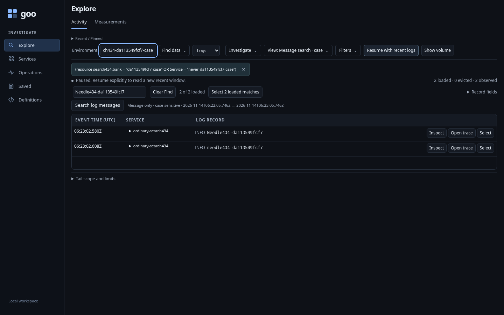
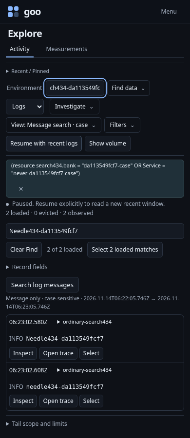
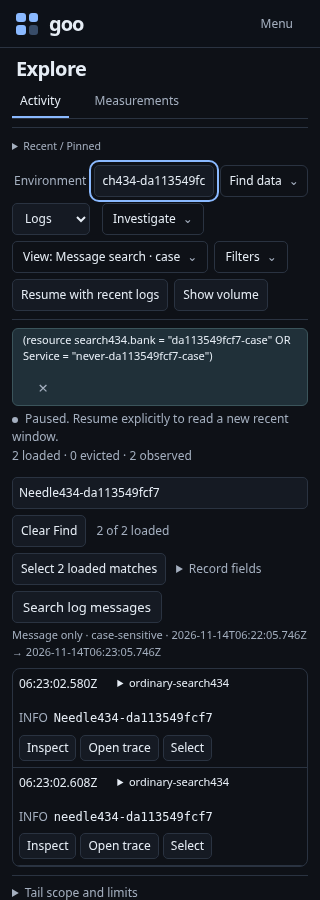
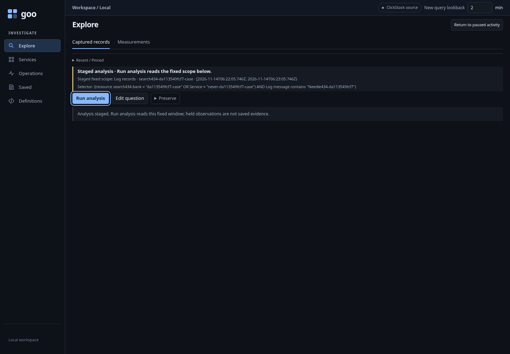

# Find a message, then search its source window

Executable: [activity-search.spec.js](../../journeys/activity-search.spec.js).
The journey uses an isolated generic Go runtime and ordinary OTLP logs ingested
through the existing collector. Each case has a unique environment and bank
attribute; existing telemetry and stores are retained.

1. Open a saved Activity scope containing an OR predicate and start the stream.
2. Pause after a completed source poll and Find a literal term locally.
3. Review **Message only · case-sensitive** and the exact UTC window beside
   **Search log messages**. A dirty environment hides the action; its retained
   callback cannot stage or read.
4. Use Enter to stage the question. The ordinary fixed editor receives focus on
   Run. The original OR remains inside an AND with the exact Body condition.
   Staging performs no telemetry read.
5. Run explicitly. A differently cased message is excluded; spaces, Unicode and
   pattern-like punctuation remain literal. A trace-ID-only local match returns
   zero message results. Other banks and older records stay outside the question.
6. Return to paused Activity. Original row keys, Find and selection remain held,
   focus returns to the search action and no stream restarts. Clearing Find
   retires the saved action without reading.

| Desktop | 390px |
| --- | --- |
|  |  |





The optional Bombadil actor independently follows Find → stage → Run → Return,
checking exact window/scope/text, held rows and Find, no implicit reads or writes,
one tail request and one explicit query, and narrow-screen containment.
Native Hegel properties exercise the actual Go evaluator/compiler; Quint replays
the real journey report and rejects altered scope, window, read and custody facts.

```sh
GOO_GENERIC_BINARY=/absolute/path/to/goo GOO_SEARCH434_BOMBADIL=1 \
  npx playwright test journeys/activity-search.spec.js
```

This is Chromium integration coverage. It does not claim physical assistive
technology speech, cross-engine acceptance, source-wide completeness, or automatic
ingestion/retention diagnosis. See the [behavior contract](../ACTIVITY_MESSAGE_SEARCH.md).
