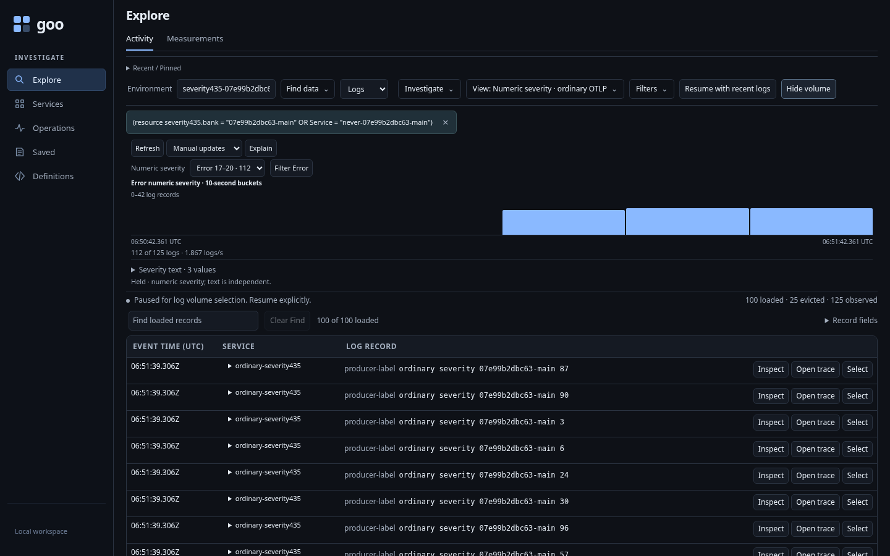
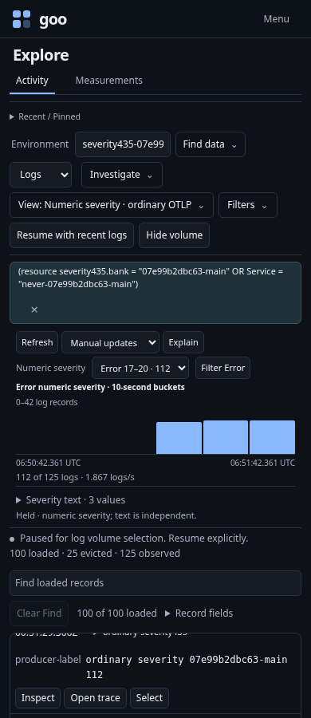
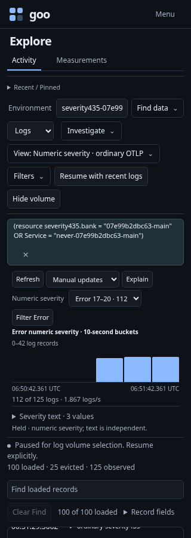
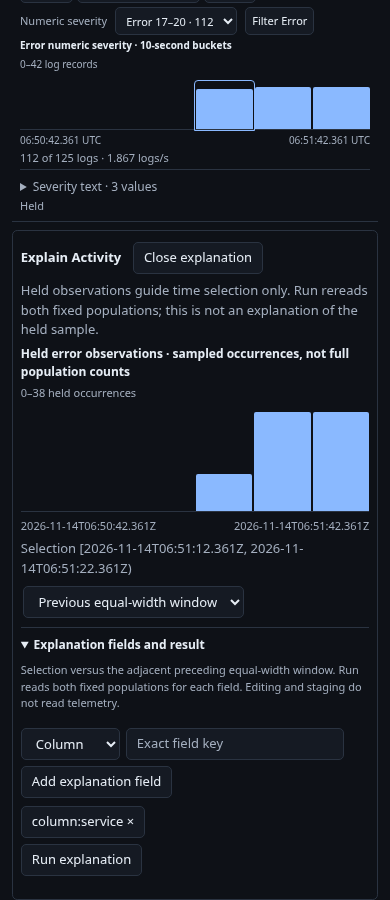

# Inspect numeric severity in ordinary OTLP logs

Executable: [activity-severity.spec.js](../../journeys/activity-severity.spec.js).
The journey uses an isolated generic Go runtime with ordinary logs sent through
the real OTLP collector. Unique environments and bank attributes isolate the
fixture; existing source data and stores remain intact.

1. Start a saved log scope with a parent OR condition, then pause its tail. The
   fixture has 125 matching recent logs, exceeding the 100-row retained buffer.
   Additional records exercise another bank, environment and older event time.
2. Choose **Show volume**. Compare overall, text-group and six time-bucket counts
   with an independent ClickHouse read. All eight numeric categories are present,
   including boundary values 0, 4/5, 8/9, 12/13, 16/17, 20/21, 24/25 and 255.
3. Choose every numeric band locally. Supplied bucket counts change, while the
   all-log scale stays fixed and no source request is made. Numeric Info includes
   a record whose producer text says `FATAL`; text grouping remains exact.
4. Select Error and a nonempty time bucket. **Explain interval** opens the existing
   explanation workspace with the exact numeric band and fixed interval, without
   reading. Closing it returns to the retained volume view.
5. **Filter Error** stages the complete parent AND the numeric 17–20 range.
   **Apply scope** explicitly opens the next stream. Its request includes the same
   environment and original OR subtree, with no SeverityText reinterpretation.
6. Saved callbacks refuse after changing the selected band or editing scope.
   Retired actions cannot refresh, stage or apply another source query.

| Desktop | 390px |
| --- | --- |
|  |  |





The optional 30-second Bombadil actor independently starts a stream, reads volume,
chooses a numeric band, stages its filter and applies it. Its invariants require
zero reads for local choice/staging, exact scope/range, no writes, two tail opens,
one aggregate request and no mobile overflow. Native Hegel checks the actual Go
classifier, predicates and aggregate conservation; Quint replays the recorded
journey with rejecting mutations.

```sh
GOO_GENERIC_BINARY=/absolute/path/to/goo GOO_SEVERITY435_BOMBADIL=1 \
  npx playwright test journeys/activity-severity.spec.js
```

These are captured-log counts, not inferred application health or unsampled
throughput. Independent reads are not a transaction. Physical assistive technology
speech and cross-engine acceptance are not claimed. See the
[severity contract](../ACTIVITY_NUMERIC_SEVERITY.md) and
[validation](../../VALIDATION.md) for actual completed results.
