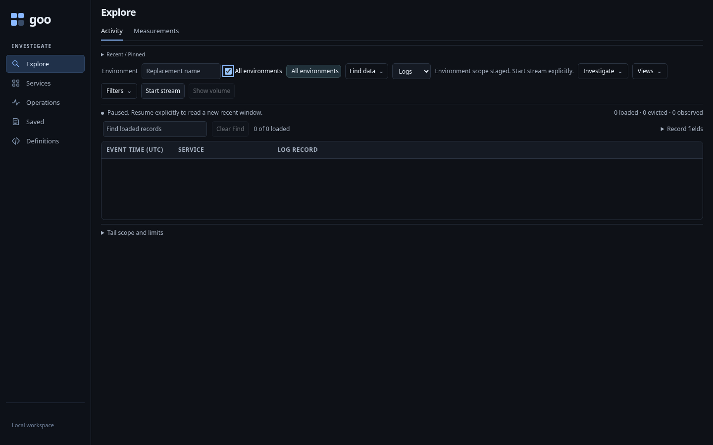
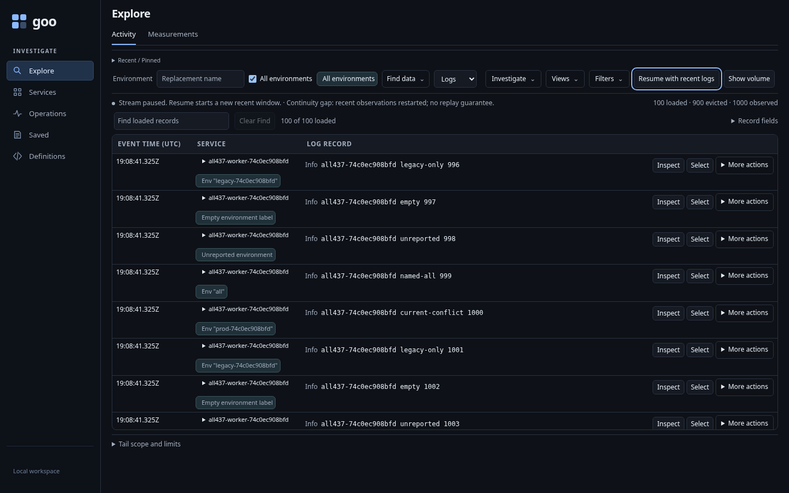
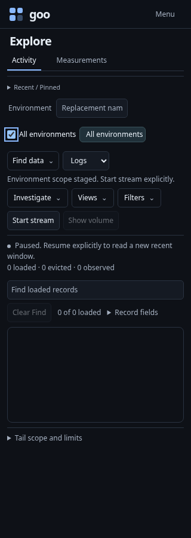
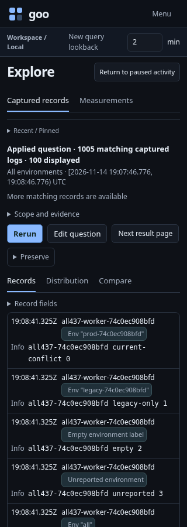

# Start with logs across environments

The [executable journey](../../journeys/all-environments.spec.js) uses real OTLP
logs copied from the collector's exporter table into one owned, isolated source
database. Successful queries are forwarded unchanged to ClickHouse. The fixture
has 1,005 records and 1,005 distinct `work.id` values, with five effective
label groups: current-key conflict, legacy-only, empty-current masking legacy,
unreported and the literal named environment `all`.

1. Open a generic workspace with no environment name. Start cannot turn blank
   input into All. Check **All environments** with Space; checking, unchecking
   and checking again retain native checkbox focus and make no source request.
2. Select Spans. The explicit All choice remains visible, but the unsupported
   profile refuses before reading. Return to Logs and explicitly Start.
3. Observe the bounded tail, then Pause with the keyboard. Its 100 retained rows
   are not the full population. Each row shows its reported winning environment;
   conflicting legacy labels remain disclosed. Wide trace actions explain that
   one environment must be chosen first.
4. Find the fixture's literal message prefix and stage a fixed search. Staging
   reads nothing; Run returns all 1,005 matching records and displays one 100-row
   page. The typed All selector and exact original poll window remain intact.
   Return restores the same held Activity keys, Find text and opener focus.
5. Refuse an actual log read with a scoped source-proxy 403. The existing rows
   remain held, the All selector remains explicit, and Retry is offered. No
   successful source result or fallback environment is fabricated.
6. Confirm an independent capture of the fixed All question. Its complete count
   remains 1,005 while its bounded inspection bank retains 1,000 records. Cold
   stored reopen reads no telemetry. The saved receipt is new evidence, not an
   archive of the earlier tail.
7. Open an exact saved All definition, opt into browser scope history, Pin, then
   cold-recall it from Recent. Metadata resolution retains the complete question;
   Stage does not acquire records. Export YAML through the actual staged settings
   independently proves the adopted configuration, rather than only checking the
   fetched definition or closed picker.
8. Request counted values for the 1,005 distinct work IDs. The existing 1,000-group
   budget refuses with a typed budget failure after two bounded source reads;
   it does not publish a partial ranking as complete.
9. Use **Stage this environment** from actual fixed rows to choose Empty,
   Unreported and named `all`. Each source-inert handoff focuses the current Run
   action, preserves predicates/window, and explicit Run matches its 201 records.
   The named label `all` is not the All selector.
10. Send otherwise-valid wide spans, inventory, trace-search and metric-discovery
    requests. Each refuses before SQL. A bounded Bombadil actor independently
    checks explicit All opt-in, one real log read, pause/focus, and retained Start
    callbacks under an unsupported profile without publication.

The actor advances on observed controls and completed reads. Its recent window
uses the actual server clock and may be empty after the main fixture ages; that
is valid unknown coverage, not a new census or a browser-frozen timestamp claim.

| Entry | Held logs |
| --- | --- |
|  |  |

| Narrow entry | Fixed All question |
| --- | --- |
|  |  |

[390px entry](screenshots/437-entry-all-390.png),
[390px held rows](screenshots/437-paused-all-390.png),
[320px held rows](screenshots/437-paused-all-320.png),
[desktop fixed rows](screenshots/437-fixed-all-1440.png),
[390px fixed rows](screenshots/437-fixed-all-390.png).

Request/SQL authority, source scope, raw membership, immutable capture admission,
keyboard/focus results and mandatory native/model acceptance are recorded in
[validation](../../VALIDATION.md). The runtime and owned database are cleaned up.

Final executed acceptance passed in 1.6 minutes (1.7-minute runner): 31 main steps,
32 configured-source SQL requests (31 main, one actor), 424 Bombadil snapshots,
and no browser errors. The mandatory native gate passed in 17.45 seconds with
zero skips and all eight negative controls rejected. At 1440/390/320 widths the
checkbox remains 14×14 px; its label hit area is 32/44/44 px high. Both the runtime
and owned fixture database were cleaned up.
