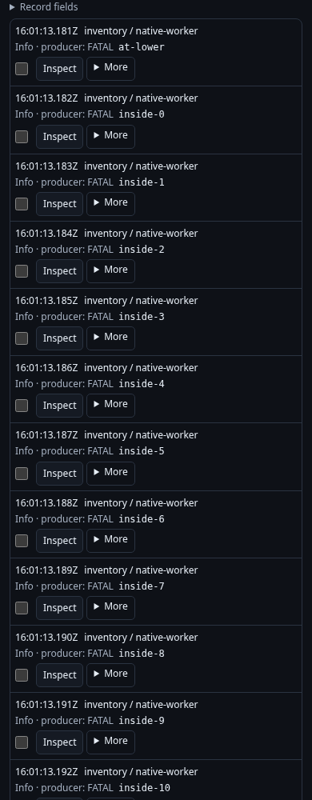
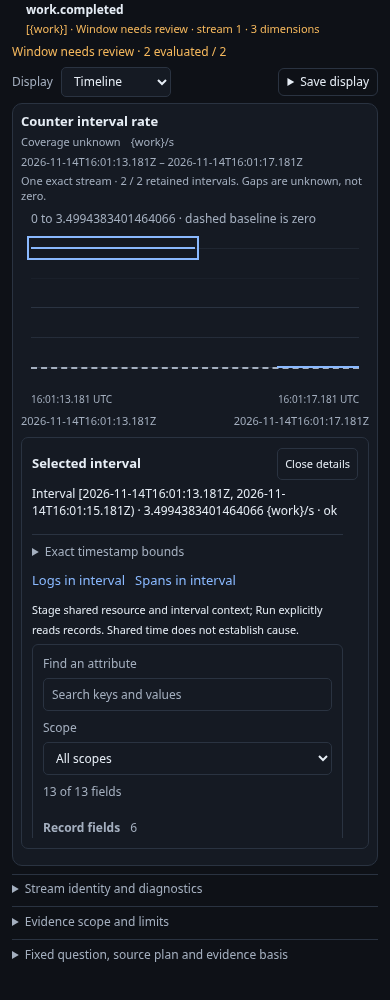
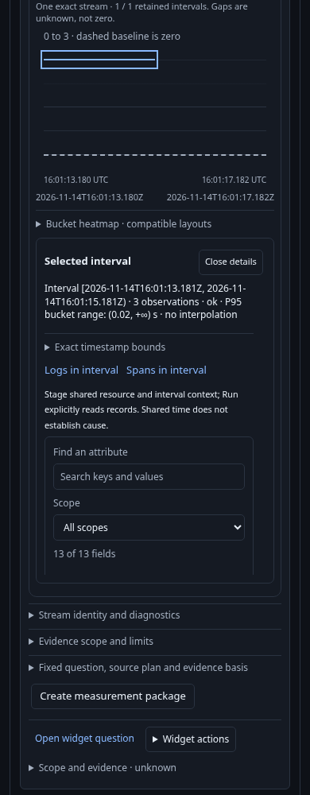

# Refine record context without changing its native parent

This 436.6 acceptance journey reuses the ordinary OTLP native-context fixture and
one isolated generic Go runtime. It exercises two actual entry points: a native
counter in Measurements and a histogram interval in a discovered Services view.

1. Observe a producer's native interval, choose its timeline point and open its
   associated logs. The fixed record question retains effective environment policy,
   resource namespace, service instance and exact nanosecond interval boundaries.
   If the Service histogram is not a default, select it with the existing native
   instrument picker and explicitly apply/reread the overview first.
   Metric dimensions are not mistaken for record attributes.
2. Check an additional CEL condition: numeric severity at most Info, and either
   an `inside-` body or the exact lower-bound record. Checking/staging reads no
   telemetry and writes nothing. The complete original predicate remains under
   AND with the additional OR condition.
3. Run explicitly. An independent complete ClickHouse oracle counts 115 records
   in the original interval and 112 in the selected population. The UI receives
   only its first 100 records; the full count must not become the displayed-page
   length. Numeric Info with producer text FATAL is included, while numeric Error
   with text INFO is excluded. Legacy environment data is included under the
   effective policy; a conflicting current key remains excluded.
4. Inspect a loaded record locally. Return to the original measurement or Service
   view without reading again. The native evidence/timeline/selection remains
   unchanged and keyboard focus returns to the context opener.
5. Invoke the old retained Check callback after return. It makes no API request,
   demonstrating that leaving the editor retires its invocation authority.

The executable [journey](../../journeys/cel-context-entry.spec.js) records actual
requests, checked receipts, complete source-oracle rows, native evidence and local
return observations. Native counters and histograms remain their own measurements;
associated records are interval context, not inferred metric membership.
After writing the observed ledger and closing its owned runtime, the journey
requires `TestQuintCELContext436Observed`. Go reconstructs the native context and
CEL plan and replays the observed local/read/return steps through the existing
model, including rejecting controls. This gate has no opt-in or missing-tool skip.

| Entry | Checked records | Held return |
| --- | --- | --- |
| Measurements counter |  [1440px](screenshots/4366-native-records-1440.png) · [320px](screenshots/4366-native-records-320.png) |  |
| Services histogram |  [1440px](screenshots/4366-service-records-1440.png) · [320px](screenshots/4366-service-records-320.png) |  |

See [validation](../../VALIDATION.md) for executed results and model acceptance.
