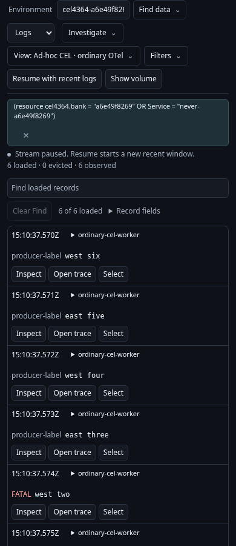
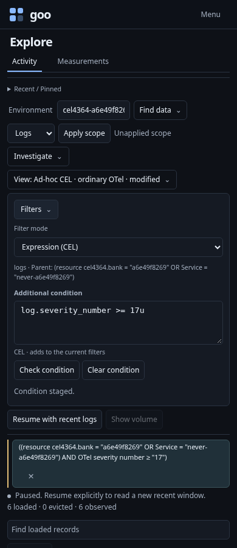
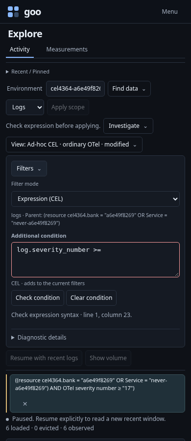
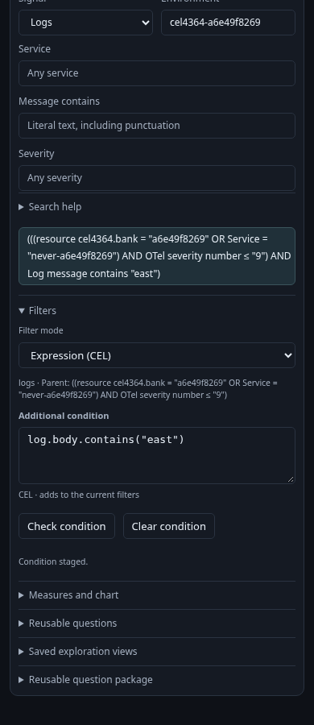

# Check a condition, then apply it deliberately

436.4 mounts the shared Conditions / Expression (CEL) editor inside existing
Filters. The live stream remains the entry point; expression editing is optional.

The executable [journey](../../journeys/cel-editor.spec.js) uses ordinary OTLP logs
in an isolated generic Go runtime, backed by the retained ClickHouse lab. Its
parent includes an OR over a resource attribute and a service condition, which
must remain intact even though that whole parent cannot be printed as CEL.

1. Start and pause Activity over six captured logs. Compare the ordinary numeric
   severity with an independent source read, including Info values whose producer
   text says FATAL. Open Filters; Conditions remains the default.
2. Choose Expression (CEL), type an additional numeric severity condition and
   Check condition. The server returns the parent AND the new condition.
   Context/check requests are pure; they do not query telemetry or save anything.
3. Type invalid text. Apply is unavailable. Switch to Conditions and back; the
   exact invalid draft survives and cannot be overwritten by accidental visual
   editing. Correct it, then check explicitly.
4. Apply scope once to read a new Activity window. Edit the same owned condition
   from Error-or-higher to Info-or-lower and check again. It replaces that owned
   condition against the original parent, rather than appending another filter.
   The second explicit Apply reads the independently expected two logs.
5. Open the existing fixed analysis for the completed Activity window. In its
   same shared Filters editor, add a body substring condition. Checking stages
   the complete fixed question without reading. Run analysis performs the one
   explicit source read and returns the independently expected single record.
6. Retain the successful fixed rows and Tail callback, then type an invalid draft.
   Run, Tail and Next are disabled; invoking retained Tail/Next callbacks cannot
   read. Tail was positively available before the edit; Next is already unavailable
   for this one-row result, so this does not claim a positive pagination case.
   Held rows remain unchanged. Check the repaired condition without running.
7. Return to paused Activity. Held data is restored without reading or writing.

The request ledger distinguishes the two pure CEL routes from source reads and
store writes. Screenshots at 1440, 390 and 320px capture both the stream-first
entry and contextual editor; fixed analysis and the linked invalid-expression diagnostic have 390px captures. These frames are
generated only by the real running journey.

| Activity entry | Contextual expression |
| --- | --- |
|  |  |

A bounded 25-second Bombadil campaign starts a fresh saved Activity view and
explores invalid/valid checks, draft retention across modes and a retired direct
Check callback without Apply, Run or store writes. The pure owner/native model
tests separately cover stale replies and retired staging callbacks. This journey does not claim physical assistive-technology testing or
cross-browser acceptance. Definition provenance/preservation and the broader
whole-product journey remain later 436.5/436.6 work.
