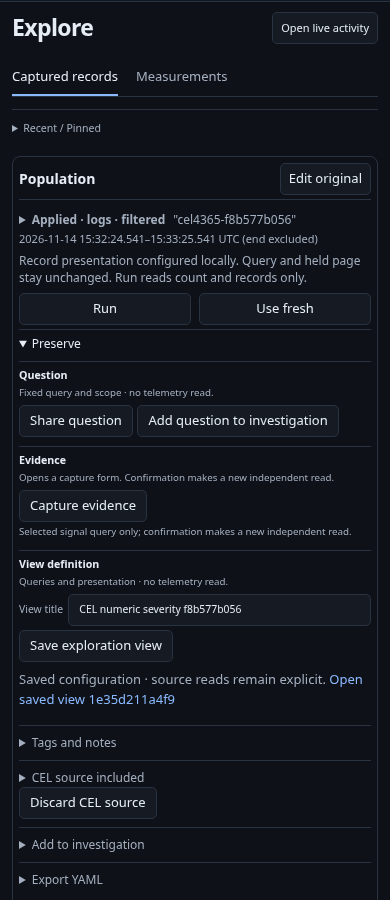
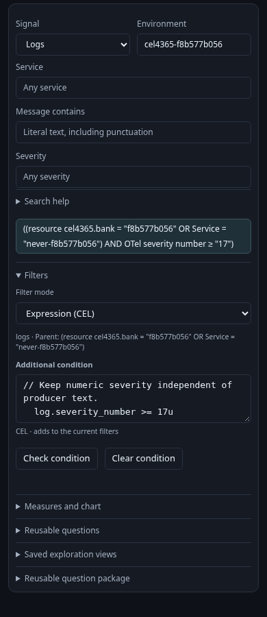
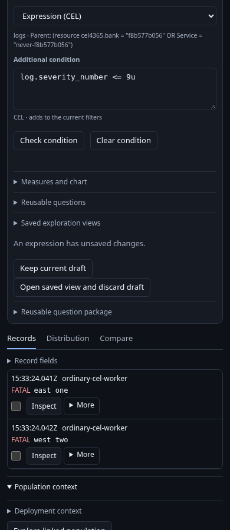
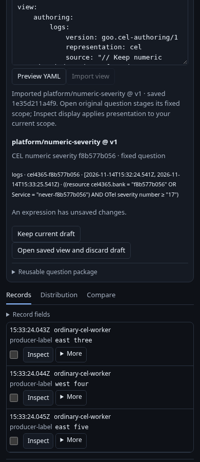

# Keep an authored condition with a saved question

436.5 extends the existing saved exploration view and portable view artifact. It
does not create a CEL library, another Save workflow or an evidence artifact.

The [executable journey](../../journeys/cel-preservation.spec.js) uses real OTLP
logs and an isolated generic Go runtime over the retained ClickHouse lab. Its
immutable parent contains a resource-attribute OR condition outside the printable
CEL subset. Numeric Info logs deliberately carry producer text FATAL.

1. Start with the complete ordinary parent, author a numeric severity condition
   with comments and spacing, and check it. Run the fixed question explicitly.
2. Open its existing linked population, choose a records composition and use
   **Save exploration view**. The typed query and exact checked source are saved
   together with original base, compiler/library binding and lowering digest.
3. Export through the existing portable YAML controls. Exact source and provenance
   travel with the view, while evidence and local source connections do not.
4. Open the saved original question, then **Edit original question**. The same
   shared Filters editor restores exact text without reading telemetry. A new
   check replaces the owned condition against its original parent, rather than
   appending to its previous result. Run remains explicit.
5. Preview and import the portable view through the existing saved-view library.
   The imported content identity and authored metadata remain intact.
6. Attempt recall with a valid, checked and applied source edit that has not been
   saved. **Keep current draft** protects that exact source too. An explicit
   **Open saved view and discard draft** stages the chosen saved original without
   querying; Run is a separate deliberate read.
7. Attempt recall while an invalid expression is pending. **Keep current draft**
   preserves the exact invalid text and leaves execution disabled; one owned
   conflict panel handles the navigation.
8. Apply the saved display to a different current question. Save that destination;
   its query remains its own and it does not acquire the donor's CEL source.

Direct HTTP controls separately verify that formatting-only source changes can
produce a different definition identity with the same admitted query/digest, while
changed meaning or an obsolete library binding refuses before creating a view.
These are transport controls, not fabricated browser interactions.

| Preserved view | Restored source |
| --- | --- |
|  |  |

| Valid unsaved source | Invalid retained draft |
| --- | --- |
|  |  |

A bounded Bombadil actor opens that actual saved original, verifies the restored
source against its stored metadata, exercises invalid-draft mode switching, checks
freshly against the same original base identity and invokes a retired hidden
Check callback. Actual fetch counters require a positive planning witness and
zero telemetry/publication calls. Native readiness gates keep the actor from
forcing text into controls that a person cannot currently use.

The request ledger distinguishes pure checking/encoding/decoding, explicit saves
and explicit telemetry execution. Actual validation results and limitations are
recorded in [validation](../../VALIDATION.md).
