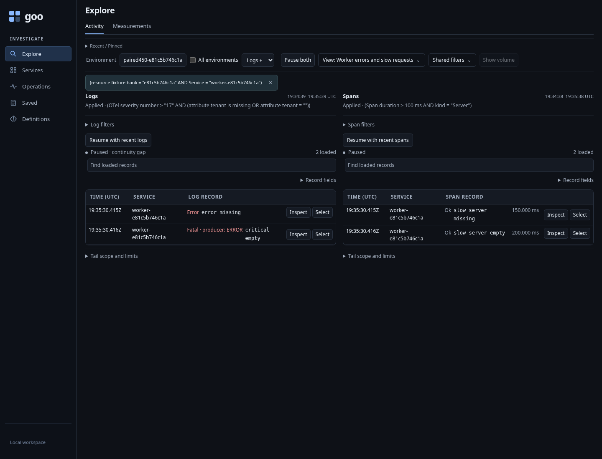
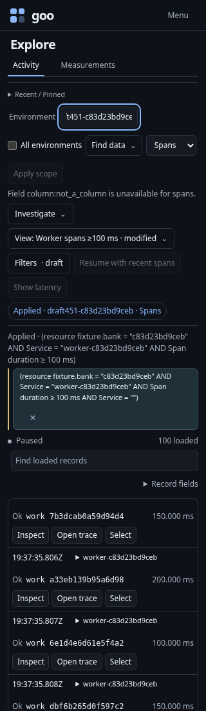
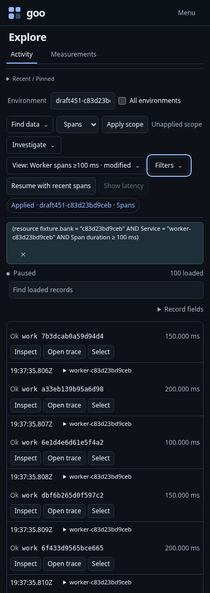
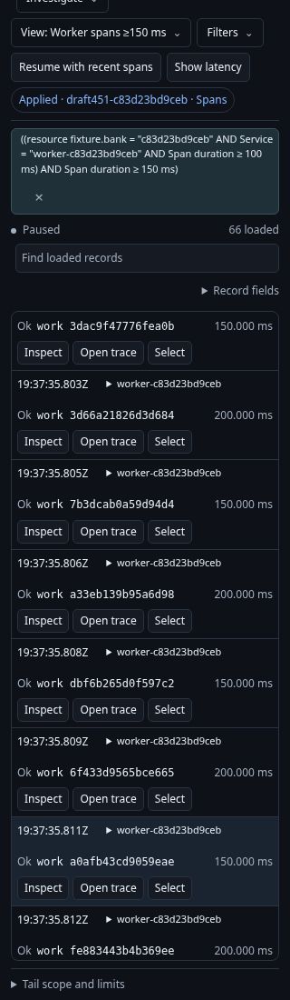

# Edit, recover and apply a filter

Executed against real OTLP spans and ClickHouse, with the 450 binary as the
baseline. The [single-stream journey](../../journeys/predicate-draft-consolidation.spec.js)
and [paired regression](../../journeys/paired-activity-filters.spec.js) use actual
source queries and an independent source ledger.

| Step | Operator action | Observed result |
| --- | --- | --- |
| Read | Start the saved span scope explicitly | Held spans and a completed rolling window appear |
| Leave Filters closed | Let the existing stream poll | Window advances; no new connection or hidden suggestion rendering |
| Open Filters | Inspect observed fields | Held suggestions hydrate locally, including tenant metadata |
| Draft | Enter an invalid filter and edit Environment | Apply/Save refuse; applied rows and original scope remain identifiable |
| Discard | Press Enter on Discard filter draft | Original predicate returns; edited Environment and Signal remain; no read; focus returns to Filters |
| Check | Restore the environment and check a CEL condition | Compiler/context calls only; Apply remains explicit |
| Apply | Press Enter on Apply scope | One selected tail opens; Filters summary is visibly focused |
| Save | Save the checked, applied definition | Exact compiled predicate AST persists, with no telemetry read |
| Change Signal | Stage Logs while a span-only condition remains | Discard preserves the intent and predicate; Apply stays disabled rather than dropping the condition |

The final paired regression retains selected-lane isolation, missing/empty
matching, paused recall, exact saved predicates, Bombadil completion and the
existing model's fifteen negative controls. The single model rejects twelve
negative controls, including wrong applied-scope labeling.

## Default paired layout

| Width | First log row relative to pair, before → after | Visible lane controls, before → after |
| --- | --- | --- |
| 1440 | 269.5 → 269.5 px | 71 → 71 |
| 390 | 234.5 → 234.5 px | 71 → 71 |
| 320 | 234.5 → 234.5 px | 71 → 71 |

All passive geometry captures add zero reads. These measurements establish no
layout regression; they do not claim a density gain. Exact duration formatting
improves readability while retaining raw predicates in titles and authoring fields.

See [validation](../../VALIDATION.md) for final receipts and the scope of independent reviews.
