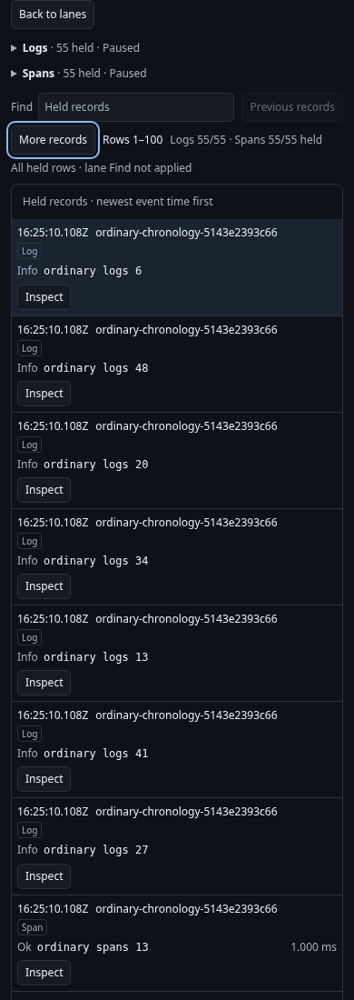
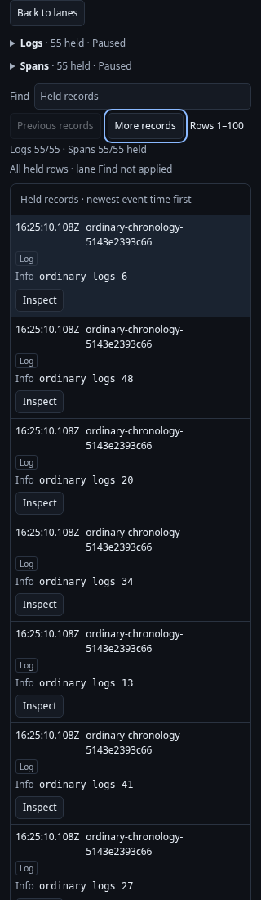
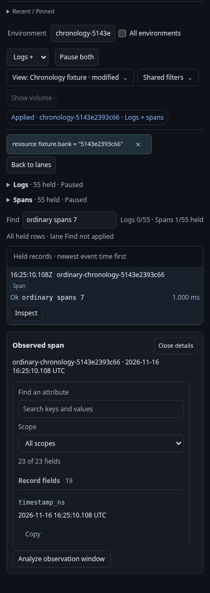

# Hold logs and spans together

The [executable journey](../../journeys/held-chronology458.spec.js) starts with
ordinary OTLP logs and spans, without a Goo manifest. Two independent Activity
lanes retain their own source questions and read clocks.

| Action | Result |
| --- | --- |
| Start paired Activity | Logs and spans use separate source connections |
| Find within a lane | The lane's local Find remains its own presentation state |
| Hold chronology | Both streams pause, then all held occurrences are ordered by exact event time |
| Page or Find held records | Presentation changes without another read |
| Inspect a span | The original lane and observation window remain authoritative |
| Analyze its observation window | A fixed question is staged; explicit Run would read |
| Return | The same held chronology and inspection return without reconnecting |
| Back to lanes | Original lane buffers, Find and read clocks return, paused |
| Change shared scope | Old chronology is retired before another source read |

The fixture includes timestamps differing only by nanoseconds, equal-time
log/span ties, and two identical physical log records. Sorting is presentation
order, not causality or a common source ordering. Duplicates remain distinct
occurrences. Neither lane is relabeled with the other's read clock, and no merged
health or completeness claim is inferred.

Tail buffers can contain several poll windows; each inspected item retains its
own original window and source observation time. The passive chronology receives
no preservation tokens. Saving or capturing the merged presentation is outside
this workflow.

The final run `5143e2393c66` passes in 1.8 minutes against the final embedded
Go runtime. Its 21 observed steps conserve 55 logs and 55 spans, including exact
timestamp ties and duplicate multiplicity, across 100-row local pages. A second
scope has one log and an observed empty span lane; zero supplied spans are kept
separate from a lane that has never read. The passive profile contains no
preservation capability.

The main journey opens four tail connections: two for the original scope and two
for the known-empty-span scope. They make four SQL reads in this run. Every held
Find, page, Inspect, fixed-window staging, Return and Back operation adds zero
source work. Before Hold, live lanes may continue their existing background polls;
local lane Find does not open a new connection. An independent Bombadil campaign
completes its twelve-phase hold/inspect/return flow in 378 snapshots with two tail
connections, no forbidden requests and no horizontal overflow. Main plus actor
make six SQL reads. Runtime and disposable database cleanup both pass, without
browser errors.

Native Quint replay admits the actual journal in 22.09 seconds, with nine planted
negative controls rejected and zero skips. The browser independently checks source
rows, original per-item windows and exact event-time order. Responsive chronology
frames show the Back control and separate source facts; inspection frames verify
that the shared heading receives focus at 320 and 390 pixels.

The existing independent-lane filter/saved-view journey also passes against that
identical runtime (`3eb2fd01e8f6`): 19 steps, 489 actor snapshots, and native replay
in 27.77 seconds with 15 rejected negative controls. Lane-specific filters and
paused saved-view recall remain independent of the held presentation.

