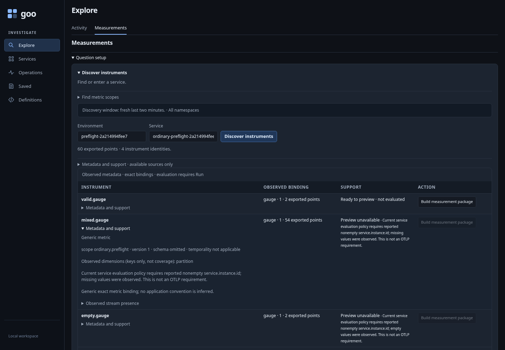
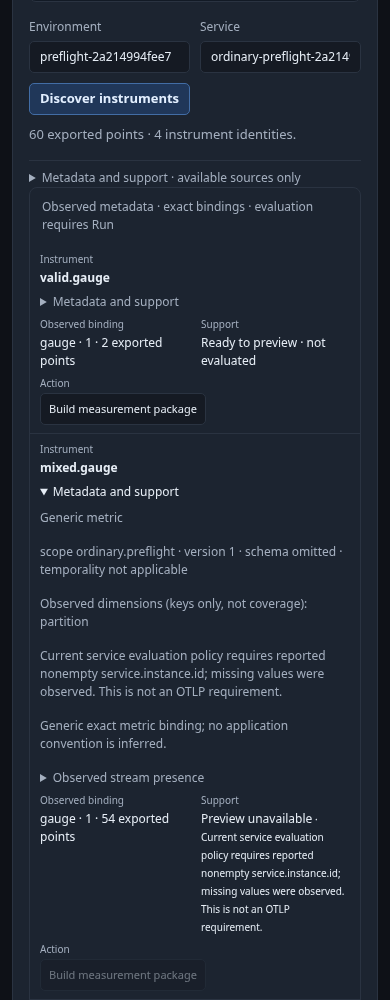
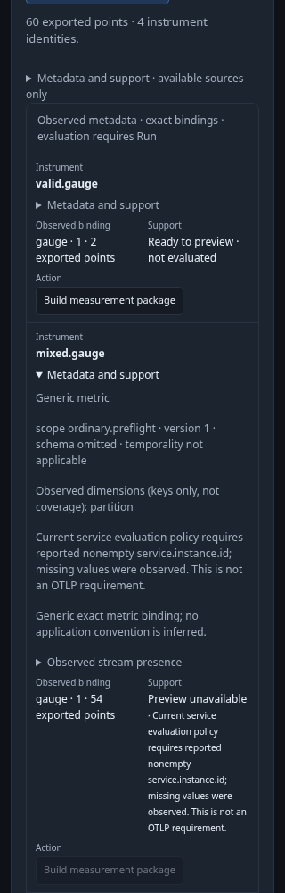
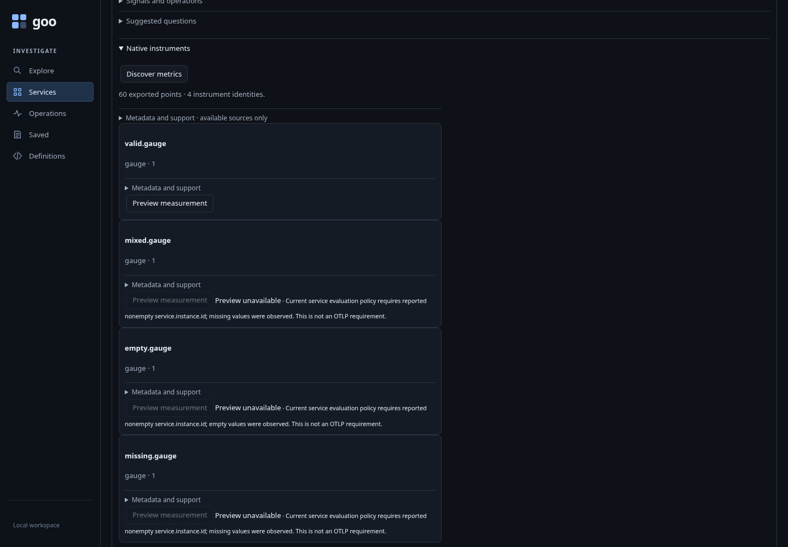
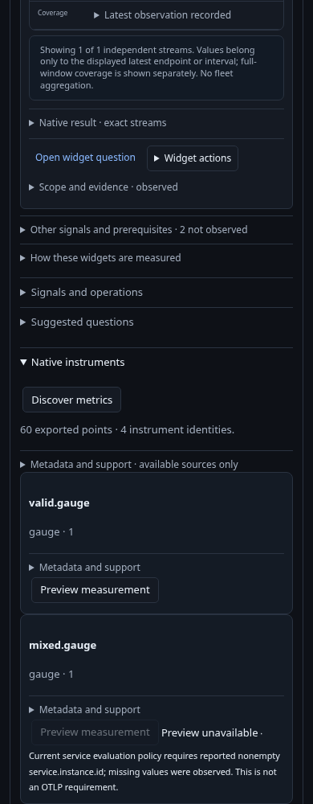
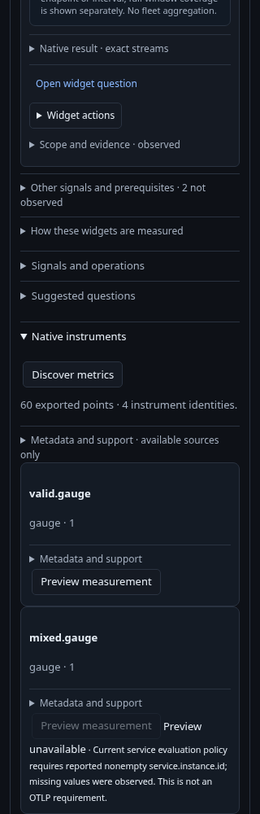

# Preview only instruments supported by the supplied metadata plan

Executable: [instrument-preflight.spec.js](../../journeys/instrument-preflight.spec.js).
The journey uses an isolated generic Go runtime and a uniquely owned gauge-only
ClickHouse database cloned from the real exporter schema. Direct fixture inserts
are source-adapter acceptance, not an OTLP collector-ingestion claim. The owned
database is removed and existing lab telemetry is preserved.

## Discover first

One service has four gauge instruments: valid, missing-instance, empty-instance,
and a mixed population of 27 streams. The mixed fixture places its incompatible
stream outside the 25 displayed previews. The actual response must show 27 streams,
25 displayed valid instance IDs and two omitted previews, while keeping the broad
binding ineligible. Fixture hashes arrange that case; they are not the eligibility
oracle.

Metric scope discovery still offers the qualified service and reports 60 exported
points. Measurements discovers all four instruments. Three Build buttons remain
native disabled with specific reasons; invoking them does not plan or run.
Metadata disclosure and local pages do not acquire telemetry.

| Desktop | 390px |
| --- | --- |
|  |  |



## Preview and run the eligible instrument

The valid instrument builds a pure definition preview, then explicit Run evaluates
two points in one exact stream. A retained Build button inside a closed discovery
disclosure cannot act. These checks complement the direct callback unit tests,
which independently reject missing plans, unsupported kinds and stale owners.

## Use the same rule in Services

The discovered service detail offers one enabled Preview and three disabled
Previews with the same supplied reasons. Binding metadata stays in native details;
opening and closing it is local. Source exclusions remain visible in the section's
metadata summary. Only the eligible instrument reaches an automatic overview measurement read;
blocked instruments stay visible as metadata without producing source failures or
Retry widgets. The enabled Preview validates a package without an additional value
read.

| Desktop | 390px |
| --- | --- |
|  |  |



The optional 30-second Bombadil actor discovers once, independently observes the
blocked/eligible controls, attempts only the exact disabled Build actions and
completes a supported pure preview. It permits one discovery, one plan and no Run
or unrelated writes. Attribute-copy controls are outside that action set.

```sh
GOO_GENERIC_BINARY=/absolute/path/to/goo GOO_INSTRUMENT_PREFLIGHT433_BOMBADIL=1 \
  npx playwright test journeys/instrument-preflight.spec.js
```

See [the contract](../INSTRUMENT_PREFLIGHT.md),
[checkpoint review](../reviews/CONSOLIDATION_REVIEW_433.md) and
[validation](../../VALIDATION.md). Preflight is metadata policy, not proof of future
source validity or generic OTLP stream eligibility.
