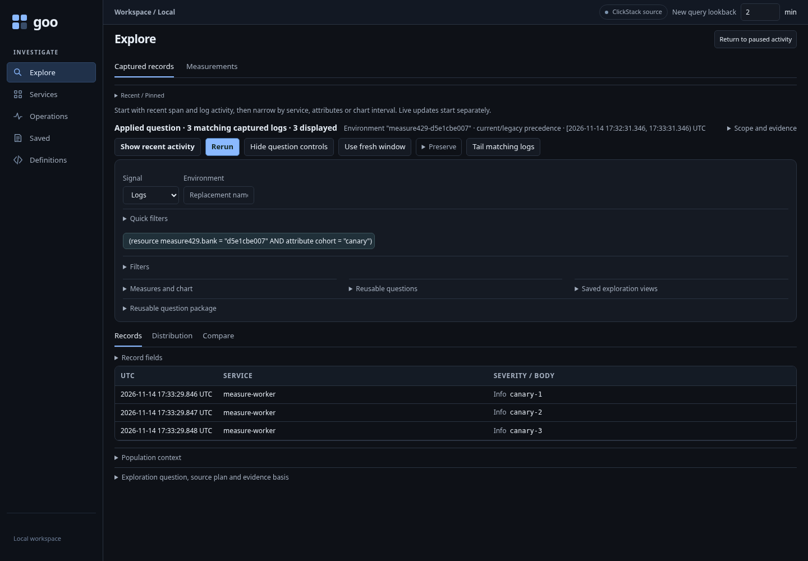
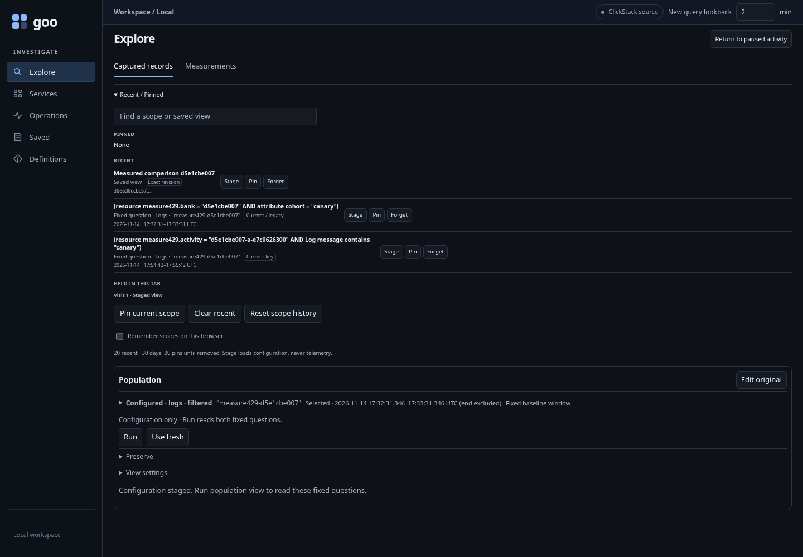
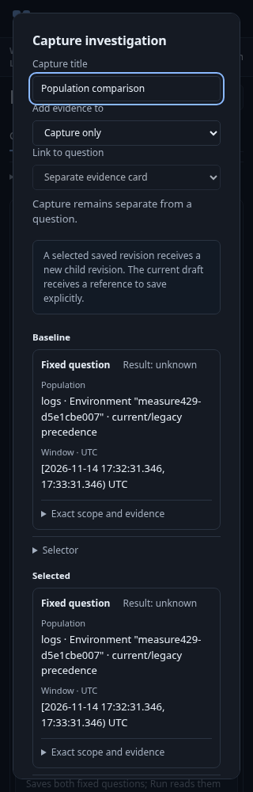
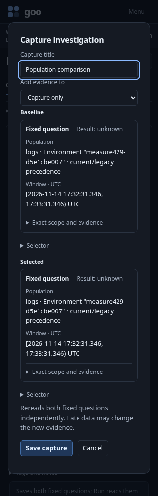

# Measure the investigation controls

The [executable journey](../../journeys/measured-preservation.spec.js) compares
an unchanged `f4bfe8d8` binary with 429, using one retained six-log OTLP fixture.
The fixed question, saved comparison, source records, event-time bounds, grouping
and viewport sizes are identical. Applied and editing states are measured
separately; opening additional controls is not credited as faster investigation.

1. Start ordinary Activity, pause its completed read, Find `canary`, stage and Run
   the observation window, then return to the same retained rows, Find and opener.
   Activity uses each server's actual rolling clock and a separate phase bank;
   its scopes are **not** presented as identical before/after fixed measurements.
2. Stage the retained exact fixed question and Run its three matching records.
   Record first-row document position and visible native actions at 1440/390/320.
   Open Edit separately. Quick filters now disclose existing shortcut controls;
   closing them retires direct hidden callbacks without changing the applied read.
   Rerun remains the primary action; switching to recent activity is secondary.
3. Open an immutable comparison and recall it through Recent / Pinned. Record the
   desktop distance from the actual title text to its Stage action. Run both fixed
   questions explicitly; each side contains three captured records.
4. Open the pair capture form in **Capture only** mode. Record modal height,
   scroll extent, preview and Save offsets relative to the modal, and visible
   action count. Close it and check opener focus. Repeated local Preserve toggles
   retain the actual record DOM with zero row additions/removals and zero source,
   store or metadata requests.
5. Confirm a fresh pair through the existing capture API. Its ordered questions
   remain unchanged; the saved heading receives focus. The capture is a new read,
   not an archive of the earlier browser observations.
6. Read a real declared decimal OTLP counter: `0.001 s` over `3.6 s`, exact rate
   `1/3600 s/s`. The same supported gap/window policy is used in both binaries.
   The original workbench shows a long decimal; the new chart uses a compact
   positive rate. Exact interval data and inspector values remain unchanged.
7. A bounded Bombadil campaign performs one explicit comparison Run, opens the
   compact two-side form, checks irrelevant destination controls are hidden,
   cancels, observes returned focus and invokes a retained closed confirm callback.
   No capture request may follow that callback. The actor advances on observed
   outcomes, not merely on clicks; it waits for the actual comparison to render.

## Measurements

Rounded document pixels; every fixed/applied sample retains the same three rows.
Modal offsets are relative to the modal because vertical centering changes its
absolute screen position.

| State / metric | 1440 px | 390 px | 320 px |
| --- | --- | --- | --- |
| Applied first row | 368 → 368 | 459 → 459 | 481 → 481 |
| Editing first row | 815 → 688 | 1242 → 960 | 1322 → 1040 |
| Editing visible actions | 52 → 48 | 52 → 48 | 52 → 48 |
| Capture-only visible actions | 9 → 8 | 9 → 8 | 9 → 8 |
| Capture-only modal height | 782 → 589 | 968 → 812 | 968 → 910 |
| Capture-only Save offset | 715 → 522 | 995 → 745 | 1130 → 843 |

The desktop Recent title-to-action gap changes from 913 px to 10 px. Narrow
rows already put actions below the title, so a horizontal gap is not a useful
mobile comparison. Applied population row position/action count is also unchanged.
These are local geometry/work measurements, not server latency or runtime speedups.

## Running it

Run `GOO_429_PHASE=before` with an explicit `GOO_GENERIC_BINARY` built from the
unchanged revision. Retain its emitted `report.json`. Run `GOO_429_PHASE=after`
with the updated binary and `GOO_429_BASELINE=/absolute/path/to/report.json`.
The after journey always requires the native gate after writing a passed report
and cleaning up its runtime; there is no acceptance skip switch.

| Updated editor | Recent / Pinned |
| --- | --- |
|  |  |

| Before capture-only | After capture-only |
| --- | --- |
|  |  |

[390px editor](screenshots/429-after-fixed-edit-390.png),
[320px editor](screenshots/429-after-fixed-edit-320.png),
[390px Recent](screenshots/429-after-recent-390.png),
[320px Recent](screenshots/429-after-recent-320.png),
[desktop form before](screenshots/429-before-capture-only-1440.png),
[desktop form after](screenshots/429-after-capture-only-1440.png),
[real native counter](screenshots/429-after-counter-1440.png).

Executed browser, model, generated and independent-review results are recorded
in [validation](../../VALIDATION.md).

Final executed after run passed in 1.1 minutes: 17 observed steps, 475 Bombadil
snapshots, no browser errors and complete owned-runtime cleanup. The mandatory
native gate passed in 17.90 seconds, zero skips, rejecting all eight negative
controls. The before flow made 22 source SQL requests; after made the same 22
plus the actor's six explicit-read queries. No server speed improvement is claimed.
