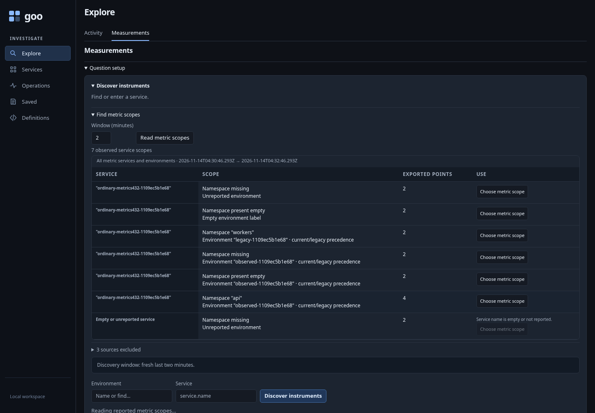
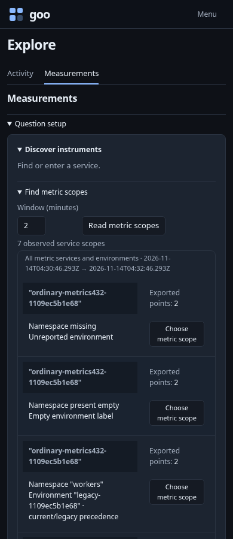
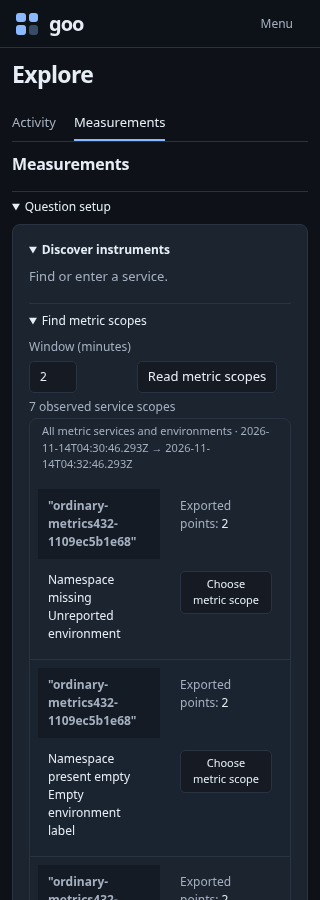
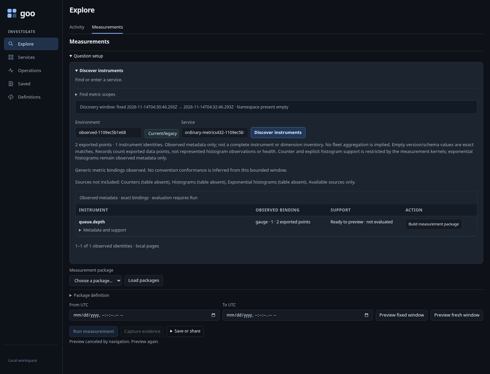
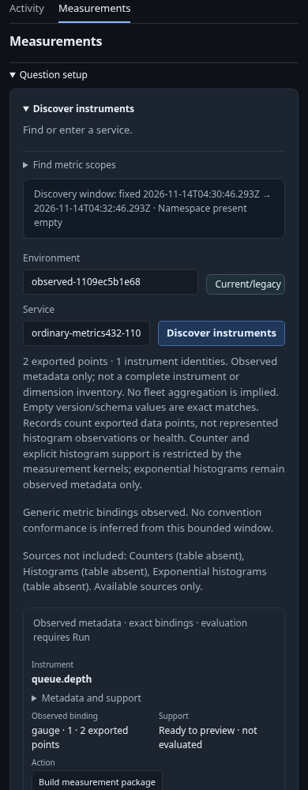
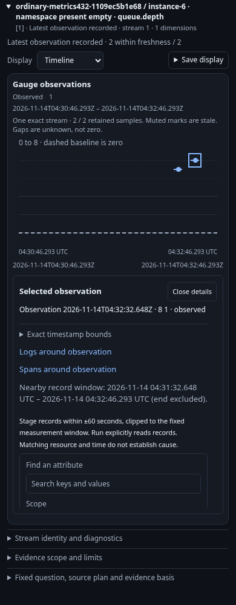

# A metrics-only investigation without guessed labels

Executable: [metric-scopes.spec.js](../../journeys/metric-scopes.spec.js).
The fixture creates one uniquely owned gauge-only database by cloning the actual
exporter table schema and inserting deterministic points. Existing lab tables,
streams and stored investigations are preserved; the owned database is removed.

## Find the scope

Start in generic Activity, where no telemetry is read automatically. Read available
signals, then Find metric scopes. The local handoff opens Measurements with blank
identity fields and preserves the exact capability-read window. Read metric scopes
explicitly; no environment, service or manifest is supplied beforehand.



The fixture covers unreported and empty environments, current/legacy conflicts,
legacy-only values, and same-named services in missing, empty and named namespaces.
Equivalent effective environment combinations merge into a four-point choice;
other valid groups retain two points. An empty-service identity remains visible
and unselectable. Reported instance IDs support the later evaluation without
changing the kernel's identity requirements.

| 390px | 320px |
| --- | --- |
|  |  |

## Stage, discover, then evaluate

Selecting each valid choice performs zero source reads. Discover instruments then
uses that choice's exact effective selector, namespace and fixed window. An old
Read or Choose control invoked after its disclosure closes cannot act.



Build measurement package is a pure preview. The test verifies definition scope
and bounds before explicitly running two gauge points in one chosen namespace.
The resulting question matches the preview; no other same-named service group
contributes to those rows.

| Preview | Explicit evaluation |
| --- | --- |
|  |  |

## Exploratory and semantic checks

`GOO_METRIC_SCOPES432_BOMBADIL=1` runs
[metric-scopes432.ts](../../verification/bombadil/metric-scopes432.ts) through the
alternate direct Measurements entry. Completion requires independently observed
scope rows, local selection, instrument results and validated package preview.
It checks one scope read, one instrument read, one pure plan, and no writes or
implicit evaluation. Fresh points avoid lookback expiry during the campaign.

Generated Hegel continuations exercise actual scope/instrument source owners and
caller-mutation isolation. Native Quint traces validate scope-preserving handoff
with rejecting controls. They complement the DOM journey; they do not claim
arrival-order completeness or a generic evaluation kernel for unidentified streams.

```sh
GOO_GENERIC_BINARY=/absolute/path/to/goo GOO_METRIC_SCOPES432_BOMBADIL=1 \
  npx playwright test journeys/metric-scopes.spec.js
```

See [VALIDATION.md](../../VALIDATION.md) for executed checks and review limits.
