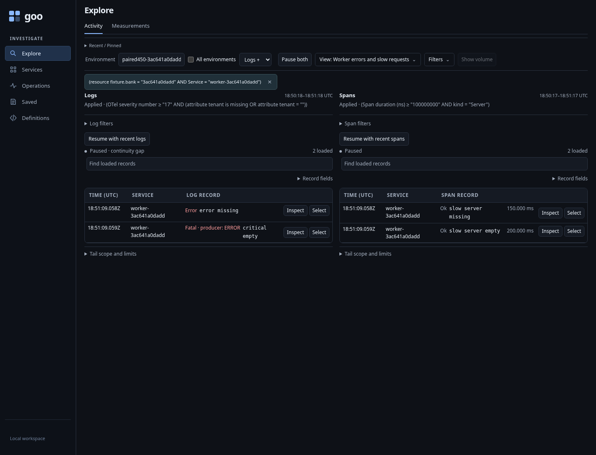
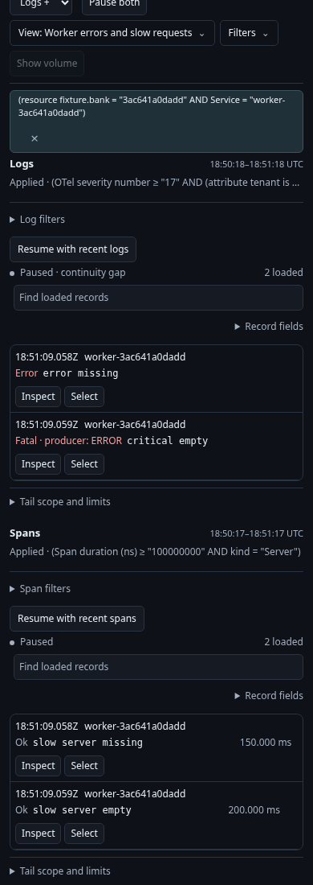
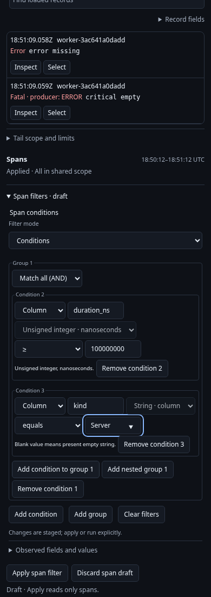

# Error logs beside slow spans

**Executed against real OTLP and ClickHouse.** The journey checks matching
source populations, lane ownership, saved configuration, keyboard behavior and
narrow layouts. Native replay includes fifteen negative controls; the exploratory
actor independently completes selective filtering.

Executable journey: [`journeys/paired-activity-filters.spec.js`](../../journeys/paired-activity-filters.spec.js).

| Step | Operator action | Observed outcome |
| --- | --- | --- |
| Start | Choose Logs + Spans Activity under a shared environment/service scope and Start | Both ordinary lanes acquire independently within the shared scope |
| Draft logs | Open **Log filters** and choose a log condition | The lane shows a pending draft; editing starts no connection while the existing read can continue |
| Apply logs | Choose **Apply log filter** | Only logs start a new recent window; spans retain their window and rows |
| Draft spans | Open **Span filters**, author a span condition visually or in CEL, and check it | Signal-specific admission and the combined shared-plus-lane predicate budget are checked without telemetry acquisition |
| Apply spans | Choose **Apply span filter** | Only spans restart; the log condition and read remain applied |
| Pause and edit | Pause a lane, then change its condition | Resume refuses the pending draft; Save view is unavailable |
| Discard | Discard the draft | The applied predicate returns without reading telemetry; explicit Resume can read again |
| Save | Save the paired Activity view | Its identity binds the shared selector, both applied predicates, and lane columns |
| Recall | Open the saved view | The conditions and columns return paused; no source read occurs until Start |

## Exercised controls

- A log-only field is accepted in Log filters and refused in Span filters; the reverse holds for span-only fields.
- An independently valid lane condition that exceeds the combined shared predicate budget is refused as a whole.
- Empty equality values and missing-field conditions survive save/recall without becoming one another.
- A changed lane never widens or replaces the protected shared condition.
- Invalid or unchecked drafts cannot be applied or saved. Hidden or retired actions cannot start a lane.
- Checking CEL may use compiler/context requests, but source acquisition remains tied to explicit Apply, Start, or Resume.
- Shared scope controls remain singular; the two lane condition summaries stay compact at desktop and narrow widths.

## Validation boundaries

The pure planner, saved carrier, store, HTTP admission, and schema tests check predicate composition and persistence. The four-transition model trial checks its modeled state sequence; it does not prove browser or source behavior. The real-source journey independently establishes lane request counts, visible state, save/recall, and screenshots.

Measured application source work is eight SQL calls for the main journey and
three for the actor. Apply/Resume opens only its selected lane; Save and paused
Recall use zero SQL. Fresh matching telemetry after Save appears on explicit
recalled Start, demonstrating that the definition stores intent, not observations.
The actor completes phase 8; native replay rejects fifteen incorrect controls.
See [validation](../../VALIDATION.md) for the final receipt and scope of checks.

