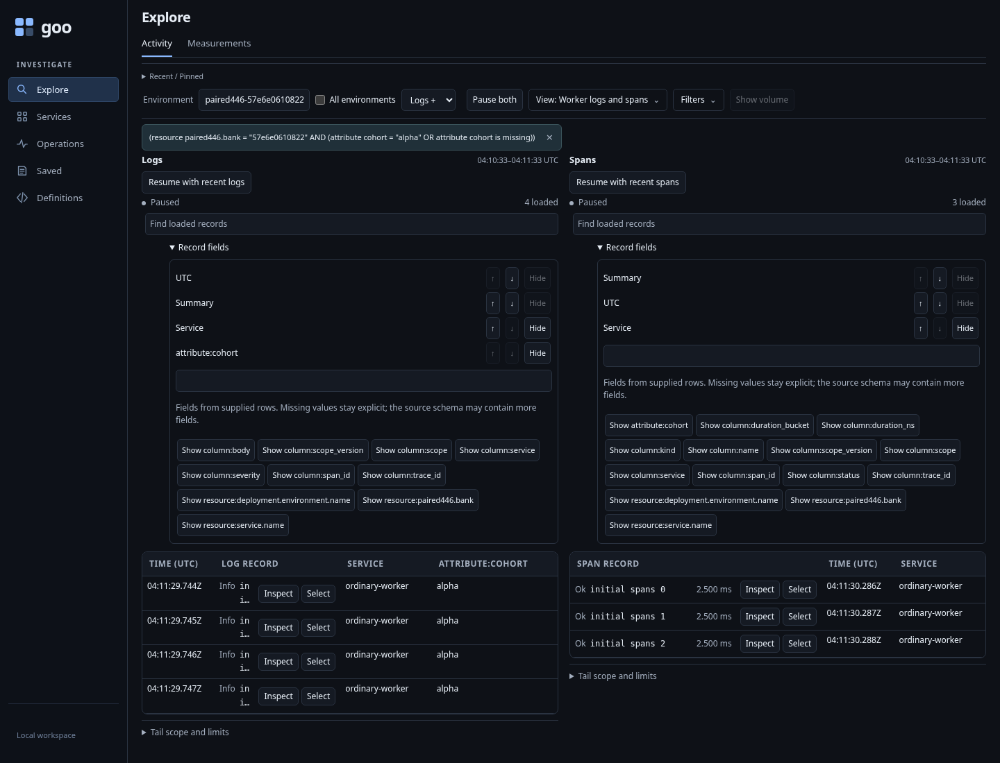
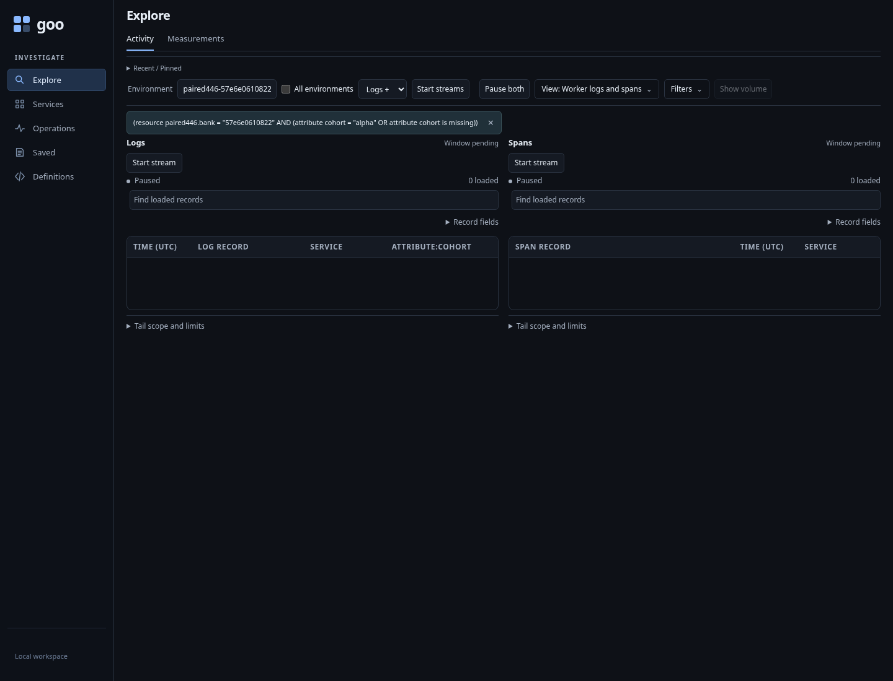
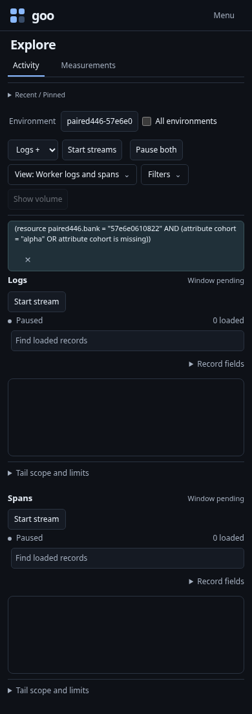

# Save and reopen a paired Activity view

An operator watches an ordinary service’s logs and spans, adjusts each lane’s
fields, and saves that setup for the next investigation. A saved configuration
never includes the old records or opens a connection by itself.

The executable journey is
[`paired-activity-views.spec.js`](../../journeys/paired-activity-views.spec.js).
It emits real OTLP logs/spans and independently confirms their stored identities.

1. Open a single starting scope, choose Logs + spans, and Start explicitly.
2. Pause both lanes. Add an attribute to Logs and choose different core-column
   orders in Logs and Spans. Save the applied configuration through Views.
3. Change the draft environment. Saving is disabled; reopening offers Keep or
   Discard. Keyboard Discard restores configuration and focuses Start streams.
4. Reload. Both lanes are empty, with their saved layouts. Configuration GETs are
   allowed; tail requests and source SQL remain unchanged throughout recall.
5. Start with the keyboard. Refuse one real source-family request, retaining the
   sibling bank, then retry that lane explicitly.
6. Inspect a log, stage its fixed observation window, and Return to the same held
   rows, scope, windows and focus without reading.
7. Reopen the single view without reading. A separate Bombadil browser saves and
   recalls another paired definition, then starts, inspects and returns.

Native checks combine Hegel properties over actual definition storage and
identity with observed-trace validation through the existing paired transport
model. Negative controls challenge recall reads, changed scope/layout/identity
and corrupted retained Return. They do not infer full source completeness or
cross-family chronology from model conformance.
