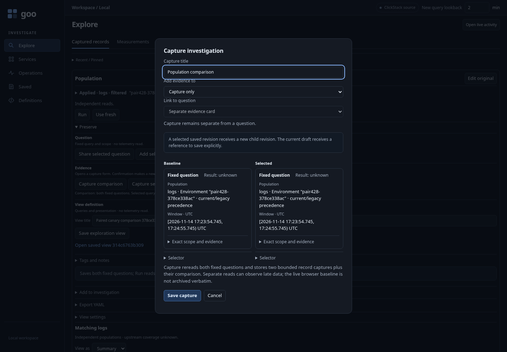
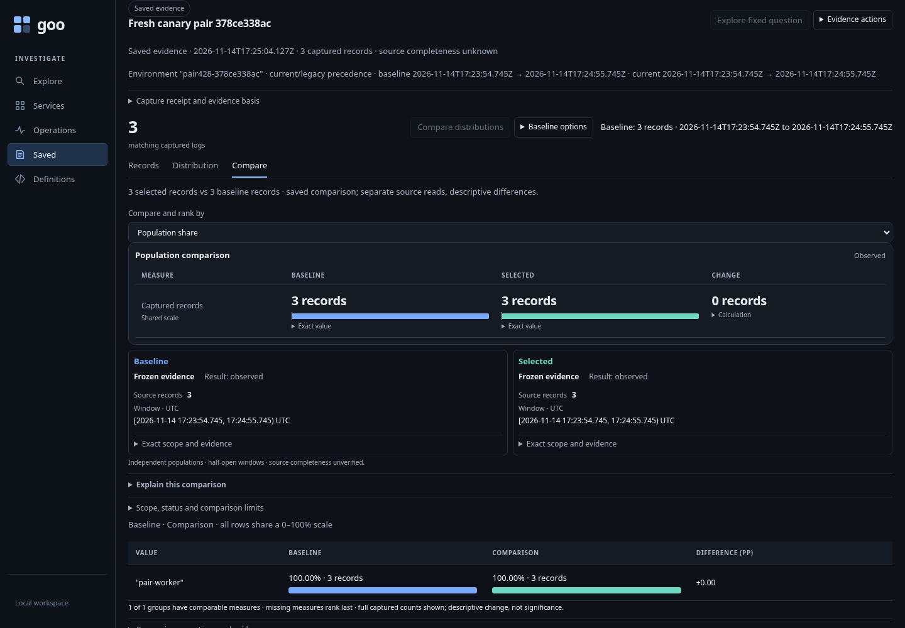

# Preserve both sides of a fixed comparison

428 adds **Capture comparison** to the fixed population's existing Preserve menu.
The [executable journey](../../journeys/paired-capture.spec.js) uses the generic Go
runtime and ordinary OTLP logs; successful telemetry responses come from the real
ClickHouse source.

1. Open a fixed canary-versus-rest Count comparison. Run explicitly to obtain the
   first observations: two canary records and three rest records.
2. Open Preserve, then Capture comparison. The native dialog previews both ordered
   fixed questions, environment, UTC bounds, predicates and grouping. Opening,
   inspecting, Cancel and Escape read no telemetry and publish no capture.
3. Let one more canary log arrive inside the fixed window. Stage an investigation
   question card through its existing action, then return to the retained view.
4. Confirm **Save capture** with the current draft as destination. The Go capture
   workflow rereads both questions and publishes two children plus their parent.
   Focus follows the chosen investigation destination. The new evidence has three
   canary and three rest records; it does not rewrite
   the earlier held comparison. Each child retains its own source-read clock.
5. Save the staged capture card as an investigation revision. Its reference is the
   general pair capture ID, not a saved-comparison decision or a view definition.
6. Reopen the pair and each underlying capture through the existing Saved controls.
   Cold reopening reads storage only and preserves IDs, fixed questions, results
   and unknown source-completeness semantics. Shared operand context identifies
   frozen child captures and their original source-read clocks, without relabeling
   receipt custody time as read time or describing stored operands as browser-held.
7. Refuse actual source SQL through a scoped forwarding proxy. The current
   population survives and the form shows an explicit failure; no automatic retry
   or rollback is claimed. Separately hold a successful capture response, Cancel
   and open other saved evidence, then release it: the stored capture may exist,
   but its retired completion cannot replace the chosen page or steal focus.
   The explicitly requested reference is still added to the retained draft without
   forcing navigation; Save revision remains explicit.

A bounded Bombadil actor explicitly runs the configured comparison, then exercises
pair preview, Cancel, focus return and a retained cancelled Confirm callback.
It permits that one pair read and forbids capture or other publication.
The browser records actual API/SQL calls, original and late raw records, stored
objects, capture pages, card references and response ownership outcomes for the
mandatory native gate. Executed results appear in [validation](../../VALIDATION.md).

| Preview | Stored pair |
| --- | --- |
|  |  |

[Narrow preview, 390px](screenshots/428-pair-preview-390.png) ·
[320px preview](screenshots/428-pair-preview-320.png) ·
[390px saved pair](screenshots/428-stored-pair-390.png) ·
[320px saved pair](screenshots/428-stored-pair-320.png)

The existing **Capture selected query** remains a separate action. General pair
captures and specialized saved-comparison receipts retain their different
compatibility and reopening contracts.

The final frozen-runtime run passed in 58.4 seconds (1.0-minute runner), including
14 observed steps, 474 Bombadil snapshots and runtime cleanup with no browser
errors. The mandatory native gate passed in 11.74 seconds, zero skips, rejecting
all eight negative controls. API and SQL accounting distinguishes the two explicit
pair captures, the refused source attempt, the two explicit UI runs and the actor's
single Run; preview, stored reopening and local recovery perform no source reads.
