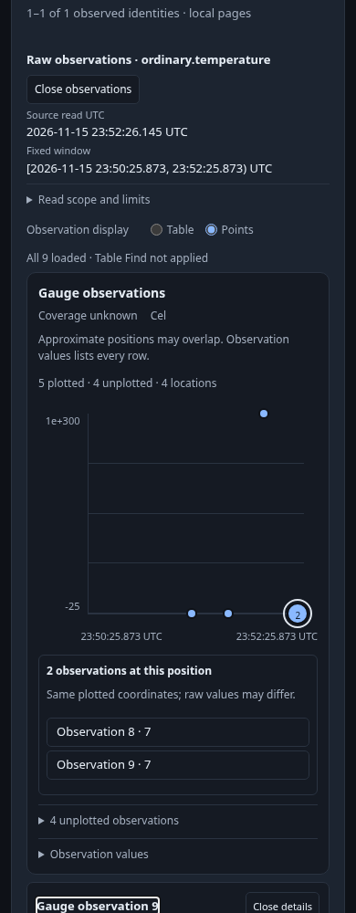
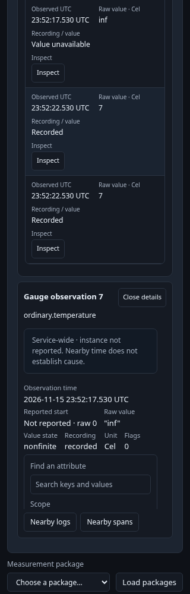

# Inspect held gauge points

The executable [OTLP journey](../../journeys/raw-gauge-points455.spec.js) starts
with an ordinary instrument: no manifest or producer identity is required.

| Action | Result |
| --- | --- |
| Discover and read | Nine physical source observations are retained, including two identical observations |
| Find in Table | A local attribute search narrows the table to one held row |
| Choose Points | All nine loaded observations remain the plot's population; the Table Find boundary is explicit |
| Move between locations | Arrow keys, Home and End move keyboard focus without choosing a point or reading data |
| Activate a repeated location | A chooser exposes both occurrences; selecting one reveals and focuses its exact existing inspector |
| Close details | Focus returns to the actual visible opener, or the active display control when the original opener is hidden |
| Switch Table / Points | Native radio navigation retains focus, the selected occurrence and the Table Find text |
| Inspect unplotted observations | The values list retains unknown flags, no-recorded values and nonfinite source values |
| Choose Nearby logs | A question is staged; only a later explicit Run could acquire records |
| Return | The same held point and display return without another source read |

The fixture sends negative, zero and extreme finite values, two identical points,
no-recorded flags, unknown flags, NaN and Infinity through ordinary OTLP. An
independent ClickHouse read checks exact timestamps, values, flags and duplicate
multiplicity. Five observations are eligible for four plotted locations; all nine
remain inspectable. The source's non-nullable flags column cannot represent an
absent flags value; this fixture does not invent one.

Points are approximate positions, with exact UTC timestamps and raw values in
accessible labels and the inspector. Coordinates may overlap, and the values
list preserves every occurrence. There are no connecting lines, inferred producer
streams, resampling or completeness claims. Coverage, value certainty and sampling
remain unknown for this held source read.

Discovery makes eight SQL calls and the explicit observation read makes three.
All subsequent display, Find, marker, member, inspector and context-staging
interactions make zero source calls. A separate Bombadil campaign repeats one
discovery and read, duplicate selection and display switching under a strict
source-authority invariant. This journey uses direct physical-source and browser
assertions; the existing model-backed raw-context journey remains a separate
regression for gauge, sum and histogram acquisition/navigation.

