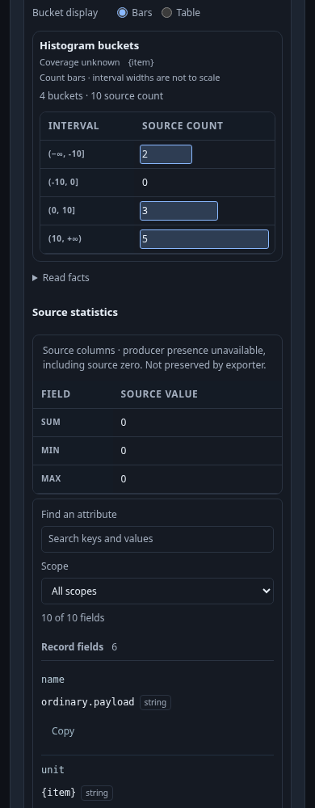
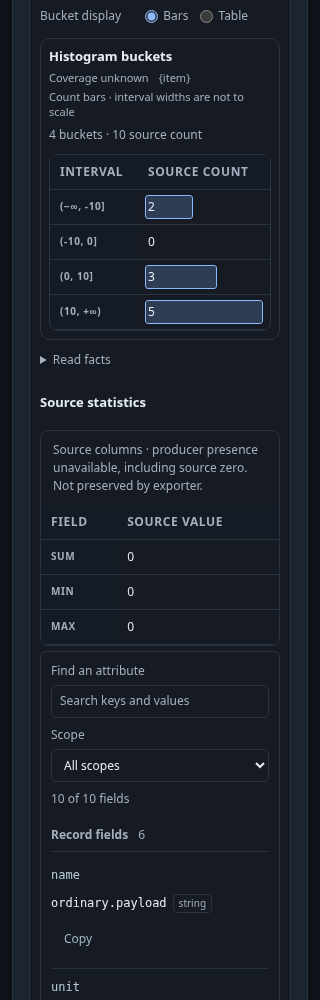

# Inspect one histogram observation

The [executable OTLP journey](../../journeys/raw-histogram-buckets456.spec.js)
starts with an ordinary explicit histogram. No Goo manifest is required.

| Action | Observed result |
| --- | --- |
| Discover and read | Eight source observations are held with their original recording states and raw fields |
| Find and Inspect | One selected occurrence supplies the bucket view; its table row immediately gains the current-selection marker |
| Read Bars | Categorical bucket rows show exact source counts, including zero and infinite edge intervals |
| Choose Table | Native radio navigation switches presentation, retaining keyboard focus, the exact bucket page and renderer |
| Page bucket rows | A 105-bucket point pages locally with at most 100 bucket rows in the DOM; Bars/Table shares the selected page |
| Close and reopen | Cached details retain display mode, bucket page and DOM; the source read is unchanged |
| Select another point | Cached occurrences retain their own display; a newly inspected point starts on its first bucket page |
| Read source statistics | Sum/Min/Max use one compact table and one shared producer-presence qualification |
| Inspect precision | Counts above JavaScript's safe integer range remain exact text |
| Inspect empty point | A recorded zero-total histogram is distinct from missing data |
| Inspect uncertain/invalid points | Unknown flags, no-recorded, malformed and missing buckets do not become plotted distributions |
| Close | Keyboard focus returns to the visible original Inspect control |
| Stage Nearby logs and return | The same selected occurrence returns without a source read |

The fixture uses ordinary OTLP through the collector and ClickHouse, including
negative boundaries, a zero-count bucket, a count above 2^53, recorded empty data,
unknown and no-recorded flags, and malformed/missing bucket vectors. An independent
physical-source oracle checks exact raw fields. Non-nullable exporter flags cannot
represent an absent flag; the journey does not invent that state.

All display changes are local. Bars are count comparisons between source-defined
buckets, with no density, percentile, rate or fleet-distribution inference. Unknown
global coverage remains unknown even when the selected vector is valid. Optional
sum/min/max presence is unavailable in the exporter and is not inferred from zero.

The consolidation live run (`915e06614a6e`) passes in 38.3 seconds on the
embedded Go runtime. It checks nineteen steps, including exact source projection,
native radio focus, local bucket paging, mode/page retention, cached inspection,
immediate table selection, certainty refusal, Close focus and held Nearby return.
Discovery uses eight SQL calls and the explicit histogram read uses three. Every subsequent interaction makes zero source calls. A separate
Bombadil campaign repeats one discovery/read, local Find, Inspect and Table/Bars
switching under source-authority and no-overflow invariants: 536 snapshots reach
the completed phase 18, including page preservation and cached reopening with no
forbidden reads. The journey cleans up the shared runtime and disposable source
database without browser errors.

The responsive frames include all four buckets and the display controls. Browser
geometry checks cover every bucket row and confirm the inspector has no nested
vertical clipping. At 320 and 390 CSS pixels, header text stays inside its cells;
computed bar-outline contrast is 8.69:1 and count-text contrast over the bar fill
is 9.27:1 in the shipped dark theme. These scoped checks are not a whole-product
accessibility certification.

