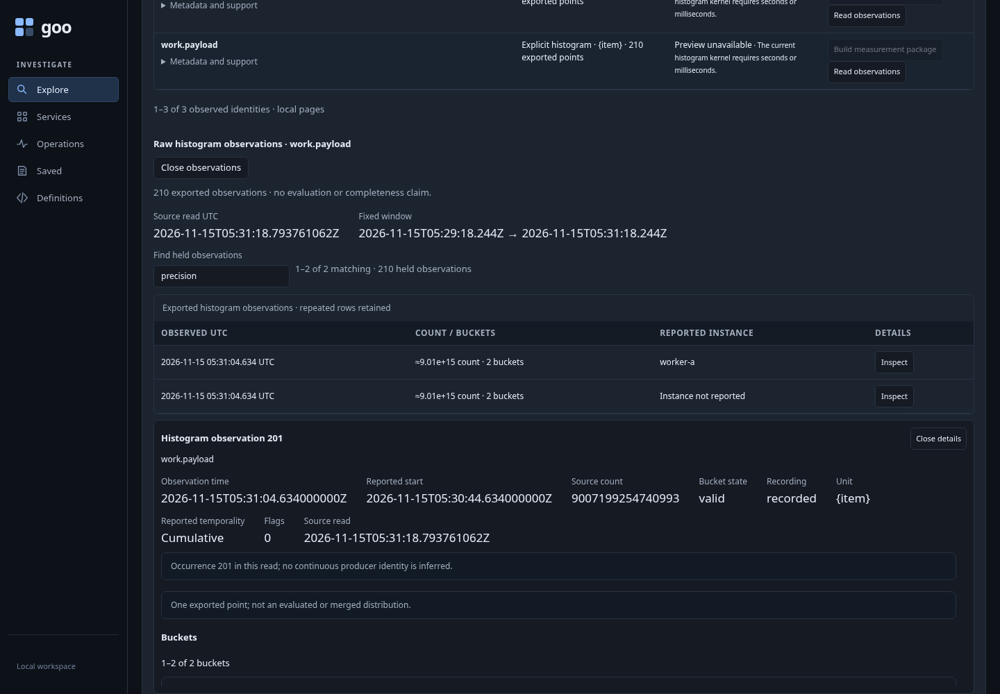
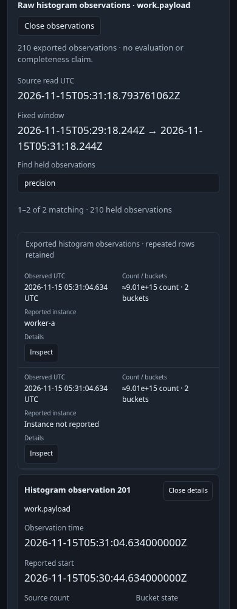

# Inspect an ordinary histogram export

An operator finds a histogram whose measurement preview is unavailable and reads
its exported points directly. The value of this flow is seeing what arrived,
including uncertainty and malformed payload, before writing a measurement.

Executable journey:
[`raw-histogram-observations.spec.js`](../../journeys/raw-histogram-observations.spec.js).

1. Send real OTLP explicit histograms from two resource variants. Independently
   read 214 stored points, including 210 matching the main instrument.
2. Discover the exact instrument. Read observations while measurement-building
   remains unavailable; compare every returned raw point with the source oracle.
3. Page through held rows and Find the precision examples. Inspect exact bucket
   counts above 2^53 and statistics whose producer presence is unavailable.
4. Leave for Activity and Return. Preserve the held result, Find, keys and detail
   without a source request or SQL read. Inspect desktop and narrow layouts.
5. Remove the bucket column only in the owned source copy. A new read refuses
   without replacing held data. Restore the column.
6. Hold a completed real response, navigate away and return, then deliver the
   obsolete success. It cannot replace the held bank or move keyboard focus.
7. Explicitly inspect another unit and temporality; reject missing temporality,
   All environments and exponential-family requests before any SQL.
8. A separate Bombadil browser discovers, reads, finds, inspects bucket detail
   and returns to the same held data.

The owned database copy is populated from actual exported rows and removed after
execution. Schema removal and delayed delivery are declared test faults. Neither
is a successful response manufactured by the UI harness.

Hegel properties and Go-to-JavaScript banks challenge exact arithmetic,
recording/presence states, duplicates and identity admission. The observed trace
reuses the held-population interaction model, with independent source and local
read counters and negative controls. Model conformance is not collection
completeness or a source-health verdict.
