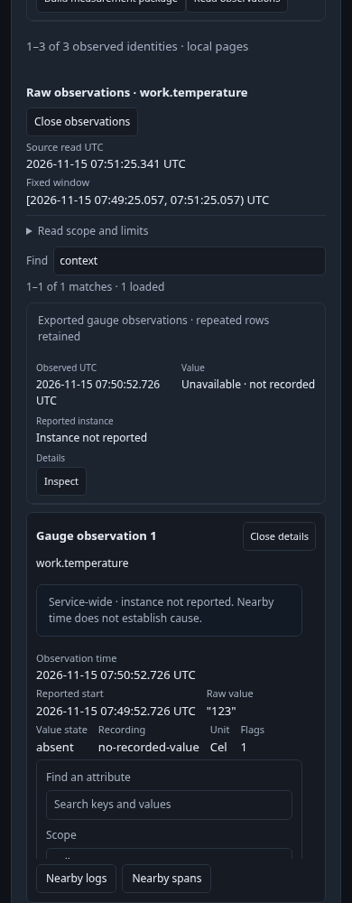
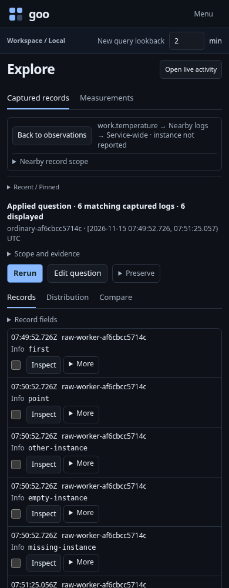
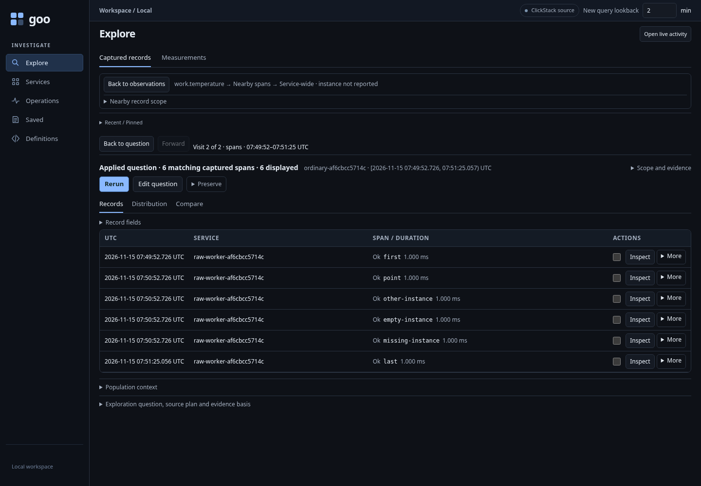

# Raw point → nearby records → Return

**Executed against real OTLP and ClickHouse.** Six contexts cover gauge, sum
and explicit histogram points to both logs and spans, including no-recorded
magnitude, missing instance identity and a reported empty instance label.

Executable journey: [`journeys/raw-observation-context.spec.js`](../../journeys/raw-observation-context.spec.js).

## Journey

| Step | Operator action | Visible outcome and contract |
| --- | --- | --- |
| Discover | Open a discovered gauge, sum, or explicit histogram instrument and read raw observations | A bounded raw bank shows its source read time; points remain raw exports |
| Locate | Use Find or paging and inspect a point | The inspector identifies one read-local occurrence, including duplicate exports |
| Scope | Choose **Nearby logs** or **Nearby spans** | The record question is staged; no record request has occurred |
| Review | Open **Nearby record scope** | The UI shows the point event time, clipped ±60-second window, and reported-instance or service-wide scope |
| Read | Choose **Run** | Ordinary record search runs with exact environment, service, namespace presence, optional instance identity, and nanosecond bounds |
| Return | Choose **Back to observations** | The held bank, page, Find state, inspector, scroll, and focus return without a metric reread |

## Exercised cases

- A reported nonempty instance label narrows logs and spans to that exact label.
- A reported empty instance label stays an exact empty equality; it is not treated as absent.
- An absent instance label produces an explicitly service-wide time association and no instance predicate.
- The real gauge retains a missing namespace. Properties additionally check explicit empty namespaces.
- A no-recorded-value point can open nearby records without pretending its magnitude was evaluated.
- Properties check clipping at either original discovery boundary. The real source journey emits records at each planned boundary and one nanosecond outside it.
- Starting another read, changing scope, closing observations, or retiring the owner prevents stale point actions and stale Return navigation.
- Opening or staging context produces zero source reads; Run is the explicit acquisition step.

## Interpretation

The resulting logs or spans share a bounded time and resource scope with the selected export. They are not proven contributors to a metric, evidence of a continuous producer, or a completeness claim. Metric labels and magnitude are deliberately absent from record filters. A saved question preserves this search scope, not the held metric point.

The planner's focused tests are in [`tests/raw-observation-context449.test.mjs`](../../tests/raw-observation-context449.test.mjs). The Go-source property gate checks 120 admitted banks and 240 ordinary questions.
Native replay includes fifteen negative controls. Bombadil completes one raw
read and two independently completed record reads before restoring held state.

Each Stage and Return adds zero source requests and SQL calls. Each Run adds one
ordinary record request and three SQL calls. Keyboard staging focuses and reveals
Run; Return restores the original context button. Frames at 1440, 390 and 320px
have no document overflow. See [validation](../../VALIDATION.md) for final results.

