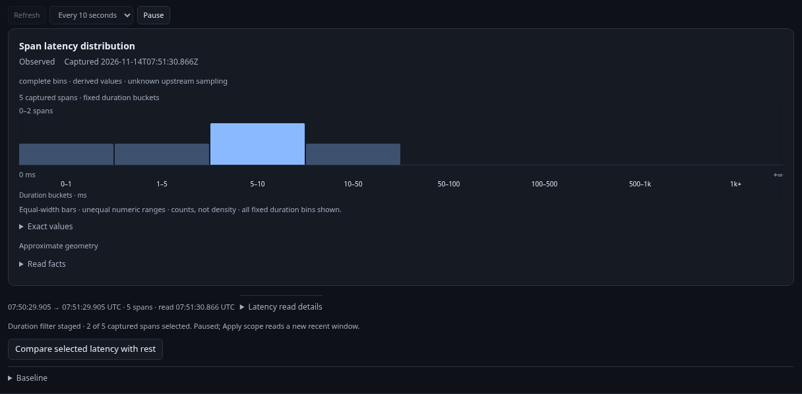
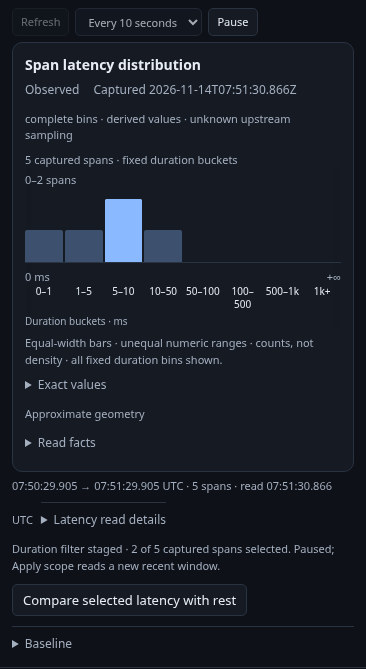
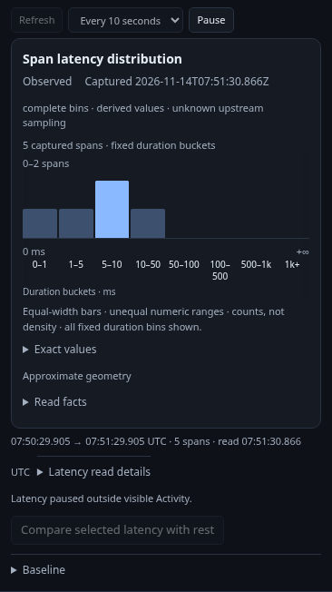
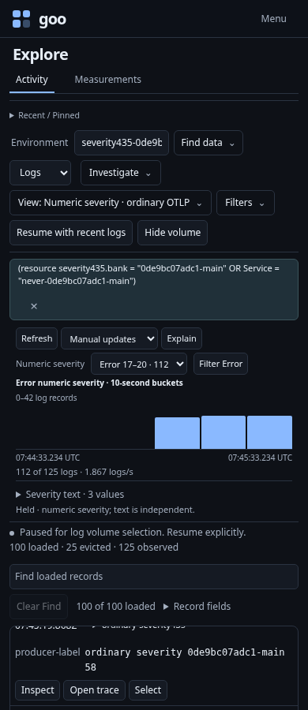

# Hold a selection and return without rereading

This consolidation executes the existing real journeys rather than introducing
another app stack:

- [Activity latency](../../journeys/activity-latency.spec.js): load an ordinary
  OTLP span scope, explicitly show/update latency, select a duration bucket and
  stage its filter. Compare works while that filter is unapplied, using the held
  fixed parent and its selected/rest partition. Run is explicit. Return restores
  the displayed parent without reading.
- After Return, the latency journey checks that retired Compare is disabled and
  directly invokes its retained callback. The parent stays held and API POST,
  latency-read and comparison-request counts do not increase. It then applies the
  staged filter explicitly and continues through delayed-response/source-fault
  recovery. Its observed ledger includes retirement as a no-read history step.
- [Log context](../../journeys/activity-log-context.spec.js): count the complete
  source population independently of the retained page, select an exact interval,
  stage explanation and return without reading. It retains pending-response and
  stale-source-action coverage, plus the shared nonempty span-latency gate case.
- [Numeric severity](../../journeys/activity-severity.spec.js): choose a band
  locally on a shared scale, preserve numeric/text independence, stage the exact
  band and fixed interval, and retain the matching held guide.

The existing latency Bombadil actor explores its real controls. Existing Quint
partition replay admits the observed stage/read/back/history sequence and rejects
scope/partition/read counter mutations, including work in the final local step.
Mounted controller tests independently trigger synchronous pause changes to
scope, clean state, visibility, native availability and render ownership; stale
actions cannot hand off. Those injected callback tests are not extra source reads
or fabricated browser responses.

| Latency desktop | Latency 390px |
| --- | --- |
|  |  |

For domain/CEL composition, generated properties verify whole-parent OR under
AND, exact record membership, nil identity, policy preservation and fully detached
mutable allocations. Existing CEL/Goo/read-only ClickHouse parity remains the
semantic gate; no text editor or source-planning HTTP route ships in this slice.

See [contract](../REFINEMENT_CONSOLIDATION.md) and
[validation](../../VALIDATION.md) for actual results and limits.
