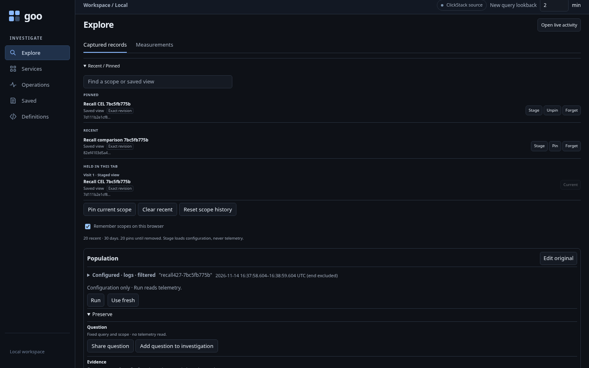
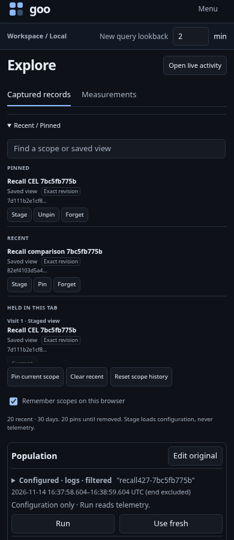

# Find an exact saved investigation from Recent / Pinned

427 extends the existing local scope journal with immutable saved-view references.
The [executable journey](../../journeys/saved-view-recall.spec.js) uses one generic
Go runtime and ordinary OTLP logs. It creates two checked definitions through the
existing API: a CEL-authored view with an unsupported ordinary parent OR, and a
composed comparison with a complete fixed baseline query.

1. Open both saved definitions. Recent remembers their exact IDs and titles;
   enabling browser persistence and pinning are explicit local actions. Cold
   reload verifies that saved-view entries contain only kind, ID and title—not
   source text, queries, rows, receipts or invocation state.
2. From Activity, choose Stage on the CEL reference. It loads definition metadata
   without querying telemetry or publishing configuration. Export through the
   existing YAML controls to verify the actual adopted definition retains its
   complete query, composition, source and compiler binding.
3. Stage the comparison. Its current and baseline operands remain distinct and
   retain their fixed environment policy/window. Only explicit Run queries their
   source populations. Independent raw logs distinguish three east records from
   two west records.
4. Search, pin/unpin and forget references locally. The readable title is display
   metadata; the immutable ID selects the definition.
5. Inject explicit missing, wrong-ID and old-library metadata responses. Refusal
   keeps the existing investigation; exporting its actual current settings proves
   the old complete configuration remains available.
6. Hold an actual metadata response, ignoring cancellation at the transport, then
   Stage B and a fresh A. Release the old A as success or failure. Neither the
   current definition nor successful-adoption event count/status can change. This
   tests request ownership, not just equality of the final URL.
7. Recall over valid and invalid authored drafts. Keep retains the exact text and returns focus;
   explicit adoption discards intentionally and focuses the new scope heading.

The browser report contains actual request slices, source/write/metadata counters,
raw source facts, exact settings exports, persisted journal entries and observations.
A bounded Bombadil actor explores native persistence, pin/filter/Stage, hidden
callbacks and Forget with actual fetch counters and no Run or publication action.
Executed results and model acceptance are recorded in [validation](../../VALIDATION.md).

| Desktop | Narrow |
| --- | --- |
|  |  |

[320px reference picker](screenshots/427-recent-pinned-320.png)

Definition resolution is not a telemetry read. Missing or incompatible definitions
never silently become a generic question or an all-environment search. Existing
held visits and ordinary question/Activity journal entries keep their own owners.

Final executed browser/native run passed in 1.7 minutes with 19 observed steps,
506 Bombadil snapshots, both focus checks and owned-runtime cleanup. The mandatory
native gate passed in 12.30 seconds and rejected all eight negative controls.
