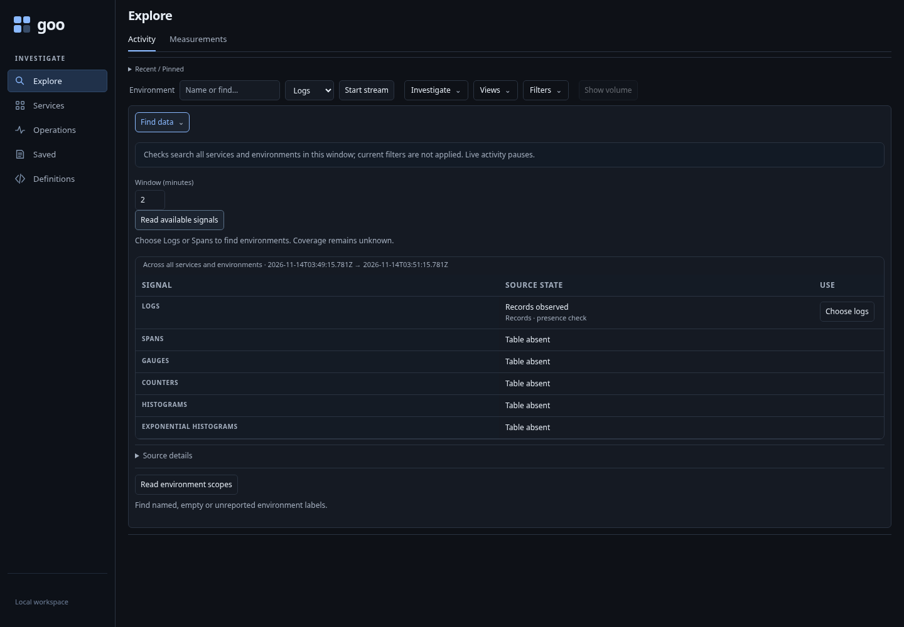
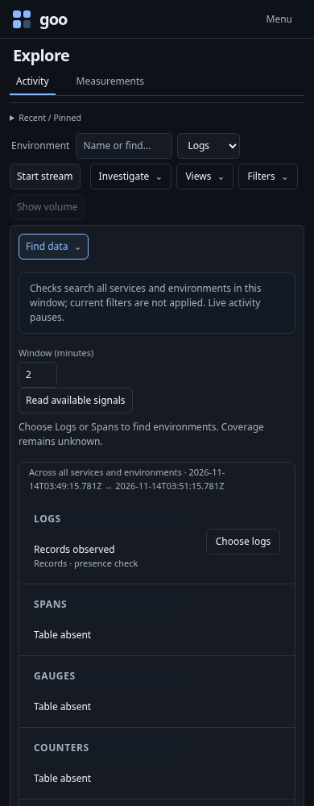
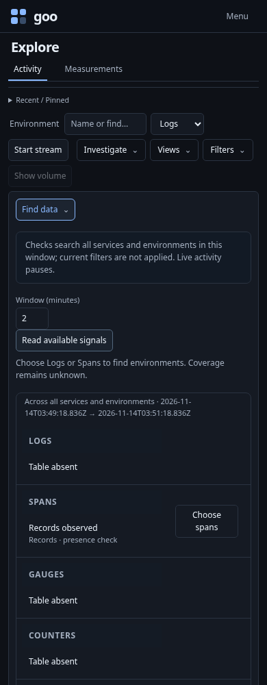
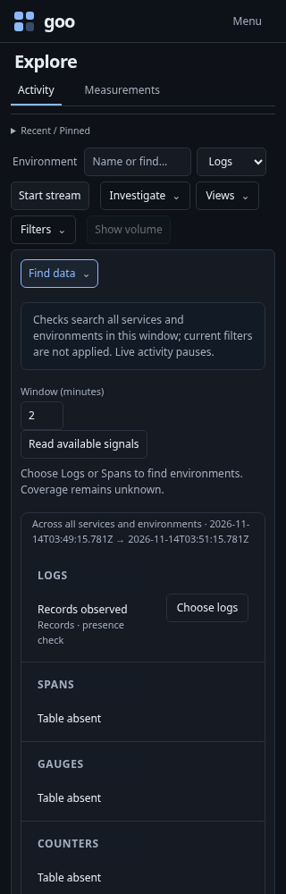
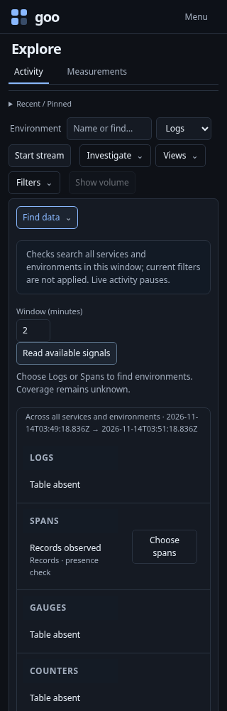
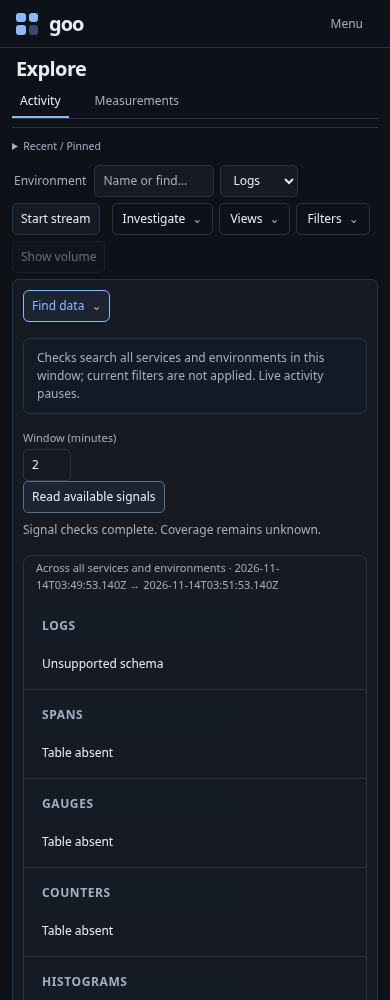

# Useful data in a partial ClickHouse installation

Executable: [source-capabilities.spec.js](../../journeys/source-capabilities.spec.js).
It creates uniquely owned temporary databases, clones real exporter table schemas,
inserts deterministic exporter-shaped rows, and starts an isolated generic Goo
runtime for each case. It does not replace, truncate or reset the lab tables or
stored investigations. Fixture databases are removed after each case.

## Discover what is available

The cases contain only logs, only spans, only gauges, an incompatible logs table,
or no exporter tables. Explicit capability reads return six distinct family states.
For a usable family, a second successful query over an empty window remains
compatible and reports no records, rather than making the table absent.



Logs-only and spans-only inventories retain their one observed service. Gauge-only
service and instrument discovery work without unrelated exporter tables. Missing
families remain visible; all-absent and incompatible-only inventory refuse.

## Choose locally, then read explicitly

Choose logs/spans changes the draft signal and focuses Read environment scopes,
with zero source POSTs. The journey continues through environment preview,
local staging and Start to a real record. It repeats the choice from an applied,
paused Activity scope to guard against accidental use of the ordinary select
handler, which would restart a stream.

| Logs only | Spans only |
| --- | --- |
|  |  |
|  |  |





## Exploration and semantic checks

With `GOO_SOURCE431_BOMBADIL=1`, the spans-only runtime also runs
[source-capabilities431.ts](../../verification/bombadil/source-capabilities431.ts).
Completion requires independently observed source rows, local signal selection,
checked environment preview/staging, live records and keyboard-safe Pause. It
forbids writes and checks one capability request, one environment read, one
preview and one tail start. Clicks do not count as successful completion.

Focused Go tests cover permission denial, malformed metadata, type mismatches,
source failure, cancellation and post-check races. Hegel generates family-state
combinations; native Quint validates actual readiness probe traces with rejecting
controls. These complement the real source/browser journey; denied metadata is
covered by structured transport tests rather than a new ClickHouse user here.

```sh
GOO_GENERIC_BINARY=/absolute/path/to/goo GOO_SOURCE431_BOMBADIL=1 \
  npx playwright test journeys/source-capabilities.spec.js
```

Actual executed results belong in [VALIDATION.md](../../VALIDATION.md).
