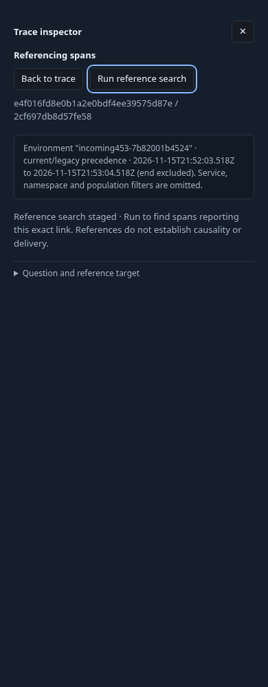
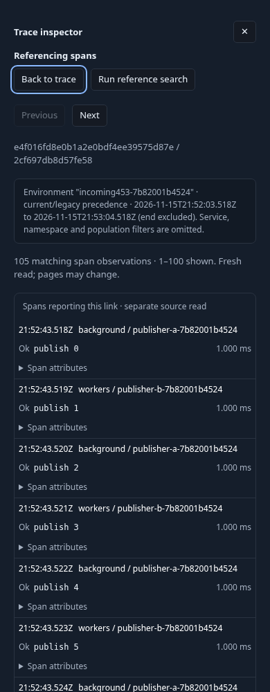
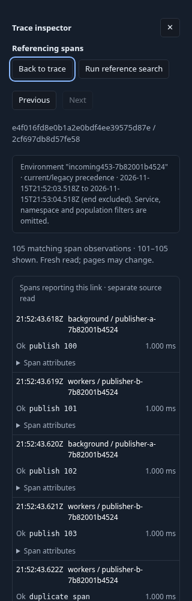

# Find spans that reference a selected span

**Executed against real OTLP and ClickHouse.** Independent native admission and
the reused drilldown model accept the report and reject fourteen negative
controls. The exploratory actor independently completes its 100/5-page lookup
and held return.

Executable journey: [`journeys/span-link-incoming453.spec.js`](../../journeys/span-link-incoming453.spec.js).
It emits ordinary OTLP spans, reads their physical ClickHouse records independently,
and uses the actual trace inspector. The selected span has no outgoing links: the
reference search is available from its reported trace/span tuple alone.

| Step | Operator action | Observed behavior |
| --- | --- | --- |
| Select | Open the consumer trace and inspect its span | The existing waterfall and selected-span inspector remain the origin |
| Stage | Press Enter on **Find referencing spans** | A reference question is staged locally; its original environment policy and fixed window remain |
| Run | Press Enter on **Run reference search** | One explicit acquisition searches reported links by both IDs; original service, namespace and population filters are omitted |
| First page | Inspect the result | The fixture has 105 matching observations, with 100 on this page |
| Next | Press Enter on **Next** in Reference pages | A fresh request reads observations 101–105; Next becomes unavailable, and focus remains on a visible control |
| Previous | Read the first page again | The same typed selector returns with offset zero; paging does not change the target or time bounds |
| Back | Choose **Back to trace**, or Escape from the lookup | Original trace rows, selected span, evidence, scroll and action focus return without a source read |
| Empty | Repeat from an unreferenced held span | The bounded empty result does not establish missing delivery |
| Recover | Retry a planted access refusal or restore the disposable fixture's missing selector column | Failure remains explicit; Run reads again only when requested |
| Cancel | Return before a pending lookup completes | A retired success cannot replace the held trace or move focus |

The independent oracle requires matching trace and span IDs at the **same link
index**, with equally sized trace, span and link-attribute arrays. A crossed tuple
whose separate arrays merely contain both values is excluded. Duplicate links in
one span do not multiply that record. Two span observations reporting the same IDs
remain two observations, including when they appear on separate pages.

The fixture also excludes records in a different effective environment and outside
the fixed event-time window. Current environment labels take precedence over
legacy labels; compatible legacy-only records still match the selected policy.

The standard source capability inspection precedes each reference acquisition.
The test renames a nested selector column only in its own disposable database;
it never changes the lab's original tables. The resulting unavailable state must
not fall back to an unfiltered count. The fixture restores the column, retries,
and drops its database during cleanup.

Successful reference reads use two standard metadata inspections and three
ordinary data queries. The executed main journey uses sixteen explicit source
requests and fifty-seven SQL calls; the actor uses six requests and twenty-three
SQL calls. Stage, Back and stale local actions acquire zero data. The missing
selector is refused after one successful DESCRIBE, before population acquisition.

A separate browser transport fault holds a completed real Go response until after
Back. Releasing it must not change the restored trace. Retained callbacks invoked
after Back or dialog close must acquire no source authority. The independent
Bombadil actor repeats an explicit search, next page and held return.

Each page is a fresh read, not a transactionally frozen campaign or a unique
invocation count. Reported references do not prove parentage, causality, delivery
or complete collection. Existing nested inspector Escape ownership remains intact.
See [validation](../../VALIDATION.md) for executed checks and their boundaries.

