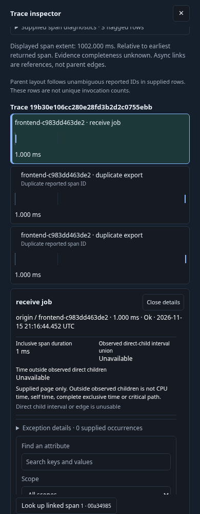
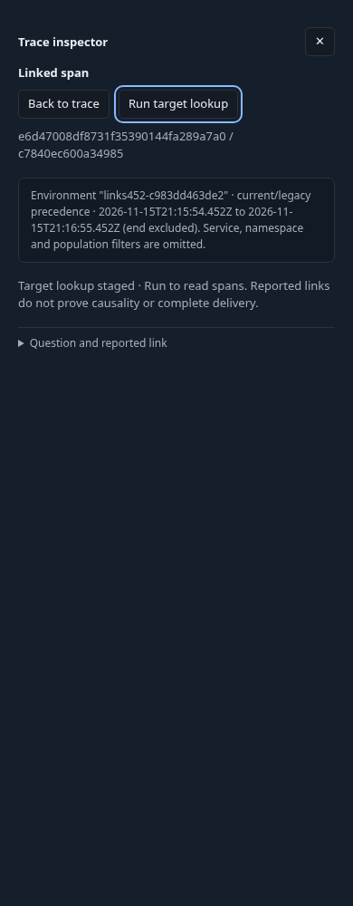
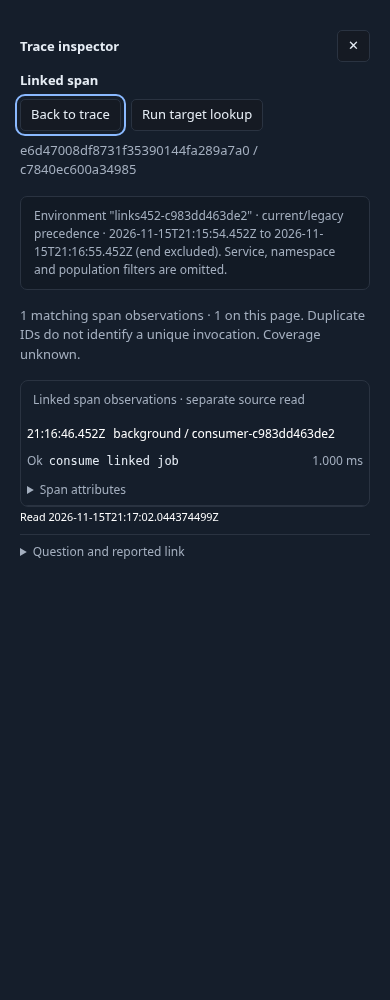

# Follow a reported span link

**Executed against real OTLP and ClickHouse.** Native replay accepts the real
ledger and rejects fourteen negative controls. The independent Bombadil actor
completes the explicit lookup and held return.

Executable journey: [`journeys/span-link-target452.spec.js`](../../journeys/span-link-target452.spec.js).
It emits ordinary OTLP spans into ClickHouse, then opens the actual fixed question
and trace inspector. It uses no manifest, seeded business definition or replacement
source response. The target read is separate evidence, not a trace-completeness or
causality claim.

| Step | Operator action | Observed behavior |
| --- | --- | --- |
| Inspect | Expand a frontend trace and select its span | The waterfall shows the supplied spans, including duplicate reported IDs |
| Choose | Choose a numbered **Look up linked span** action | Full target trace/span IDs identify the selected reported link |
| Stage | Press Enter on that action | Original environment policy and fixed window remain; no source read occurs; Run receives visible focus |
| Run | Press Enter on **Run target lookup** | One ordinary span query matches both target IDs; original service, namespace and population filters are omitted |
| Inspect result | Read the target record and its attributes | A consumer in another service and namespace can match, including a legacy environment label under the original effective policy |
| Return | Choose **Back to trace**, or press Escape | Original trace rows, evidence bases, selected span, scroll and action focus return without a read |
| Empty | Look up an absent or excluded target | The UI reports the bounded empty lookup without inferring missing delivery |
| Ambiguous | Look up a duplicated reported ID tuple | Both observations remain distinct; no unique invocation is inferred |
| Recover | Retry an explicitly refused lookup | The same target question is read again only on Run |
| Cancel | Return while a lookup is pending | The retired lookup cannot replace the held trace or steal focus |

The fixture includes a different span in the target trace, the same span ID in a
different trace, a target in a different effective environment and a target
outside the original time window. Independent physical records define the
expected membership. These controls distinguish an exact reported tuple from a
whole-trace expansion or an inherited population filter.

A planted source HTTP 403 is exposed through the ordinary Go API as HTTP 502;
the fixture checks explicit Retry rather than an automatic retry loop. Escape
returns from the lookup first. The selected-span inspector retains its existing
inner Escape dismissal before the outer trace dialog closes.

The journey also holds a completed real Go response behind a declared browser
transport fault, returns, then releases it. The UI must ignore that retired
success. Saved callbacks invoked after Back or dialog close must acquire no source
authority. The independent Bombadil actor exercises its own explicit
Stage → Run → Back path.

The measured main journey uses twelve ordinary exploration requests and thirty-three
physical SQL calls; its independent actor uses five requests and sixteen SQL
calls. Each link Stage and Back adds zero reads. A successful explicit target
Run uses one ordinary request and three SQL calls; the planted refusal and
canceled attempt stop after their first physical query. Cancellation POSTs retire
existing query IDs rather than acquiring another source result.

The reused population drilldown model checks local stage/return versus explicit
reads; native admission checks the actual questions, oracle membership, source
ledger and held bank. Current executed checks and limitations are recorded in
[validation](../../VALIDATION.md).

