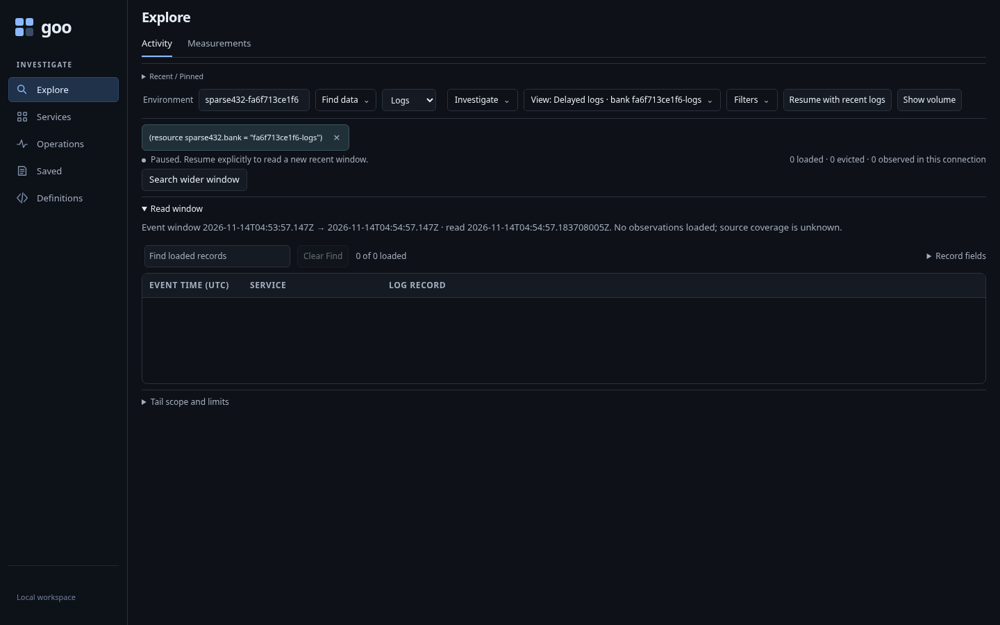
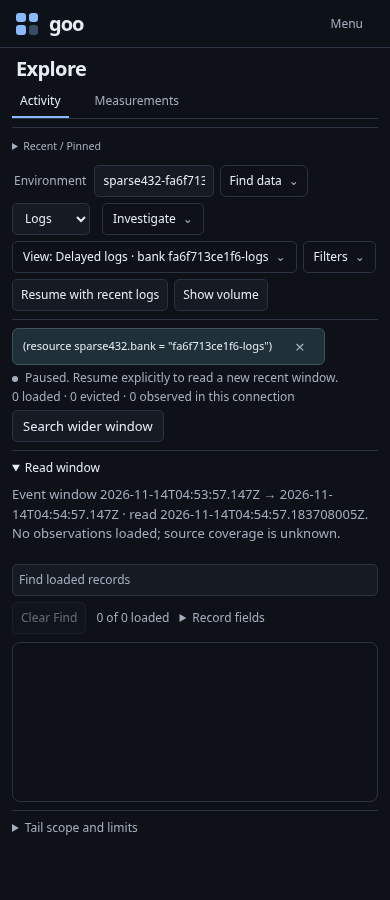
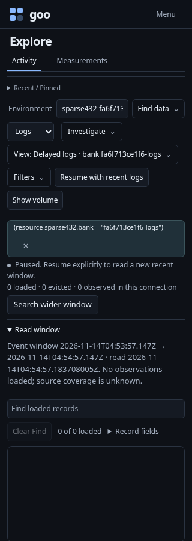
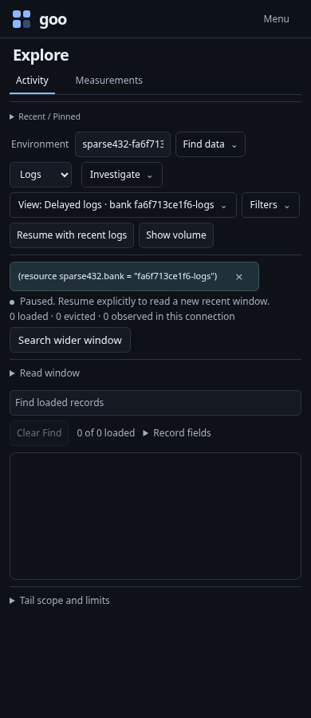
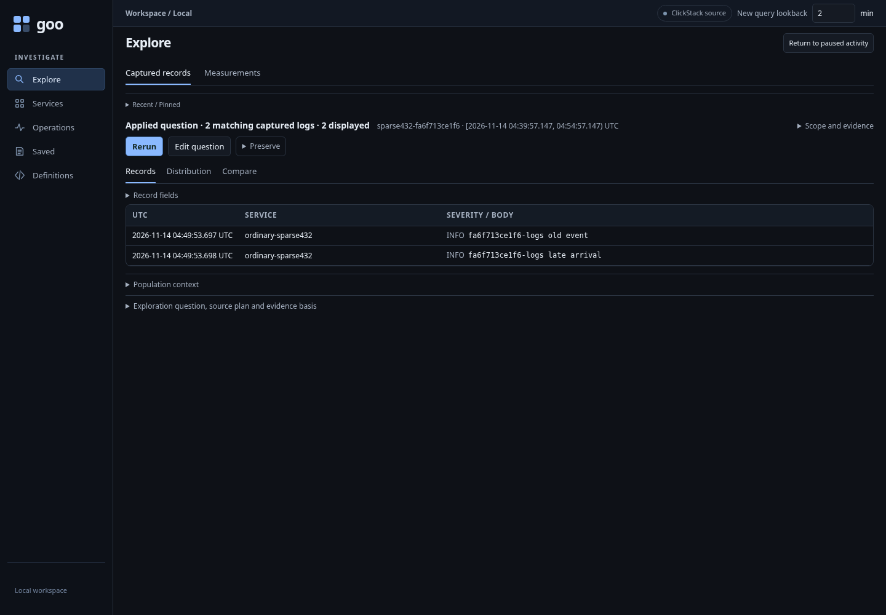

# Find older telemetry from a quiet Activity stream

Executable: [sparse-data-recovery.spec.js](../../journeys/sparse-data-recovery.spec.js).
The journey sends ordinary OTLP logs and spans through the lab collector. It uses
unique resource labels and metadata-only saved Activity configurations to set up
the exact scopes; setup is separate from the tested recovery gestures.

## A successful recent read with no loaded observations

The fixture's matching records have event timestamps five minutes old. They are
outside Activity's recent one-minute window. Current distractors have another
resource label or environment and must not leak into the applied scope.

**Search wider window** appears beneath the quiet stream. It stages locally,
preserving the applied signal, environment policy, resource predicate and columns.
The existing Run action receives focus. The 15-minute window ends at the last
completed poll, rather than the time of the click.

| Desktop | 390px |
| --- | --- |
|  |  |



## Read the fixed window explicitly

Run finds the older record in that exact scope. The event-time bounds and source
read time remain separate. The journey then inserts another old event and reruns
the same fixed question: the window stays fixed while the new read finds the
additional record.

Return restores the original paused Activity without a source read. Resume
explicitly starts a new recent window. Both logs and spans follow this path,
including a typed effective empty-environment scope.

| Staged search | Held return |
| --- | --- |
|  |  |



## Interaction and model checks

Pending scope edits withdraw recovery. Unit checks distinguish successful empty
loaded observations from limited, stale and failed reads, and reject hidden or
retired actions. The native model validates actual journey handoffs and source
requests with rejecting scope/window/implicit-read controls. Optional Bombadil
exploration exercises the local-stage, explicit-read and held-return boundaries.

An empty stream is not a source count or an ingestion health signal. These tests
do not infer arrival ordering, clock-skew diagnosis or source retention coverage.

See [the contract](../ACTIVITY_SPARSE_RECOVERY.md) and
[executed validation](../../VALIDATION.md) for outcomes and limits.

```sh
GOO_GENERIC_BINARY=/absolute/path/to/goo GOO_SPARSE432_BOMBADIL=1 \
  npx playwright test journeys/sparse-data-recovery.spec.js
```
