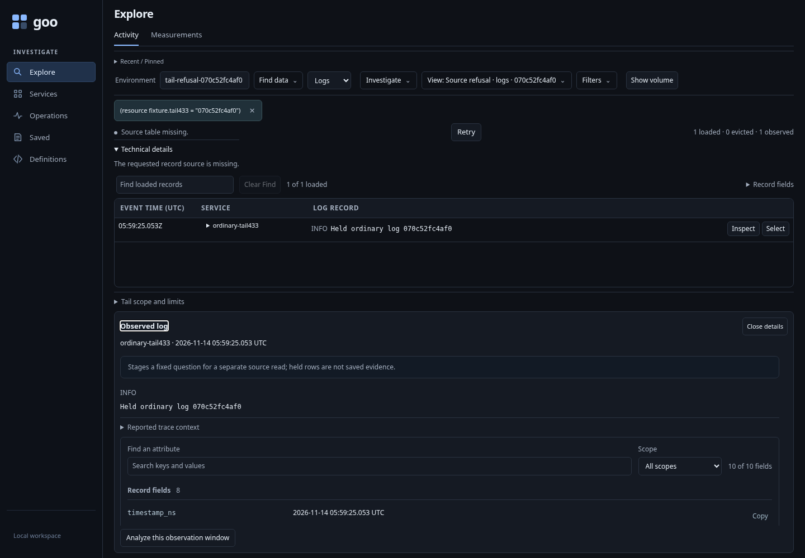
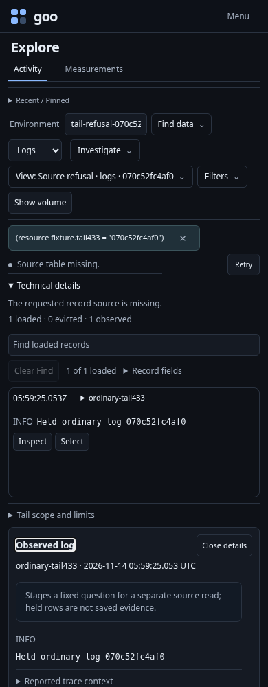
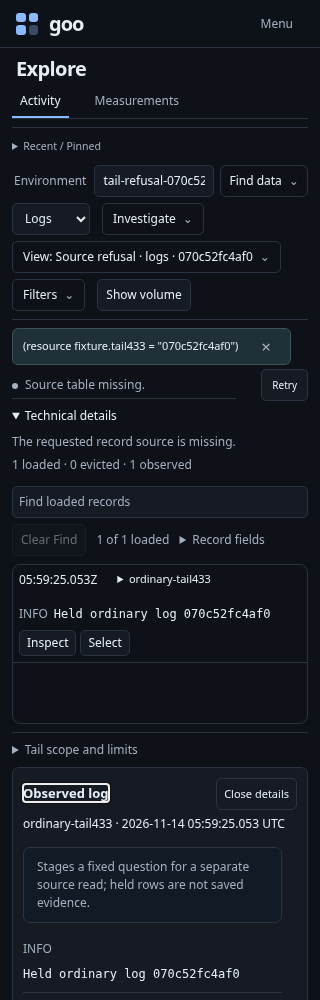

# Fix a live source without losing the held observations

Executable: [tail-refusal.spec.js](../../journeys/tail-refusal.spec.js).
The journey starts an isolated generic Go runtime over a uniquely owned ClickHouse
database. It creates and removes only its own tables. Existing lab telemetry,
investigations and source credentials are preserved.

## Missing source, then incompatible schema

For logs and spans, Start encounters a real absent exporter table. Activity shows
**Source table missing** and Retry. It makes no new tail request after waiting
longer than the automatic reconnect interval, and offers no wider-window action.

The fixture then creates an incompatible table. Keyboard Retry performs one new
request, shows **Source schema incompatible**, and returns focus to Retry. Creating
the actual exporter schema and a recent record lets the next explicit Retry recover.

## Inspect and select the held row after another failure

The test removes its table while the stream holds a valid observation. The next
poll refuses, while the original row and handle remain available. Opening Technical
details and inspecting the record preserves both the failure and the open
explanation. No source request is made. Local Find and Select loaded matches still
work without reads or writes; selection is cleared locally before the next probe.

| Desktop | 390px |
| --- | --- |
|  |  |



A retained Retry callback cannot read after an unapplied environment edit or when
Activity is hidden. The successful prior read does not make a later failed read
empty or healthy.

## Access and transport boundaries

An owned loopback proxy forwards successful source requests unchanged. It injects
one upstream HTTP403 to exercise **Access denied** and explicit recovery. This is
an injected transport refusal, not a newly created denied ClickHouse user.

A separate one-shot socket interruption reaches the real backend transport
classifier. Activity reconnects automatically after two seconds and loads the
record. Both probes record their actual requests, frames and recovered row.

## Observed traces and exploration

A byte-preserving read-through observer records actual SSE frames before they
reach the UI, with explicit delivery drains before assertions and navigation.
It does not manufacture responses or replace the product's stream parser.
Native Quint replay admits the actual selectors, sequence, retry policy and
held-row facts, with rejecting controls for policy/scope/read/custody mistakes.
Generated Hegel tests separately exercise the production Go classifier. Go's
`testing/synctest` verifies the real handler's 60-second rollover without waiting
60 wall-clock seconds.

The optional 30-second Bombadil actor independently observes a real missing-source
refusal, a quiet interval longer than the retry cadence, and guarded retired
callbacks. Completion requires one tail open and no forbidden read or write.

```sh
GOO_GENERIC_BINARY=/absolute/path/to/goo GOO_TAIL_REFUSAL433_BOMBADIL=1 \
  npx playwright test journeys/tail-refusal.spec.js
```

[Recovery contract](../ACTIVITY_SOURCE_RECOVERY.md) ·
[Validation](../../VALIDATION.md).
