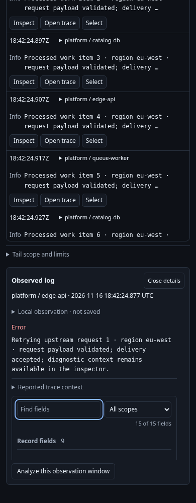
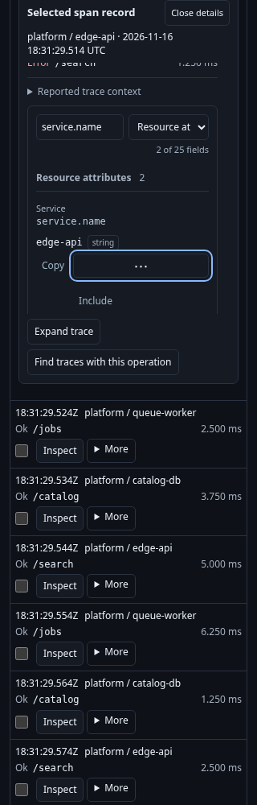
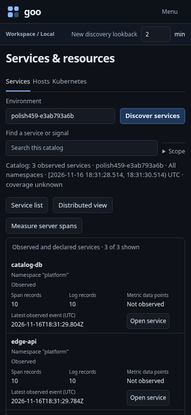
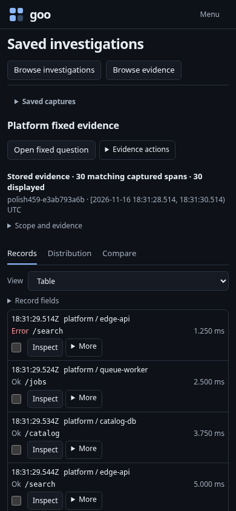

# Inspect records without losing the data

The [executable before/after journey](../../journeys/ui-polish459.spec.js) uses
ordinary OTLP logs and spans. Activity gets a fresh live bank per pass; fixed
records, service discovery and Saved use the same thirty source spans in both.
It does not mock successful telemetry or UI responses.

| Operator action | Result |
| --- | --- |
| Start and pause Activity | Thirty actual log observations remain held |
| Inspect a record | Shared UTC, record summary and compact attribute controls remain readable |
| Open contextual help with Enter; close with Space | Full explanation is available on demand; focus stays on its summary |
| Find a field and choose Resource attributes | Local field filtering updates counts without reading data |
| Open a field’s actions at 320/390px | Qualified names distinguish scope/key; native Escape closes the menu and restores focus |
| Analyze the original observation window | Only staging is local; explicit Run performs a separate read |
| Run the fixed question | All thirty source identities, event times, durations, statuses and services match the before pass |
| Discover services | All six native table columns remain available in compact mobile cards; missing metric observations stay “Not observed” |
| Skip navigation from Services or Saved | Tab/Enter moves to main content without changing the current route or reading data |
| Reopen Saved | Stored records and source question remain unchanged without a source reread |
| Use a coarse pointer | Shared attribute inputs and visible actions retain 44px targets |
| Disable JavaScript | The native skip-link anchor still reaches the main landmark |

The attribute controls retain their accessible labels and native Search/Select
behavior while reducing repeated visible chrome. The empty/unknown states, exact
values, original scope and source read behavior remain explicit. The card layout
changes signal-count placement, not signal grain or missing-value semantics.

## Measured comparison

Measurements are CSS pixels from actual browser frames, not latency benchmarks.
Both inspector types have the same toolbar layout after the pass.

| 390px view | Before | After |
| --- | ---: | ---: |
| Attribute toolbar height | 146 | 52.5 |
| First field from attribute-viewer top | 206 | 112.5 |
| Service card height | 228 | 156 |

The 320px service card is 182px high and keeps all six source cells available.
The inspection text and service source identities are checked independently of
layout measurements. Desktop/mobile frames also check horizontal overflow.

The baseline passes in 29.9 seconds and the final polished journey in 50.1
seconds on the reviewed binary. All eight local checks leave browser POST and
source SQL counters unchanged. The fixed thirty source identities and values are
identical across passes; fresh Activity data is checked separately. Coarse-pointer
controls measure 44px, and native skip navigation also passes with JavaScript
disabled. The final run reports clean runtime teardown without browser errors.

The existing held-chronology regression (`6b8f19517175`) passes on the identical
polished runtime: 21 observed steps, 335 Bombadil snapshots, native Quint replay
in 38.78 seconds and nine rejected negative controls. Its local interactions add
no source reads, and runtime/database teardown passes.

Execution receipts and broader checks are recorded in
[validation](../../VALIDATION.md). This is scoped keyboard/layout/source testing,
not a whole-product accessibility certification.

