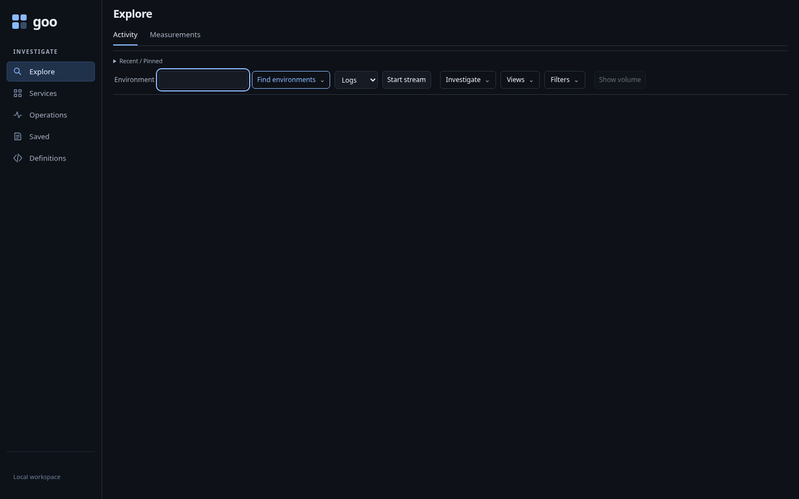
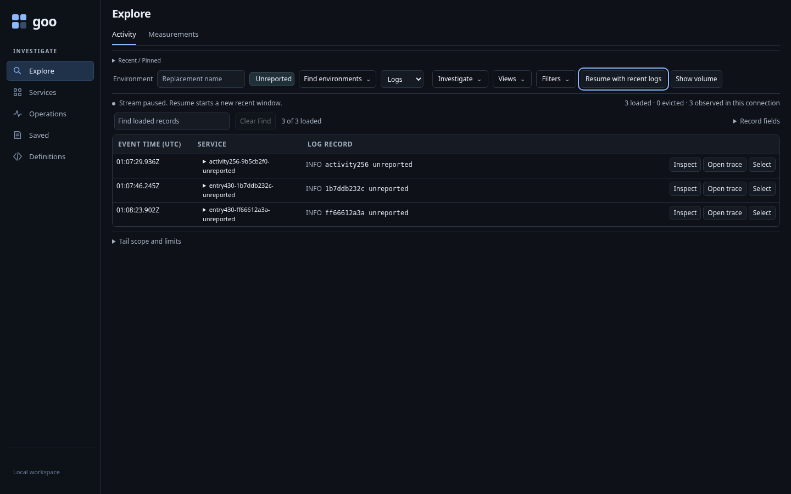
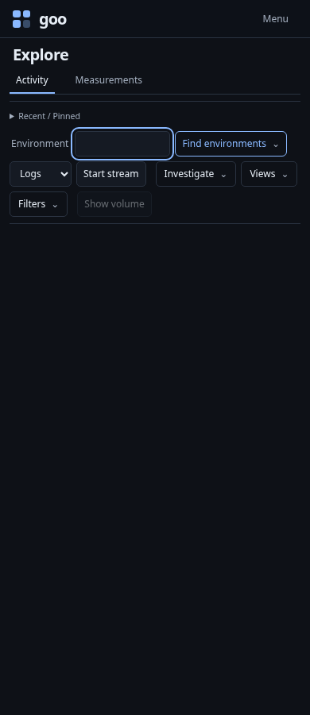
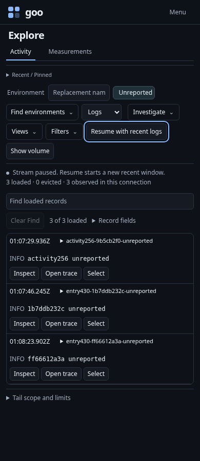
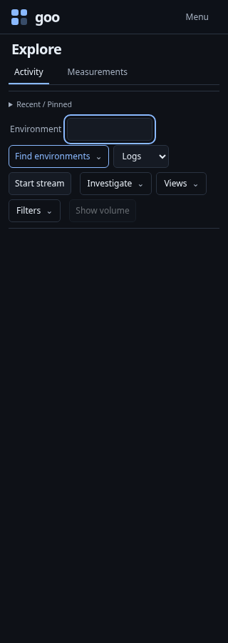
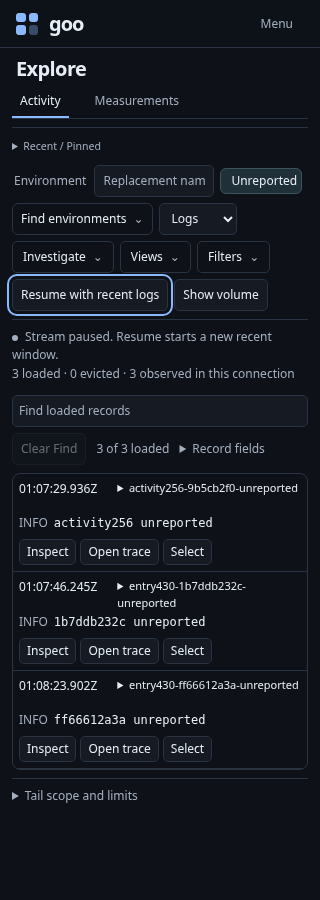

# From unfamiliar OTLP to live Activity

Implemented journey: [unknown-data-entry.spec.js](../../journeys/unknown-data-entry.spec.js).
The test starts an isolated generic Go runtime and sends real OTLP logs/spans to
the lab collector. It does not load a manifest or bootstrap through a saved view.

## Choose a scope without guessing labels

Fresh Activity makes no telemetry POSTs. Find environments is next to Environment;
typing a draft retains Start stream rather than changing the first action to Apply.
Opening the native chooser stays local. Read environment scopes explicitly reads
the selected signal and bounded window.



The journey exercises unreported, empty-current/legacy-conflict, named-current
conflict and legacy-only environments. Preview reads the chosen effective scope.
Stage performs no source request, adopts the exact typed selector and focuses
Start stream. Starting is explicit. A retained Read control invoked after its
disclosure closes is refused.

## Read, pause and resume

Live records include the arbitrary Python-tagged fixture. Explicit keyboard Pause
focuses Resume; explicit Resume focuses Pause. The supplied observations stay
separate from full-query counts. Switching an already applied clean Logs scope to
Spans retains the existing behavior of starting the selected signal; the journey
accounts for that read separately from local environment staging.



At narrow widths, controls wrap and the record remains readable without page
horizontal overflow:

| Entry | Paused records |
| --- | --- |
|  |  |
|  |  |

## Exploratory and semantic checks

The optional `GOO_ENTRY430_BOMBADIL=1` campaign uses
[unknown-data-entry430.ts](../../verification/bombadil/unknown-data-entry430.ts).
It must observe discovery, preview, local staging, live records and two keyboard
pause transitions before reporting completion. It checks exact named scope,
source budgets, forbidden writes, focus and narrow layout; a click alone does not
complete a phase. Fresh actor data prevents the 60-second live window expiring
while the deterministic journey runs.

The existing environment Hegel properties and native Quint constructor traces
cover policy identity and detachment. They complement the DOM journey rather
than claiming to model browser focus or signal availability.

Run with an explicit compiled binary and an available lab collector/ClickHouse:

```sh
GOO_GENERIC_BINARY=/absolute/path/to/goo GOO_ENTRY430_BOMBADIL=1 \
  npx playwright test journeys/unknown-data-entry.spec.js
```

Actual executed results are recorded in [VALIDATION.md](../../VALIDATION.md).
