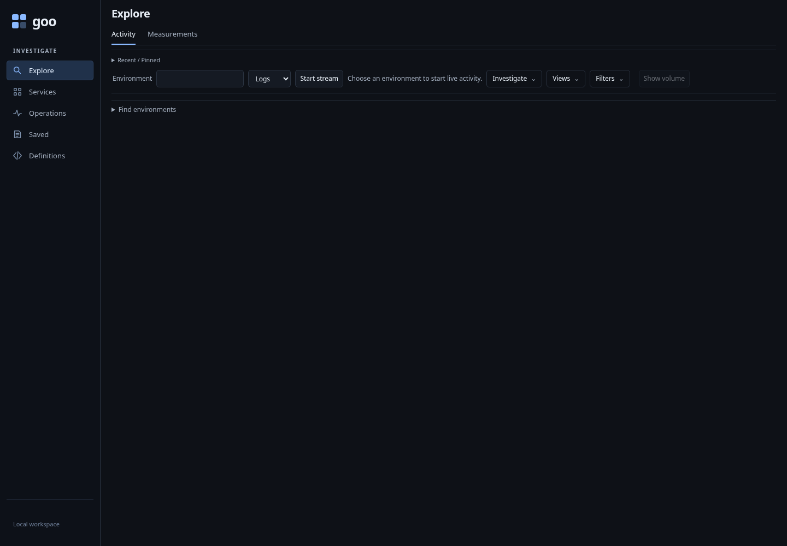
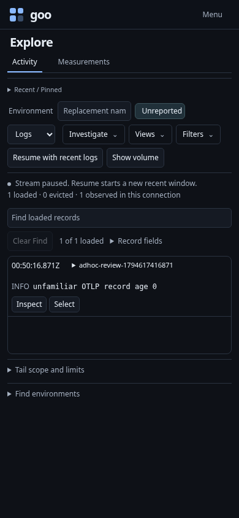

# Ad-hoc live telemetry: product and usability review

Status: review and proposed implementation order; findings below are not delivered
features. Four independent specialists reviewed product completeness, UX,
OpenTelemetry/data architecture, and accessibility/interaction coverage. The root
reviewer reconciled their findings and performed the bounded browser checks below.

## Product conclusion

Goo already has the core investigation tools. The largest gap is reaching them
from unfamiliar data without knowing environment names, service names, exporter
assumptions or which signal arrived. Improve that first useful observation before
adding more chart types or another authoring surface.

The target flow is:

**Open Goo → find available data → choose an observed scope → watch records →
inspect and narrow → compare → save a view or keep observations.**

OTLP arrives through a Collector and supported ClickHouse exporter tables. Goo
reads those tables; it is not an OTLP receiver. This review recommends improving
that existing boundary, not adding a receiver, proxy or arbitrary SQL editor.

## Findings and priorities

| Priority | Finding | Change to make |
| --- | --- | --- |
| P1 | Generic entry asks for an environment before showing what exists. Existing Find environments is a secondary disclosure. Empty, absent and legacy environment labels are supported, but reaching live data requires Read → Preview → Stage → Start. | Put the existing observed-scope chooser beside the blank input. Make finding data the primary unscoped action. Keep preview available; consider direct staging only through a checked selector contract. Starting a read remains explicit. |
| P1 | Entry and scope discovery default to Logs. A traces-only source looks empty until the user tries Spans. Metrics-only data has no equivalent environment bootstrap. | Offer a bounded, explicit Find recent data result with independent logs/spans/metric-family states and a window. Choose a scope from observed identities. Never translate unreadable sources into zero counts. |
| P1 | Service discovery unions logs, traces and gauge/sum/histogram tables. Only exponential histograms are optional. A partial-signal installation can stream successfully while its service inventory fails. | Check supported table/column availability explicitly and execute supported families independently. Distinguish absent, unreadable, incompatible and successful-empty sources. Preserve per-family refusals. |
| P1 | Live tail reads the last 60 seconds of event time. New arrivals with older timestamps can be absent from live data. Empty status offers no useful continuation. | Label the event-time window concisely. Offer Search a wider window and Change signal/scope. Wider search stages the existing fixed question; it must not silently widen a live subscription. Show observed event age only when actually measured. |
| P1 | Tail errors collapse to `Tail HTTP <status>` and automatic reconnect replaces actionable details. | Reuse safe source-refusal presentation. Keep transient reconnect, but stabilize configuration/schema failures with an explicit retry and details. Preserve held records. |
| P1 | Compact Pause/Resume hides the activated control without moving focus. Keyboard Pause was reproduced leaving focus on BODY. | Keep a stable toggle or transfer focus when the user activates a disappearing control. Inspection, scrolling or background pauses must not steal focus. |
| P1 | Direct Measurements discovery retains `local` and requires a known service, even in generic mode. | Remove lab defaults from generic entry and reuse observed scope/service selection. Preserve typed environments, namespace and native instrument compatibility checks. |
| P2 | Background batches rewrite polite status and local Find announcements. | Deduplicate unchanged status and announce meaningful transitions, not each poll. Validate mutations; assistive-technology speech output still needs a separate check. |
| P2 | Named environment preview buttons share the same accessible name; scope cells are ordinary data cells. | Include scope identity in accessible names and use row headers. Keep complete labels available when visually truncated. |
| P2 | Field suggestions come from loaded rows; full-query key discovery is bounded. Rare fields can be absent from pickers. | Show supplied-field provenance, share field pickers between columns and filters, and preserve literal key entry. Later add bounded key search if a real need remains. |
| P2 | Local Find cannot naturally become a source search, and Analyze/Explain/Build entrances compete. | Provide explicit supported handoffs, such as literal log-body search, and consolidate around one Analyze scope entrance. Do not silently convert arbitrary local Find syntax into source predicates. |
| P2 | Save/reuse exposes several storage families before the user's intent. | Standardize Save view / Keep observations / Add finding wording and artifact badges. Retain exact-view Recent/Pinned work; do not merge configuration with frozen observations. |

## What is already present

Reuse these capabilities rather than rebuilding them:

- Structured attributes, namespace-aware identity and exact missing/empty values.
- Bounded live buffers, visible continuity gaps, automatic pause for keyboard
  inspection and held-parent return.
- Explicit full-scope counted values, multi-value staging and selected/rest comparisons.
- Traces/waterfalls, log context, service/resource dashboards and error grouping.
- Native instrument discovery with units, schema, temporality and support reasons.
- Saved view composition, portable import, captures, findings and annotations.
- Shared display components whose lifecycle does not fetch telemetry.

A blank environment must not become an implicit all-environments selector. Such a
mode could be useful later, but requires a typed scope contract across queries,
tail, saved views and comparisons. Promoting existing discovery is the smaller
first improvement.

## Proposed next cycle

This is a proposed reprioritization of the pending 427–429 cycle, prompted by the
ad-hoc-data direction. No implementation milestone is renumbered by this review.

1. **Breadth — unknown-data entry.** Expose observed-scope discovery at first use,
   fix generic lab-default leakage, and make available signals understandable.
   Introduce the smallest reusable source-capability result needed to support
   partial-signal discovery; do not create a separate onboarding application.
2. **Depth — sparse and delayed data recovery.** Stage wider fixed windows from
   empty streams; preserve the selector and parent. Complete metrics-only
   environment/service/instrument discovery using the shared source capabilities.
3. **Consolidate — shared interactions and source states.** Standardize discovery
   selection, refusal/retry, Pause/Resume focus and announcements. Apply the same
   contracts to Activity, Services and Measurements, then review the whole flow.

The existing exact saved-view recall proposal remains valuable after first-data
entry. Existing paired-capture adoption follows that; neither should be rebuilt
inside the discovery work. See the [426 roadmap](../ROADMAP_2026_11_13_CHECKPOINT_426.md)
for their existing acceptance contracts. Prefer this finite cycle to an open-ended
vendor feature checklist.

## Acceptance journeys to add

The existing generic journey proves a no-manifest runtime using a known fixture
environment; it does not prove discoverability when the user knows no labels.

| Case | Required outcome |
| --- | --- |
| Logs only; no environment attribute | Discover an unreported scope, start live logs, inspect an unfamiliar field, count values and stage a comparison without typing a guessed label. |
| Spans only | Find that spans exist, choose namespace/service, inspect a trace and return to held records. |
| Metrics only | Discover environment/service/instrument, show support reasons and build a checked measurement without a manifest. |
| Named, legacy, empty, conflicting labels | Distinct typed choices and exact scope round-trip; missing must not collapse into empty or all. |
| Sparse, delayed/backfilled, future-skew events | Explain the event-time window; explicit wider search finds older records within supported query windows and source retention, while future events are not claimed as current. |
| Missing or incompatible tables; denied access | Per-source states with useful refusal and retry; available signals remain useful. |
| High-volume partial tail and disconnect | Limits, evictions and gaps stay visible; loaded counts never become population totals. |
| Save and reopen | Full configuration stages without telemetry; Run is explicit. Captures remain separate. |
| Keyboard and 320/390px | Distinguishable discovery actions, stable explicit Pause/Resume focus, actual-opener return, no page overflow and no announcement flood. |

Use real OTLP through the collector for integration acceptance, plus focused
source-adapter tests for partial-schema cases. Extend Bombadil actions/invariants
for discovery, recovery and Pause/Resume; model staged/applied/paused/retired
transitions with existing Hegel/Quint tools. Keep no-read assertions for local
staging/return and definition reopen. A review is not a substitute for executing
this matrix.

## Review evidence and limits

Specialists reviewed current source and existing journeys independently; they did
not execute new tests. The root reviewer started the existing compiled Go binary
in isolated generic mode, using the lab ClickHouse without sample declarations.
The root injected two small real OTLP log records through the local Collector,
with no environment label: one current event and one five minutes old. The
collector returned HTTP 200. Without typing a known environment, the reviewer used
Find environments → Preview unreported logs → Stage in Activity → Start stream.
The two-minute preview and live view each displayed the current event; the older
event was outside their requested windows. This is not an independent proof that
the older event was persisted or that a wider query would retrieve it.

The browser confirmed zero telemetry POSTs before explicit discovery, successful
unreported-scope adoption, live records, and keyboard Pause focus loss. The
390px paused layout had no page-level horizontal overflow.

The initial rendered view shows an empty page beneath a compact scope toolbar:

This is a usability observation, not a claim that the shell needs more prose.
Promote the existing next action into that space, then let records lead.

Source review, rather than new isolated-store execution, establishes the
partial-signal table dependency and metrics bootstrap findings. Repeated
screen-reader speech and all viewport cases remain untested in this review.
No production behavior changed.

Independent OTel/data and UX follow-ups accepted the consolidated review and its
execution limits. UX requested the supported-window/source-retention qualification
in wider-search acceptance; it is incorporated above.

## Source references

- [Generic startup](../GENERIC_STARTUP.md) and [collector configuration](../../config/collector.yaml).
- [Stream entry](../../ui/stream-entry.mjs), [environment adoption](../../ui/environment-adoption.mjs), [typed environments](../../ui/record-environment.mjs).
- [Tail UI](../../ui/tail.mjs), [tail query](../../exploration/tail.go), [SSE handler](../../cmd/goo/tail_http.go).
- [Service inventory](../../exploration/service_discovery.go), [metric discovery](../../measurements/discovery.go), [Measurements UI](../../ui/measurements.mjs).
- [Record query fields](../../exploration/model.go), [source projection](../../exploration/compiler.go), [record columns](../../ui/record-columns.mjs).
- [Generic integration journey](../../journeys/generic-startup.spec.js), [environment journey](../../journeys/256-activity-environment.spec.js).
