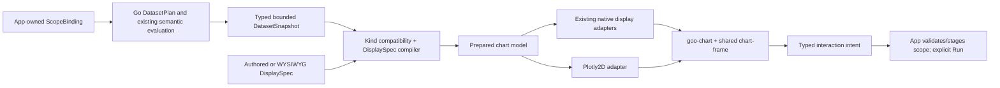

# Chart platform design — 260

Research/proposal, 2026-10-30 UTC. No chart runtime or dependency was changed by
this review. The recommendation is a typed Goo chart contract with interchangeable
renderers, followed by a small Plotly-backed pilot. The public abstraction should
be **kind + data roles + scope**, not Plotly traces and layout JSON.

## Charting is a subset of the whole UI grammar

The [root proposal](../VIEW_GRAMMAR_PROPOSAL_260.md#target-the-whole-ui-is-a-composable-view)
now defines the broader target: one public `ViewDefinition` composes a screen,
reusable section or widget. This report's `DisplaySpec` is only its chart/kind
projection, not a second view language. The same component registry must cover
tables/lists/streams, waterfall/detail, attributes, search/filter/facets, forms,
breadcrumbs, actions and responsive layouts. Built-in screens and contributed
views consume the same public contracts; there is no private built-in screen API.

The canonical context has typed dataset roles **and** named scope sessions,
selection, parameters, documents/drafts and action outcomes. A comparison binds
independent dataset roles; a composition binds children to those roles and scope
sessions. It is not a flat single-provenance row bag or an opaque renderer payload.
The flattened snapshot notation below is illustrative common data; actual Go
schemas should use shape-specific tagged forms, with multi-dataset composition
represented explicitly by `ViewDefinition`.

Controls declare local versus scope-bound behavior. A local table search filters
supplied inspection rows only; a scope search/facet emits a typed operation to the
named draft/applied scope owner. Facet counts retain their declared basis (applied
scope, scope excluding their own clause, baseline or inspection rows), coverage
and omitted values. Complete-data eligibility can gate controls as well as charts.
New data demands, source commits, navigation, Keep/Capture and publication use
registered host intents/effects; a template cannot acquire authority by naming an
action or endpoint. Outcomes/errors flow back through the same controlled context.

Whole-screen parity therefore joins the chart-family inventory: representative
Activity, service/resource overview, trace/detail, Saved, Definitions and
investigation declarations must work with shared scope/selection/action/lifecycle
contracts. The first pilot should include a scope-bound table/facet alongside the
chart toggle, not claim whole-UI expressiveness from a successful line chart.

## Prerelease policy and semantic parity

Goo has no legacy compatibility floor. Establish one canonical scope/dataset/kind/
view contract and replace obsolete APIs, saved formats, adapters and duplicated
widgets directly when the canonical path covers their useful behavior. Do not
create compatibility aliases, dual old/new modes or permanent migration shims.
A pilot may replace the current implementation after semantic tests; phased
implementation is for proof and bounded delivery, not a requirement to preserve
serialized development formats. Specialized renderer code can remain where useful,
but its inputs, quality, semantics and interactions must be expressible in the
same grammar. There is no opaque waterfall/native-widget escape from the model.

## Existing foundations

The current UI has useful primitives rather than a general chart runtime:

| Existing code | What already works | Semantics the canonical contract must express |
| --- | --- | --- |
| `ui/chart-frame.mjs`, `chart-frame.css`, `docs/UI_CHART_FRAME.md` | Framework-neutral chart heading, unit/window/state; caller children and focus survive metadata updates | Shared chrome and app-owned freshness/status |
| `ui/time-bars.mjs` | Exact integer/rational supplied counts, native keyboard/pointer selection and range intents | Exact labels, explicit unknown/zero distinction and selection contract |
| `ui/value-timeline.mjs` | Exact decimal/rational arithmetic for domain preparation; subtract exact nanosecond bounds before pixel conversion; bounded supplied points | Point identity, gap/state handling and explicit brush intent |
| `ui/bucket-heatmap.mjs` | Supplied bucket layouts/counts, unknown/outside states, native table/button fallback and keyboard rectangle selection | Bucket semantics, accessible controls and exact boundaries |
| `ui/waterfall.mjs` | Parent-first supplied span geometry, missing parents/cycles, exact start subtraction | Dedicated trace semantics; do not replace with a generic Plotly bar chart |
| `ui/numeric-distribution.mjs`, `aligned-histogram.mjs`, `histograms.mjs` | Bin/count/denominator and native histogram validation; precomputed counts rather than arbitrary client-side statistics | Existing semantic validators and truthful comparison support |
| `ui/distributions.mjs`, `grouped-time-series.mjs`, `service-dashboard.mjs`, `native-presentation.mjs` | App-specific adaptation of source results to plots | Query ownership, fixed/live/captured scope, selection planning and independent evidence |

`package.json`, `package-lock.json` and the runtime modules currently contain no
Plotly, Vega or ECharts dependency/loader. `goo-chart-frame` is not that missing
renderer abstraction: it deliberately supplies only chrome. Retrofitting its
`.data` property to accept vendor charts would break its useful narrow contract.

## Proposed layers



One data snapshot can offer several compatible kinds without rerunning telemetry.
Changing kind changes presentation, not the selected population, measurement,
window, source clock or evidence identity. A kind needing a new aggregation should
show **Needs another dataset** and offer an explicit staged recipe. It must not
quietly fetch more data or present statistics over the displayed page as fleet
measurements.

### Small public contract

Illustrative TypeScript notation; not an implemented API:

```ts
type FieldType =
  | 'string' | 'boolean' | 'int64' | 'uint64' | 'decimal' | 'rational'
  | 'timestamp_ns' | 'duration_ns' | 'category';

type DatasetSnapshot = {
  version: 'goo/dataset/v1';
  id: string; revision: string;
  shape: 'records' | 'time-series' | 'binned-distribution'
       | 'bucket-grid' | 'ranked-groups' | 'span-intervals' | 'state-intervals'
       | 'scalar-summary' | 'record-fields' | 'relationship-graph'
       | 'comparison' | 'composition';
  provenance: {
    scopeBinding: string; basis: string; observedAt: string;
    origin: 'held' | 'capture' | 'live';
    window: { fromNs: string; toNs: string }; // half-open, exact strings
    extent: { id: string; kind: 'selected-occurrences' | 'query-result'
                         | 'aggregate-domain' | 'fixed-window' | 'reported-closure';
              scopeHash: string; memberBasis?: string };
    completion: CompletionClaim[];
    countBasis: 'source-records' | 'selected-occurrences' | 'native-observations';
    denominator?: string; // exact; never inferred from visible rows
  };
  fields: { key: string; type: FieldType; nullable: boolean;
            unit?: string; semantic?: string }[];
  quality: DatumQuality;
  rows: { key: string; values: Record<string, unknown>;
          quality?: Partial<DatumQuality>; cellQuality?: Record<string, Partial<DatumQuality>>;
          members?: string[] }[];
  omitted: { rows: number; reason?: string };
};

type DisplaySpec = {
  version: 'goo/view/v1';
  kind: string; // e.g. timeseries.line/v1; stable versioned registry ID
  dataset: string; // dataset role, not a source URL
  channels: Record<string, string>; // x -> bucket_start, y -> errors, series -> service
  options?: { title?: string; palette?: string; domain?: 'shared' | 'per-series';
              legend?: 'auto' | 'shown' | 'hidden'; interpolation?: 'step' | 'linear' };
};

// Framework-neutral display API. Application supplies both snapshots and renderer.
chart.snapshot = checkedSnapshot; // do not shadow HTMLElement.dataset/DOMStringMap
chart.view = checkedView;
chart.selection = { keys: ['stable-row-key'] };
// SSR may serialize bounded JSON in inert application/json children, with normal
// server HTML escaping. Detached SPA properties must upgrade without losing data.
```

Keep exact numeric cells as decimal/rational/integer strings. A prepared chart
model separately carries finite approximate geometry and exact labels; a Plotly
array is not the authoritative dataset. A bounded record dataset is explicitly a
page/selection; its `members` do not prove unique physical events or causality.
For comparisons, retain two dataset/provenance bindings and check unit, bins,
window alignment and denominator compatibility before offering an overlay.

The model needs explicit runtime limits, initially inherited from each existing
source family. The first pilot should cap **8 series / 256 intervals per series**,
labels at an established bounded text size, and have a visible limited/omitted
state. Those are proposed presentation limits, never measurement totals. Larger
budgets require a measured renderer/memory decision and compatible Go plan.

### Go boundary and declarative grammar

Go should validate a `DisplaySpec` against a versioned kind registry before saving
or compiling it, then separately evaluate data eligibility (including hard
completeness requirements) for every renderable snapshot. Use ordinary structs for common options and typed channel roles;
kind-specific bounded JSON can be checked against a known per-kind validator.
Normal library users should not manipulate generic renderer type machinery.
Validation checks field existence/type/unit, allowed options/transforms, role
cardinality, point/series budgets and the declared dataset recipe. Unknown kinds,
unknown options and incompatible units fail with actionable diagnostics.

A `KindDefinition` may describe:

- Stable ID/version, human title, shape and semantic requirements.
- Channel roles and editor controls, defaults, compatible existing dataset recipes.
- One built-in visual composition/renderer mapping and supported intent events.
- Accessible alternative, exact-value detail and optional safe declarative template.

Service/team contributions should instantiate or compose these built-ins using
versioned declarative data. They should not upload JavaScript or arbitrary Plotly
traces. A WYSIWYG editor edits the same `DisplaySpec` AST as YAML, with schema-derived
field pickers and control panels. Existing YAML+CEL/KCL direction can author the
normal form; this proposal does not require another competing authoring syntax.

Separate **display transforms** (stable sorting, label formatting, channel mapping,
unit display conversion, explicit visibility) from authoritative **population
transforms** (query grouping/filtering, rates, histogram aggregation, joins and
percentiles). Population semantics belong in the checked Go `DatasetPlan`/measurement
layer and preserve OTel semantics, resets, temporality, sampling and independent
read clocks. Bounded pure local projections, including held-page grouping, trace
geometry and direct-child interval unions, are allowed when the grammar declares
the exact input extent, algorithm, quality propagation and member/intent mapping.
They require no additional source read and must be labelled exact only relative
to that supplied extent; they cannot promote a page/selection statistic into an
authoritative parent-population measurement. No average of percentiles;
no browser auto-binning of a displayed page masquerading as a source distribution.

## Typed quality, completeness and eligibility

The chart grammar must cover **every** current widget family, not just the easy
numeric plots. A renderer can specialize its geometry and interactions; it cannot
hide required semantics or treat a raw vendor spec as a substitute for a dataset
contract. Missing quality representation is a model gap to fix, not permission to
silently flatten the widget into an ordinary chart.

Quality is dimensional and may differ at dataset, series, record, cell, bin and
edge level. Defaults can be inherited with explicit, checked local detail; a team
view cannot override uncertain input to make it certain.

```ts
type DatumQuality = {
  value: 'observed' | 'derived-exact' | 'estimated' | 'bounded'
       | 'unknown' | 'missing' | 'invalid' | 'not-applicable';
  representation: { type: FieldType; exact: boolean; unit?: string;
                    displayRounding?: string };
  // Only present when a source/evaluator actually supplies a justified bound.
  bounds?: {
    kind: 'deterministic' | 'statistical'; lower?: string; upper?: string;
    lowerInclusive: boolean; upperInclusive: boolean;
    method: string; level?: string; assumptions: string[];
  };
  measurement: { uncertainty: 'known' | 'unknown' | 'not-declared' | 'not-applicable';
                 method?: string; boundRef?: string };
  interpretation?: { status: 'known' | 'unknown' | 'unsupported' | 'not-applicable';
                     profile?: string; rawField?: string };
  population: { basis: 'selected-occurrences' | 'query-records' | 'aggregate'
                    | 'native-observations'; support?: string;
                denominator?: string; omitted?: string };
  sampling: { status: 'none-attested' | 'sampled' | 'unknown' | 'not-applicable';
              method?: string; fraction?: string; weightField?: string };
  time: { eventAt?: string; readAt: string; evaluatedAt?: string;
          custodyAt?: string; freshness: 'current' | 'stale' | 'unknown';
          arrival?: 'on-time' | 'late' | 'unknown'; revisionState?: 'original' | 'corrected';
          cutoffNs?: string; clockCertainty: 'bounded' | 'unknown' | 'not-applicable';
          clockBounds?: {lowerNs: string; upperNs: string; method: string} };
  relationship?: { basis: 'reported' | 'declared' | 'contextual';
                   state: 'resolved' | 'missing' | 'ambiguous' | 'cyclic'
                        | 'unknown' | 'not-applicable' };
  reasons: string[]; lineage: string[];
};

type CompletionAspect = 'records' | 'groups' | 'bins' | 'time-cells'
                      | 'interval-coverage' | 'reported-graph'
                      | 'collection' | 'sampling';
type CompletionClaim = {
  aspect: CompletionAspect;
  status: 'complete' | 'partial' | 'unknown' | 'unsupported';
  scopeHash: string; extentId: string; planHash: string; datasetRevision: string; basis: string;
  fieldsOrMeasures?: string[];
  domain?: {fromNs: string; toNs: string; cutoffNs?: string; policy?: string};
  // Reference to server-validated evidence, not a user-authored complete flag.
  attestation: string;
};

type KindRequirements = {
  shape: DatasetSnapshot['shape'];
  channels: Record<string, {types: FieldType[]; unitSemantic?: string}>;
  completion: {aspect: CompletionAspect; status: 'complete';
               relativeTo: 'bound-selection' | 'bound-query' | 'bound-measure' | 'fixed-window'
                         | 'reported-closure' | 'declared-collection'}[];
  minimumSupport?: string;
  acceptedValueQuality: DatumQuality['value'][];
  requiredBounds?: {kind: 'deterministic' | 'statistical'; method?: string};
};
```

The snapshot uses these typed, aspect-specific completion claims; do not also
maintain a coarse legacy `complete` boolean/string as a competing contract.
Sampling/coverage/freshness are not collapsed into `DatumQuality.value`, and exact
string encoding is not certainty about the measured world. The measurement facet
separately records whether physical/estimator uncertainty is known; absent bounds
are not proof of zero uncertainty. Sampling `none-attested` requires the relevant
server/source contract, not a raw telemetry attribute or a template assertion. Observed zero remains
an observed value. An empty exhaustive query can be complete with No data;
a percentile over zero support remains undefined. A known raw status code can
have unknown domain interpretation. A bucket-derived p95 bound is not a confidence
interval, and an open tail cannot be replaced by a fabricated finite endpoint.

### Complete-only widgets are a hard gate

A widget may require complete records, complete aggregates, a closed time window,
a resolved reported graph or an actual collection/no-sampling guarantee. These are
different requirements. Go evaluates the kind's requirements against claims for
**the exact scope, dataset revision, source plan, basis and relevant domains**.
Team templates cannot certify their own data, and renderer configuration cannot
waive eligibility. The prepared render plan should carry the kind/version and
basis-bound eligibility result alongside the checked snapshot.

| Required guarantee | Eligible evidence | Not proof |
| --- | --- | --- |
| Complete records | Exhaustive bounded result/materialization for the bound query at its declared basis/cutoff | A page presented as its parent query, `rows.length == count`, or separate count/page reads that happen to agree |
| Complete groups/bins | Source/evaluator attests all required groups/bins/support for the bound measure | Client histogram over displayed records; top-N groups; a truncated grid |
| Complete time/interval coverage | Every required interval/cell under explicit alignment/lateness policy | An active tail; absent cells filled with zero; merely seeing first/last samples |
| Complete reported closure | Declared graph domain and required identity/edge closure are established | One full span page; no `hasMore`; plausible parent IDs |
| Complete collection/no sampling | Source collection and sampling contract actually supports that guarantee | An exhaustive query of captured telemetry whose upstream coverage is unknown |

An explicitly selected20-occurrence extent may be complete **as that attested
selection** while its parent query/collection remains partial or unknown. A widget
requiring all selected occurrences can be eligible; one requiring all matching
parent-query records cannot reuse that claim. `extentId` and the requirements'
relative domain prevent the two claims from being conflated.

Unknown or partial required aspects make a complete-only kind **unavailable**;
a footnote is insufficient and the chart must not draw partial marks under that
contract. The definition can still be valid/publishable while preview is blocked.
Offer **Requires complete data** and an explicit plan/read/materialization action,
or another kind designed to represent partial observations. If the source/budget
cannot satisfy the requirement, explain that limitation; do not silently weaken it.
An aggregate histogram requiring complete bins/counts does **not** require every
raw event to be downloaded. Plan the correct aggregate evidence, not an unnecessary
raw materialization. A record-derived exact distribution can separately require
complete records.

Re-evaluate requirements for every revision and SSE correction. If eligibility
regresses, withdraw the current chart, or deliberately retain the last eligible
frozen snapshot as **stale**, with its original basis/window. Never retain old
marks while relabelling them as current or partially updated complete evidence.
Eligibility is also a prerequisite for semantic brush/drill/filter intents: a
blocked widget may expose diagnostic inspection, not unsupported population actions.

### Propagation and rendering policies

The Go dataset/measurement evaluator declares propagation rules per transform;
renderer adapters consume the result rather than invent statistics:

- Required unknown operands yield unknown output. Missing is not zero. An
  unavailable/zero denominator is not a finite ratio; unequal windows need explicit
  rate normalization and independent clocks.
- Exact arithmetic preserves exact representation where defined, while measurement
  uncertainty and sampling remain. Estimated operands cannot become certain output
  merely because arithmetic used integers/rationals.
- Bounds require a named propagation method and assumptions. Correlated operands,
  ratios and statistical intervals do not inherit naively added/subtracted bounds.
  Statistical level is supplied only when the method establishes it; never invent
  CIs from sample size or bucket width.
- Counter reset/epoch/gap boundaries produce unavailable or explicitly partitioned
  intervals. No clamping negative/invalid rates or substituting an older good value
  for an invalid latest sample. Summed overlapping span durations are not wall time.
- Grouping retains support, omitted/other populations and missing/empty categories.
  Scalar percentile reaggregation remains invalid. Histogram rebin/merge requires
  explicit compatible semantics and propagated bounds/coverage.
- Relationship narrowing preserves reported/declared/contextual basis, ambiguous
  identity, unresolved parents and cycles. A resolved edge is not proof of causality
  or clock synchronization.

Each kind declares how accepted quality states appear: gaps/unknown markers,
hatched or otherwise non-color-only estimates, method-labelled bands, open-bound
markers, stale styling and explicit incompatible states. Exact values and reasons
remain in the accessible alternative. Common quality chrome is compact; local
marks disclose differing quality without repeating paragraphs. Custom templates
may change presentation but cannot hide required quality or turn gaps into zero.

### Existing-family expressiveness inventory

This inventory maps the current semantic families, including composed widgets and
remaining older demo renderers. It is the minimum parity checklist before replacing
old paths, not a legacy API/pixel compatibility requirement. Every row needs a
canonical kind/composition declaration and tests covering its actual quality states.
The proposed shape union includes `scalar-summary`, `record-fields`,
`relationship-graph`, `comparison` and `composition` alongside records/series/bin/
grid/interval shapes; do not narrow it to easy numeric plots and hide the remaining
families in opaque renderer payloads.

| Current family / inspected modules | Canonical shape and roles | Quality/completion semantics | Allowed interaction intents |
| --- | --- | --- | --- |
| Logs/spans, record cards, attributes and reported ancestry (`record-presentation.mjs`, `record-results.mjs`, `attributes.mjs`) | `records` / `record-fields`; timestamp, body/name, typed fields, stable occurrence and optional reported edge roles | Page/selection versus query population; missing vs empty vs invalid; exact IDs do not establish uniqueness; contextual ancestry labels | Select/inspect occurrence, field/facet intent; explicit trace/context action with revision/key check |
| Facets/counted values/group tables (`filter-editor.mjs`, `filter-values.mjs`, `record-results.mjs`) | `ranked-groups`; category value/presence, count, support, denominator, other/omitted | Complete-group requirement for complete-only kind; independent count/group read bases; no top-N-as-whole claim | Choose category/missing/empty; stage explicit predicate, not implicit read |
| Time count bars including Activity/service volume (`time-bars.mjs`, `distributions.mjs`, `service-dashboard.mjs`) | `time-series`; exact interval start/end, count, series, support | Observed zero distinct from absent interval; final shorter interval; separate aggregate read; complete-window variant hard-gates required cells | Select interval, brush exact supplied bounds, preview/commit range |
| Scalar value/interval timelines (`value-timeline.mjs`, `service-timeline.mjs`) | `time-series` / `state-intervals`; endpoint or interval, exact value/unit, series identity | Unknown gaps, stale endpoints, signed ranges, explicit interpolation/persistence; no automatic continuous certainty | Select point/interval, range preview/commit, local legend visibility |
| Grouped time series/small multiples (`grouped-time-series.mjs`) | `time-series` grouped by semantic field; group key, measure, time/bin | Shared vs per-panel domain explicit; missing group vs zero; omitted groups; independent series quality | Group/range selection; same typed interval/member maps across panels |
| Raw-span latency histogram (`latency-histogram.mjs`, `activity-latency.mjs`) | `binned-distribution`; exact duration ranges/counts and covered population support | Precomputed source bins; zero vs no-data; distribution of captured spans, not unique requests; complete-only mode requires exhaustive aggregate bins/support, not raw download | Select bin/range; exact half-open duration predicate via planner |
| Numeric powers-of-two histogram (`numeric-distribution.mjs`, `numeric-bins.mjs`) | `binned-distribution`; numeric binding/type/scale/unit, exact unequal bin bounds and counts | Valid/missing/empty/invalid coverage sums; unequal-bin counts vs density; no fabricated point from open bounds | Exact bin/range intent, numeric predicate planning; unsupported/invalid bindings refuse |
| Native explicit/exponential histogram and percentile range (`histograms.mjs`, `native-presentation.mjs`) | `binned-distribution` + `scalar-summary`; layout, temporality/epoch, exact count, quantile rank/bound method | Complete interval/compatible layout where required; reset/gap errors; bucket-derived deterministic range/unbounded tail, not statistical CI or exact point percentile | Inspect complete exported interval/bucket; select only mapped compatible exact bounds |
| Time/bucket and grouped duration heatmaps (`bucket-heatmap.mjs`, `grouped-time-series.mjs`) | `bucket-grid`; time columns, exact row-bin layout, count/state per cell | Known zero, unknown cell and outside-layout are distinct; complete-grid kinds require all required cells/layouts | Cell/rectangle selection, keyboard anchor/extend/commit; exact bin/time bounds |
| Aligned numeric/raw/native distribution comparison (`aligned-histogram.mjs`, `numeric-distribution-comparison.mjs`, `numeric-comparison.mjs`, `evidence-comparison.mjs`) | `comparison` of aligned `binned-distribution`; side, bin, count, share, support | Independent clocks/bases, compatible units/layouts; numerator/denominator exact; empty support has no share; incomplete side not zero; complete-side requirements explicit | Side/bin/rectangle intent; inspect one original side or stage compatible child |
| Ranked baseline/current breakdowns (`comparison-breakdown.mjs`, `comparison-visual.mjs`) | `comparison` + `ranked-groups`; category/presence, two measures, denominator, descriptive difference | Rare/support populations retained; normalized rates for window widths; exact differences vs uncertain population coverage; no implied significance/anomaly score | Rank measure/local display; select side/group, stage checked predicates |
| Population explanations and attributed cohorts (`explanation.mjs`, `activity-explanation.mjs`) | `comparison` / `ranked-groups`; independent populations, category support/shares/lift, overlap/identity declarations | Changed-between-reads and absent groups remain unknown; descriptive support not causal explanation or confidence; complete-group variants hard-gate | Select category/side, stage declared population predicate, inspect retained examples |
| Pattern comparison (`log-pattern-comparison.mjs`, `log-pattern-comparison-view.mjs`) | `comparison` + `ranked-groups`; versioned pattern ID, unclassified group, count/rate/share per side | Complete accounting before absent-as-zero; unclassified vs classified preserved; widths/clocks independent; changed reads withhold differences | Choose metric, pattern/side selection and explicit fixed scope |
| Time-series comparison and baseline/live overlay (`comparison-series.mjs`, `comparison-series-owner.mjs`, `fresh-comparison.mjs`) | `comparison` of `time-series`; side, aligned interval, exact value/unit, domain | Independent bases; common support/alignment checks; unknown intervals gaps; stale baseline is historical, not a current peer | Select side/interval/range; view-only legend; context/revision-bound refine |
| Trace waterfall/tree (`waterfall.mjs`, `visualizations.mjs`, `trace-search.mjs`) | `span-intervals` + `relationship-graph`; exact start/duration, trace/span/parent keys and edge basis | Duplicate/ambiguous identities, missing parents, cycles, partial closure, invalid time and clock uncertainty; full-graph variants require attested closure | Span/edge select, inspect, parent-aware close; explicit context broadening |
| Observed-page span timing breakdown (`trace-page-breakdown.mjs`, `trace-page-breakdown-view.mjs`) | `scalar-summary` over `span-intervals` + declared direct-child edges; inclusive duration, direct-child union, uncovered observed-page duration, grouping | Page-relative derivation only; truncated/ambiguous/cyclic/unusable edges withhold unsafe exclusive-style values; not full self time or request latency | Select span/group; highlight exact held row keys; no invented full-graph metric |
| Trace-page baseline comparison (`trace-page-comparison.mjs`, `trace-comparison-view.mjs`) | `comparison` of page span timing summaries/intervals | Preserve each supplied page/identity/basis; no business-call equivalence inferred; missing side not zero | Inspect/select side row, compare supplied pages; explicit new trace read |
| Latency rail, compact p50/p95/p99 and mean (`components.mjs`, `activity-latency.mjs`, `distributions.mjs`) | `scalar-summary`; named statistic, exact count/sum/order-rank or explicit bound, unit and source measure | Numeric exactness distinct from distribution coverage; raw-source order statistic versus native bucket bound; no average-of-percentiles | Inspect exact summary/bound method; context action only where supported |
| Generic stats, signed comparison bars/deltas and statuses (`components.mjs`, `comparison-visual.mjs`, `evidence-summary.mjs`) | `scalar-summary` / `comparison` / semantic status; value/unit/support/quality | Zero vs undefined ratio, signed exact deltas, stale or incompatible values; display rounding not measurement uncertainty | Inspect details; declared action/reference intent; no arbitrary health inference |
| Native gauges/stocks/counters (`native-presentation.mjs`, `measurements.mjs`, `resource-native-view.mjs`) | `time-series` + `scalar-summary`; exact stream identity, value/unit, epoch/temporality, intervals | Fresh/latest vs older; invalid last sample not replaced; counter reset and coverage partitioning; rates require complete relevant intervals | Select endpoint/interval, inspect stream, preview existing plan |
| Reported categorical state/history (`state-observations.mjs`, `state-measurement.mjs`) | `state-intervals` or point-state series + raw-code field; code, label, observation state | Exact raw unsupported code with unknown interpretation; unknown/stale observation separate from category; no numeric severity/health inference | Inspect history/code, select observation; interval extension only with declared policy |
| Pool connection state counts/capacity/utilization/wait (`pool-connections.mjs`, `pool-view.mjs`, `pool-signals.mjs`) | `composition` of state-keyed gauge series, count bars, capacity scalar, exact rational ratio, wait distribution | Used/idle/custom states distinct; independent instruments/clocks; absent capacity blocks utilization; wait percentiles preserve native bounds and epochs | Choose state/stream/instrument; inspect count/capacity/wait basis; explicit parent-preserving drill |
| Host CPU-time/utilization (`host-dashboard.mjs`, `host-counter-pair.mjs`, `resource-native-view.mjs`) | `composition` of counter intervals, exact stream/dimension roles, utilization or rate summary | Reset/epoch/time support, fractions outside valid domain, latest invalid vs older valid; CPU time vs utilization are different measures | Select exact interval/instance/dimension; preview source definition |
| Host disk/network read/write and receive/transmit (`host-disk.mjs`, `host-network.mjs`, `host-counter-pair.mjs`) | `composition` of directional counter-rate series; unit and direction role | Same stream/authority, valid interval coverage and resets; absent direction not zero; incompatible dimensions not merged | Select direction/interval/stream; explicit native context |
| Host filesystem capacity/used and storage gauges (`host-filesystem.mjs`, `resource-native-view.mjs`) | `composition` of gauge series and ratio/summary; resource authority, filesystem identity, bytes/capacity | Nonnegative/unit checks, stale endpoints, denominator/support/alignment; measurement rounding separate from exact record encoding | Select filesystem/mount/stream; inspect capacity basis and raw values |
| Kubernetes pod/container CPU/memory/limits/requests/state (`kubernetes-browser.mjs`, `state-measurement.mjs`, `resource-native-view.mjs`, `container-resources.mjs`, `container-resource-history.mjs`) | `composition` over resource-authority-bound native datasets; entity/container identity, metric role/unit and state | Container vs pod authority/grain, source profile, independent endpoint clocks, unknown limit/request, readiness code interpretation; no sums across incompatible resource identity | Select discovered exact resource/stream; plan/read explicit; no invented inherited owner |
| Service/resource RED/USE overviews and automatic widgets (`service-dashboard.mjs`, `service-timeline.mjs`, `host-dashboard.mjs`) | `composition` of record aggregates + native series + compact summaries + optional deployment annotations | Each dataset keeps own basis/coverage/clock; errors/status semantics explicit; no transactional dashboard snapshot; complete-only child gates independently | Bind current service scope, shared range intent, explicit child view/context action |
| Queue/worker and business/demo SVG panels (`visualizations.mjs:queue`, operation example adapters) | Ordinary named `composition` of gauge/rate/quantile series and dimensions | Current ad hoc interpolation/freshness assumptions become explicit policies; counts/workers/wait units, stale current state and sampling limitations | Stream/interval inspection and scoped drill; business labels are package data, not new renderer branches |
| Deployment/event annotation lanes and workflow/context marks (`service-timeline.mjs`, deployment/context adapters) | Event/interval lane composition with semantic annotation role and reference | Declared deployment/workflow identity vs contextual time proximity; uncertain clocks and late arrivals; annotations not causal proof | Select reference/context, keep explicit relationship basis; stage rather than silently join |

Family names are stable conceptual kinds, not a demand to keep today's module
names. Obsolete duplicate renderers can be deleted once their distinct semantic
cases are represented and tested. This table must be updated when a new family is
introduced; unsupported cases must be visible as model/eligibility gaps rather
than get an untyped vendor escape payload.

## Predefined observability portfolio

Offer compatible kinds rather than a chart picker containing every vendor type:

| Kind | Required supplied data | Same-data alternatives / guard |
| --- | --- | --- |
| `records.table` / `logs.stream` | Record rows, exact timestamp, body/span fields | Field cards/JSON details; table/stream toggles do not execute a query |
| `timeseries.line` / `timeseries.bar` | Precomputed intervals or endpoints, measure and unit, optional series role | Table, step line or bars; do not interpolate unknown intervals; bars show interval extents |
| `ranked.bar` | Groups with exact support/denominator and stable keys | Ranked table; truncation/other population explicit |
| `distribution.histogram` | Precomputed exact bins/counts and coverage | Exact bins table; counts versus density must be explicit for unequal bins |
| `heatmap.histogram` | Aligned time-by-bucket grid with layouts | Histogram slice or exact table; mismatched layouts/unknown cells stay distinct |
| `scatter` | Paired typed numeric fields from supplied records/aggregates | Paired table; displayed-page population and omitted points disclosed |
| `state.timeline` | Declared state intervals/unknown gaps | State table; do not infer persistence across missing observations |
| `trace.waterfall` | Supplied trace/span identity, parent edges and exact intervals | Span table/tree; specialized current component retains ambiguous/cyclic parent handling |
| `comparison.overlay` | Two compatible series/distributions and independent provenance | Side-by-side/table; compatibility predicate gates overlay and shared axes |
| `stat` / `quantiles` | Checked scalar or existing exact summary | Existing compact primitives; do not expand into generic heavyweight plots |

Initial automatic defaults: time-series → line/step appropriate to its semantic
kind; intervals/counts → bars; precomputed distribution → histogram; records →
table/stream. Show only a few compatible alternatives in a **View** menu.
Remember display preference by view identity, not by globally mutating the source.
A view template can bind a named scope or current compatible context; explicit
mapping is required when a requested field/semantic role is missing.

## Interaction, live updates and accessibility

A passive `goo-chart` dispatches events such as:

```ts
type ChartIntent = {
  version: 'goo/chart-intent/v1'; kind: string;
  dataset: string; revision: string;
  action: 'select' | 'preview-range' | 'commit-range' | 'legend-visibility';
  selection?: { keys: string[] };
  bounds?: { x?: {from: string; to: string}; y?: {from: string; to: string} };
};
```

Renderer point indexes are translated to stable dataset keys before dispatch.
Bounds are reconstructed from checked exact bins/time extents, not trusted from
floating-point pixel coordinates. The app rejects stale dataset revisions,
unsupported actions, unknown keys and incompatible scope before staging a query
or invoking the existing Go selection planner. Hover/legend changes are local;
brush preview must not subscribe, read, publish or navigate. Explicit controls
perform semantic scope changes. Direct chart interaction never freezes evidence.

An SSE owner should replace or append checked snapshots, coalesce render updates
and retain original event/source clocks. Stable series keys and `uirevision`-like
renderer state preserve zoom only while scope/domain policy is compatible. When
scope changes, clear stale selection/zoom and cancel gestures. Unknown intervals
create gaps, not zeroes or a connected line. A render-generation token prevents
late asynchronous vendor work from replacing a newer snapshot. Disconnect must
remove observers/listeners and dispose renderer resources; reconnect restores
only supplied state, never a subscription.

Keep the accessible exact-value table, summary and native selection controls
outside vendor SVG/canvas. Provide keyboard-equivalent point/range selection,
visible focus, touch scrolling without accidental brushing, pattern/shape support
in addition to color, reduced motion and no unsolicited per-point live narration.
Use existing native keyboard primitives where possible. Plotly/ECharts rendering
is not evidence that every required keyboard/screen-reader interaction works.
A rendering failure leaves exact values and semantic action controls available.

`goo-chart-frame` can remain the shared outer chrome. The new chart surface should
receive an app-injected renderer adapter; custom-element lifecycle must not load
telemetry or fetch vendor code. An explicit application asset loader loads one
pinned local renderer bundle when needed, outside the passive element's lifecycle.
No CDN, map/geocoding, MathJax or remote data loading is needed for the pilot.

## Renderer decision

Official sources reviewed on2026-10-30; upstream moving-branch figures are not
measurements of Goo or a recommendation to install an unpinned latest version.

| Renderer | Fit | Cost / decision |
| --- | --- | --- |
| Existing Goo native components | Exact/bounded observability semantics, native controls, small loaded surface | Retain useful semantic tests/geometry as appropriate; replace old contracts through the canonical registry |
| Plotly.js | Broad2D portfolio; scatter/bar/heatmap can provide the requested extensible base; `react`, `extendTraces`, `purge`, UI revision machinery | Recommended first vendor adapter, **restricted2D/custom bundle**; measure before making it a universal default |
| Apache ECharts | Broad dashboard portfolio, Canvas/SVG options; source includes aria labels and decal support | Credible alternative if measured Plotly bundle/lifecycle/a11y cost misses acceptance; not a second simultaneous runtime |
| Vega | Declarative visualization grammar and Canvas/SVG | Useful design inspiration/possible future adapter; do not expose its entire language as Goo's measurement grammar |
| uPlot | Focused fast Canvas2D time-series library, streaming/cursor sync; official README advertises ~50KB min | Good specialized alternative if live-series volume dominates; does not alone cover requested broad chart-kind portfolio |

Plotly is MIT licensed; ECharts Apache2.0; uPlot MIT. Validate all selected bundle
and dependency notices at the actual pin. Plotly's official bundle README currently
advertises full minified4.84MB / gzip1.49MB, basic402KB gzip and cartesian506KB gzip.
These upstream figures may change. Basic lacks heatmap; a custom restricted bundle
should include only needed trace modules. The strict bundle's CSP-related changes
carry their own size trade-off; test the chosen bundle under Goo's actual CSP.
Do not relax CSP or add arbitrary script execution to make a chart render.

Avoid WebGL by default for the first bounded pilot. GPU/context/resource behavior
requires a separate many-widget soak test. Plotly's generic histogram/statistical
traces must not recompute Goo's server-defined metrics; render supplied bins using
geometry appropriate to their exact bounds. Never pass UInt64 nanoseconds/counts
through JavaScript `Number` as their authoritative representation. Subtract exact
origins and scale only for plotting, then map interaction back to exact keys.

### Escape hatch

A trusted, code-managed advanced adapter may expose a version-pinned Plotly spec
as a last resort. It should be visibly advanced, budgeted and opt-in, with no
implicit source access. It must not become the public saved-view normal form or
inherit semantic interaction guarantees unless it supplies a checked key mapping.
Public/team declarative templates allow only known safe options: no functions,
remote URLs, arbitrary HTML/hover templates, unbounded transforms or executable
expressions. The WYSIWYG path should not need this escape hatch.

## Recommended delivery order

1. **Ship a canonical contract + registry pilot with explicit replacement.** Build the pure typed
   dataset/view validator/compiler and the passive shell. Map current table/time-bar/value-timeline semantics into canonical kinds and
   replace obsolete adapters. Demonstrate a same-snapshot View toggle. Keep the
   exhaustive family/quality inventory as the expressiveness gate; no dual legacy
   path or arbitrary renderer payload is an acceptable permanent fallback.
2. Add one pinned local Plotly2D adapter behind the same canonical spec. Pilot
   `timeseries.line`, `timeseries.bar` and `scatter`; allow specialized waterfall/native-histogram renderer implementations only
   when their full data/quality/interaction semantics are represented in the
   canonical grammar. Replace old serialized contracts rather than preserve aliases. Use a gallery and one real
   service/fixed-result workflow with explicit field binding.
3. Measure actual compressed transfer, cold/warm render, retained heap and resize/
   disconnect resource behavior at1,4,12 widgets and bounded live updates. Test
   keyboard/table alternatives, exact integer extremes, unknown gaps, altered
   scope/revision rejection, disclosure/navigation withdrawal and zero source
   effects on kind toggles. Include Bombadil intents/invariants and property
   tests for the exact-to-geometry/key mapping.
4. After passing those gates, add dataset-recipe authoring and a WYSIWYG editor
   for the same AST, then service/team kind/view contributions and export/import.
   Server compilation remains the semantic authority; do not start with an
   arbitrary dashboard JavaScript plugin system.

The present round should finalize this contract with the customization proposal
and select the pilot context. Do not add a large Plotly dependency or claim a
working general editor without the integration/performance/accessibility checks.
That is a staged implementation recommendation, not a request to postpone the
user's existing authorized trace-return and common-control cleanup work.

## Sources and verification limits

Local code paths above were inspected directly. Official public sources read:

- [Plotly README](https://github.com/plotly/plotly.js/blob/master/README.md),
  [bundle inventory/sizes](https://github.com/plotly/plotly.js/blob/master/dist/README.md),
  [custom bundles](https://github.com/plotly/plotly.js/blob/master/CUSTOM_BUNDLE.md),
  [MIT license](https://github.com/plotly/plotly.js/blob/master/LICENSE).
- [Plotly API implementation](https://github.com/plotly/plotly.js/blob/master/src/plot_api/plot_api.js)
  for `react`, `extendTraces`, `purge` and UI revision behavior.
- [ECharts official README](https://github.com/apache/echarts/blob/master/README.md),
  [Apache license](https://github.com/apache/echarts/blob/master/LICENSE),
  [aria/decal implementation](https://github.com/apache/echarts/blob/master/src/visual/aria.ts).
- [Vega official README](https://github.com/vega/vega/blob/main/README.md).
- [uPlot official README](https://github.com/leeoniya/uPlot/blob/master/README.md)
  and [MIT license](https://github.com/leeoniya/uPlot/blob/master/LICENSE).

Plotly/ECharts/Vega hosted documentation pages were unavailable under this
session's network policy; official GitHub sources were used instead. No browser
benchmark, accessibility certification or new renderer execution was performed.
