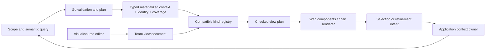

# Scoped display kinds and team-authored views — research for 260

Date: 2026-10-30. This is a design/research report, not an implementation claim.
The recommended direction is **one scoped result, several compatible display kinds,
and a declarative view document shared by visual and source editors**. Adopt the
useful contracts from oscope, Kindly, Plotje and Portal in Goo's Go/JSON/web-component
architecture; importing their Clojure runtimes is unnecessary.

## Updated user requirements

The latest user direction governs the recommendations below: Goo is prerelease
and needs no legacy format/API maintenance. Use one canonical scope/data/kind/view
contract; change callers, schemas, saved development formats and fixtures directly
where useful. Researching an older implementation identifies useful semantics, not
an obligation to keep its wire format, editor path or renderer API. Revision
references protect the meaning of current evidence/definitions, not a compatibility
floor for every earlier representation.

Every current chart/widget must be expressible through the canonical data and
plotting/composition grammar, including typed certainty/uncertainty and partial
states. Complete-data requirements are hard kind eligibility conditions. These
requirements are part of the first contract/inventory, even when implementation
proceeds incrementally; a successful generic line-chart pilot is not a parity verdict.

Evidence labels: **[R]** inspected repository code and checked-in tests; **[D]**
upstream documentation/source; **[P]** proposed Goo behavior. No sibling repository
was modified. Clojure/browser suites were not executed during this research, so
"implemented" below means code plus its test coverage, not a fresh runtime verdict.

## Findings that change the design

- **The editor the user remembers exists in oscope.** It is a bounded EDN text
  editor with server-rendered chart/Hiccup preview, example loading and progressive
  input preview. It is not a WYSIWYG layout/field-binding editor. Its strongest
  reusable feature is separation of query recipes from returned data. [R]
- **Plotje is `scicloj/plotje`, distinct from Plotly.** Its current alpha is a
  composable grammar of graphics with inspectable intermediate stages and output
  backends. Oscope implements its own bounded portable subset; it does not expose
  the entire current Plotje API. [R,D]
- **Kindly supplies display intent; Portal supplies much of the desired interaction
  model.** A kind is a request to present a value in a particular way. Portal
  filters registered viewers by compatibility, lets the selected value choose a
  preferred viewer, supports switching and keeps navigation history. Neither
  mechanism, by itself, defines safe telemetry queries or observability semantics. [D]
- **A chart library must not become the query grammar.** Changing table to bars over
  the same materialized result can be local. Changing a raw page to a full-population
  histogram requires an explicit different data request, even when the selected
  scope is unchanged. Count, rate, percentile and histogram semantics belong in
  Goo's Go planner and typed result contract. [P, consistent with Goo's existing RFC]

## 1. Oscope: the working pieces to reuse

Inspected sibling revision: `87a488c3d42a96b13ff52ff8d8fd26fdb003a6d1`.

| Piece | Actual implementation and evidence | Transfer to Goo |
| --- | --- | --- |
| Serializable edit document | [`visualization/document.clj`](https://github.com/chucklehead-dev/oscope/blob/87a488c3d42a96b13ff52ff8d8fd26fdb003a6d1/src/oscope/visualization/document.clj#L8): version2, kinds `plotje`/`hiccup`, original source text, bound data sources, ready/invalid state. Validation reconstructs the document from bounded source instead of trusting caller-provided parsed values. | One versioned document/AST; retain invalid draft text and explain errors without replacing the last valid view. |
| Query/data separation | [`plotje-from-screen`](https://github.com/chucklehead-dev/oscope/blob/87a488c3d42a96b13ff52ff8d8fd26fdb003a6d1/src/oscope/visualization/document.clj#L98) emits a reference plus selected output fields. Returned service names/counts/points are not copied into editable chart recipes. | Save scope/query bindings and field mappings, never accidentally serialize the preview's row values as a reusable definition. |
| Semantic source families | The same function has separate `telemetry-query`, `current-query`, `counter-query`, `histogram-query` paths. It deliberately preserves richer physical metric provenance where the generic gauge-only query cannot express it. [`PLOTJE.md`](https://github.com/chucklehead-dev/oscope/blob/87a488c3d42a96b13ff52ff8d8fd26fdb003a6d1/docs/PLOTJE.md). | Result families and kind compatibility must retain units, temporality, reset/bucket semantics, scalar-versus-distribution type and grain. Do not coerce them into one numeric array. |
| Portable chart subset | [`plotje/spec.clj`](https://github.com/chucklehead-dev/oscope/blob/87a488c3d42a96b13ff52ff8d8fd26fdb003a6d1/src/oscope/plotje/spec.clj#L8) bounds source text32768 characters,512 rows,48 columns,4 named sources and4 layers. Marks: line, point, bar, area, rule, tick. It validates source references, fields, colors, dimensions and finite numbers. [`plotje/svg.clj`](https://github.com/chucklehead-dev/oscope/blob/87a488c3d42a96b13ff52ff8d8fd26fdb003a6d1/src/oscope/plotje/svg.clj) renders SVG. | Use bounded schema-checked kinds with documented capabilities and a renderer adapter. Oscope's exact limits/syntax are examples, not inherited Goo requirements. |
| Safe presentation markup | [`hiccup/spec.clj`](https://github.com/chucklehead-dev/oscope/blob/87a488c3d42a96b13ff52ff8d8fd26fdb003a6d1/src/oscope/hiccup/spec.clj#L6): bounded text/node/depth counts; structural tags/attributes; escaped strings; no event attributes, scripts or URLs; tagged literals refused. | A small component-template AST is practical. Expose Goo display primitives rather than arbitrary HTML/CSS/JS to team-authored packages. |
| Mountable editor | [`ui/visualization_editor.clj`](https://github.com/chucklehead-dev/oscope/blob/87a488c3d42a96b13ff52ff8d8fd26fdb003a6d1/src/oscope/ui/visualization_editor.clj#L175): full form POST works without JS; JS adds debounced preview and example buttons; a closed document parser feeds SVG/safe markup. | Progressive enhancement and a shared source/visual representation are worth preserving. Textarea plus rendered preview is a useful advanced mode, not the requested final visual authoring experience. |
| Rebinding behavior | [`plotje-post-context`](https://github.com/chucklehead-dev/oscope/blob/87a488c3d42a96b13ff52ff8d8fd26fdb003a6d1/src/oscope/ui/visualization_editor.clj#L249) resolves the requested source family and query before rendering; literals remain detached from telemetry. | Explicitly separate rendering already supplied data from running a changed scope/query. Goo should not inherit automatic telemetry reruns on every editor keystroke. |
| End-to-end evidence | [`test/browser/oscope.spec.js`](https://github.com/chucklehead-dev/oscope/blob/87a488c3d42a96b13ff52ff8d8fd26fdb003a6d1/test/browser/oscope.spec.js#L68) covers real telemetry→metric series→Edit this chart→area/line changes, and a second test rebinds the same recipe after telemetry changes without changing editor text. [`visualization_editor_test.clj`](https://github.com/chucklehead-dev/oscope/blob/87a488c3d42a96b13ff52ff8d8fd26fdb003a6d1/test/oscope/visualization_editor_test.clj) covers mount paths, body bounds, missing sources, custom aggregate/bucket recipes and detached literals. | Reuse these journeys as acceptance patterns, not as proof Goo already implements an editor. |

Oscope also has a clean dependency direction: selection→command→effect→bounded
query→screen→views. Its workbench can apply host-specific Kindly advice only at
render time (`README.md` architecture section and `ui/workbench.clj`). That is a
useful fit for language-neutral Goo: OTel attributes remain telemetry; presentation
advice is separate application/package metadata.

The inspected editor provides render/preview routes, not a durable team-view catalog
or package-distribution workflow. Those would be new Goo work.

The oscope editor's progressive script aborts older requests, but its code should
not simply be copied as Goo's live/editor owner. Goo already requires generation,
visibility, origin and immutable-evidence guards. Preserve those stronger contracts.

## 2. The observability repository

Inspected revision: `ca7ae8a6250f2af3623d0c0cad26c9710a6bbc4d`.
A search of its tracked paths and relevant source/docs did not locate an equivalent
Plotje/Hiccup visualization editor. The concrete remembered editor is in oscope.
This is a bounded finding about these checkouts, not a claim about all historical
branches or external dependency repositories.

The relevant additional work is the lake UI and its
[Mosaic research](https://github.com/casselc/observability/blob/ca7ae8a6250f2af3623d0c0cad26c9710a6bbc4d/otel-chdb/research/mosaic.md).
That report documents a working analytical spike and measured constraints:
selection-driven linked views can be valuable; pre-aggregation may leave stale
cubes after replacing rows under the same table identity; browser engines can
truncate timestamp precision; and a coordinator's DuckDB SQL is not interchangeable
with ClickHouse SQL. These are prior report claims, not measurements rerun here.

For Goo, carry result identity/revision into renderer state, preserve exact
nanosecond references outside plotting coordinates, and translate interaction
intents through the Go planner. Do not put Mosaic's or Plotly's querying model in
charge of Goo's source, evidence or lifecycle contracts.

## 3. Kindly: a protocol for display intent

Upstream inspected on2026-10-30, main revision
`f7fe1b6ebe25ae182aeee822c6c203b15168e262`; README calls v4 beta.

- [`resources/kinds.edn`](https://github.com/scicloj/kindly/blob/f7fe1b6ebe25ae182aeee822c6c203b15168e262/resources/kinds.edn)
  defines supported display requests as data and generates APIs. Kinds include
  table, Plotly, Vega, Hiccup, Markdown and others.
- [`v4/api.cljc`](https://github.com/scicloj/kindly/blob/f7fe1b6ebe25ae182aeee822c6c203b15168e262/src/scicloj/kindly/v4/api.cljc)
  attaches `kindly/kind` and `kindly/options` metadata; non-metadata values can be
  wrapped. Display advice remains separate from the underlying value.
- The protocol is broad enough to include executable/Reagent/Scittle kinds. That
  breadth is not a suitable default team-template trust model for Goo. Borrow the
  display-intent distinction and registry, not every supported execution mode.

**Recommended translation:** a versioned, serializable preferred-kind descriptor
alongside a data/result reference. It is presentation advice and never changes the
scope, field meanings, source query or stored evidence. A compatible table/record
inspector remains an explicit alternative when a preferred kind is unavailable;
it is not a successful rendering or automatic downgrade of a blocked complete-only
kind. This is data inspection/accessibility recovery, not an old-format fallback.

## 4. Plotje: compositional graphics and inspectable planning

Upstream inspected main revision `b5c5ea778bce5b42a6e85adcc1945c91b6a69c8c`;
README labels it alpha. Plotje is not a Plotly wrapper.

Its [pose model](https://github.com/scicloj/plotje/blob/b5c5ea778bce5b42a6e85adcc1945c91b6a69c8c/notebooks/plotje_book/pose_model.clj)
is plain composable data: data, mappings, layers and options. The
[architecture](https://github.com/scicloj/plotje/blob/b5c5ea778bce5b42a6e85adcc1945c91b6a69c8c/notebooks/plotje_book/architecture.clj)
splits pose→draft→plan→membrane→plot. Draft flattens inherited options; plan resolves
geometry in data space; a later stage produces drawing primitives/output. Intermediate
values can be inspected and tested. The
[layer-type registry](https://github.com/scicloj/plotje/blob/b5c5ea778bce5b42a6e85adcc1945c91b6a69c8c/src/scicloj/plotje/layer_type.clj)
makes mark/stat/position capabilities discoverable.

[Extensibility](https://github.com/scicloj/plotje/blob/b5c5ea778bce5b42a6e85adcc1945c91b6a69c8c/notebooks/plotje_book/extensibility.clj)
separates statistics, scales, coordinates, positions, extraction and output backends.
`plan->plot` is a direct backend extension point, while other formats pass through
Membrane. Its docstring mentions Plotly as an example, but the inspected built-in
methods are SVG and buffered-image/PNG; no registered Plotly backend was found.
Do not mistake an extension example for an implemented Plotly adapter. Adopt the
staged contract and explicit capabilities without replicating every internal stage
as a new Goo abstraction.

[Interactivity](https://github.com/scicloj/plotje/blob/b5c5ea778bce5b42a6e85adcc1945c91b6a69c8c/notebooks/plotje_book/interactivity.clj)
is currently SVG/browser based and mark-specific: points/interval bars carry
row references/tooltips; some other marks accept options without drawing the
interaction. Its documented limitations make a useful counterexample: Goo should
never silently advertise unsupported selection, tooltip or axis capabilities.

**Recommended translation:** user-facing observability types such as latency
histogram, error-rate series, ranked breakdown, scatter, heatmap and trace waterfall
compile to a bounded renderer-neutral view plan. Plotly, SVG or another renderer
is an adapter. Users normally choose a kind and fields, not Plotly trace/layout
objects. Raw renderer configuration is a separately named advanced mode.

## 5. Portal: compatible views over the selected value

Upstream inspected master revision `16299380b3ce97429fe9f424984f795e84eae5c7`.
README's example dependency is0.68.1; that is not asserted as an immutable latest
release guarantee.

- [Viewers](https://github.com/djblue/portal/blob/16299380b3ce97429fe9f424984f795e84eae5c7/doc/ui/viewers.md)
  take values and render them; predicates filter compatible viewers; the selected
  value has a viewer dropdown. A metadata key can request a default viewer.
- [`portal.ui.api/register-viewer!`](https://github.com/djblue/portal/blob/16299380b3ce97429fe9f424984f795e84eae5c7/src/portal/ui/api.cljc)
  registers named viewer specs. The
  [inspector](https://github.com/djblue/portal/blob/16299380b3ce97429fe9f424984f795e84eae5c7/src/portal/ui/inspector.clj#L43)
  computes compatible viewers and reconciles explicit/default selections.
- [Selection](https://github.com/djblue/portal/blob/16299380b3ce97429fe9f424984f795e84eae5c7/doc/ui/selection.md)
  is keyboard-relative and supports ordered multi-selection.
  [History](https://github.com/djblue/portal/blob/16299380b3ce97429fe9f424984f795e84eae5c7/doc/ui/history.md)
  preserves navigation between derived values instead of turning every interaction
  into a new disconnected screen.

**Recommended translation:** put one **View as** control near the currently
selected result/context, not one renderer switch per dashboard card. List only
compatible kinds by default; an explanation can show why others need different
inputs. Remember a local choice for the same data identity. A team preference may
suggest a default but must not override an active user's compatible choice on
refresh or cause a source read.

## 6. Proposed Goo contract

This section is all **[P]**, not currently accepted wire syntax.

Use four boundaries:

1. **Scope/query definition:** selected signal, exact environment policy, time
   semantics, predicates, measure and grain. Go owns validation/planning and
   source execution. Existing telemetry packages and fixed questions are inputs.
2. **Materialized context:** a versioned immutable result identity/revision,
   schema, units, temporal representation, coverage/limits, original query/read
   clocks and bounded data products. It can contain records, series, bins,
   distributions or trace relationships. Do not reduce every family to untyped rows.
3. **Kind/view definition:** compatible input requirements, field bindings,
   defaults, view parameters, allowed presentation transforms, layout and declared
   gestures. No hidden fetching or changes to measurement semantics.
4. **Renderer plan:** checked concrete primitives/series plus stable selection
   references and accessibility alternatives. Built-in display components and a
   chart backend consume it; application owners handle effects/navigation.

The input descriptor should distinguish:

| Family | Required meaning carried beside values |
| --- | --- |
| Record page/selection | Original scope and page positions/occurrence references, row limit and completeness state. A page aggregate is labelled as loaded records only. |
| Time series | Time anchor, bucket boundaries, unit, dimension identity, gaps/unknown values and measure definition. |
| Distribution/histogram | Representation, explicit bounds, counts, exact/estimated quantile semantics and support. Never average scalar percentiles into a fleet percentile. |
| Trace context | Supplied span identities, parent relationships and ambiguity/partiality. No complete-trace claim from a partial page. |
| Comparison | Both scope/result identities, common scale, original windows, denominator/support and alignment policy. |
| Live context | Stream owner/epoch, watermark or observation state and a bounded current materialization. A display is not a subscriber. |

A kind registry entry needs stable namespaced ID/version, title, input contract,
parameter schema, default bindings, available gestures, limits and fallback. Use
schema/capability matching, not arbitrary package-supplied predicate code. Explain
incompatibility: "requires histogram bins; this value is a scalar p95" is useful;
a missing menu item with no reason is not.

Separate **switch representation** (zero source reads, same result identity) from
**derive/run another analysis** (explicit new plan/read with a related scope).
Rendering a histogram from20 inspected rows cannot silently become the full source
population histogram. A waterfall can show supplied spans with unresolved parents
but cannot synthesize missing ancestry. Exact timestamps/counts/decimals remain in
canonical strings or exact scalar representations; plotting coordinates may be
bounded approximations with exact tooltips/reference links.

### Quality, complete-only kinds and full-product expressiveness

The research suggests a broader input contract than a structural type predicate.
Portal's viewer predicates establish that a value can be rendered; Goo must also
establish that rendering it preserves the observability claim. Evaluate declarative
requirements in trusted registry/planner code. A team-contributed kind does not
supply arbitrary predicate code or attest to its own completeness.

Model quality separately from both display kind and exact numeric encoding:

| Facet | Canonical distinctions and examples |
| --- | --- |
| Value knowledge | Recorded value, exact declared derivation, estimate, bounded value, unknown, invalid, missing, not applicable. A count can be zero while its percentile is unavailable. |
| Representation | Exact integer/decimal/rational/time versus rounded labels or approximate drawing coordinates; exact encoding does not prove an exact physical measurement. |
| Bounds/statistics | Deterministic versus statistical intervals, method, assumptions, confidence level only when supplied, and inclusive/exclusive endpoints. Never manufacture uncertainty bands. |
| Coverage | Full/partial/unknown records, aggregate bins/groups/support, fixed-window intervals and relationship closure, relative to a declared scope and basis. |
| Collection | Known sampling/weights/collection guarantee versus unknown upstream coverage; exhaustive query results do not establish unsampled real-world telemetry. |
| Time | Event/read/evaluation/custody clocks, stale basis, late/corrected values and known/unknown clock uncertainty. |
| Relationships | Reported, declared or contextual association; resolved/missing/ambiguous/cyclic links. A complete returned page is not proof of complete trace ancestry or causality. |

These facets can apply at dataset, series, row/cell, bin or edge level. Go
transformations declare propagation: unknown required operands remain unknown;
estimated inputs do not silently become certain; missing/invalid values are not
zero; reset/gap boundaries cannot produce valid counter rates; scalar percentiles
cannot be combined into a fleet percentile. Bounds propagation needs a declared
method and assumptions, especially for ratios and correlated estimates. Custom
kinds must support the supplied quality states or refuse with a reason. Shared
app-owned quality/provenance chrome remains outside custom template control.

A complete-only kind declares **which aspect** it needs complete: all matching
records, full aggregate bins/groups/support, a closed fixed window, reported graph
closure, or a known collection/no-sampling guarantee. A source/planner result must
attest to that aspect for the exact dataset revision, scope, query/read basis and
relevant cutoff. A page length equal to a separately read count, an untruncated
response, or `hasMore=false` alone is insufficient. Complete empty input can be a
valid complete result that still renders No data; completeness and statistical
support are different requirements.

When a requirement is unmet, View as marks the kind **Requires complete data** and
explains an explicit acquisition/materialization plan, if supported. Partial or
unknown data cannot render a complete-only widget with a warning as a substitute.
A different partial-friendly kind may remain available, but it is not an automatic
semantic downgrade of the requested definition. The editor may validate/publish a
complete-only definition while its current partial preview remains blocked. Run
acquires data explicitly; every new revision/SSE update rechecks eligibility. If
coverage regresses, withdraw the current complete-only rendering or clearly retain
the last eligible frozen basis as stale.

Maintain an exhaustive existing-widget mapping: input shape + semantic roles +
quality facets + grammar declaration + renderer + typed interaction intents +
states/negative controls. Cover records/attributes/facets, stats/quantiles, ranked
breakdowns, time/grouped/value series, raw/native histograms and heatmaps,
comparisons/explanations, state intervals, trace waterfall/tree/timing/page breakdown
and service/host/Kubernetes/native resource widgets. Business/demo presentations
must be ordinary definitions. Specialized renderers are allowed, but no widget
may retain an opaque semantic escape outside the grammar because it is hard to
express as generic x/y series. Extend the canonical model when necessary, replace
the superseded path and tests directly, and make parity a completion gate.

### Reusable packages and templates

A service/team package should contribute kinds as compositions of trusted primitives,
plus named reusable views, semantic field requirements and optional semconv-aware
binding suggestions. Start with structural nodes such as stack, grid, text, stat,
record table, chart, tabs and scope-aware links. Loops/conditions bind only the
materialized context, with bounded iterations/node count. Strings are escaped;
actions are declared intents such as inspect-record or stage-filter, never inline
JavaScript, SQL, arbitrary URLs or direct backend calls.

Store namespaced identity, owner, versioned input contract, immutable revision,
parameters, default scope bindings and normalized AST. Keep instance preferences
separate from the published view revision. Resolve team/service defaults from
explicit discovery/manifest context; missing metadata is unknown, not permission
to broaden the selected scope. A package can be exported/imported through an
ordinary reviewed definition path; telemetry attributes themselves do not install
renderers. Trusted custom renderer code can be a later, distinct extension tier.

YAML is a sensible authoring format lowering to JSON/typed Go IR. KCL may generate
that same resource at build time. CEL can later supply bounded typed calculations
where Goo actually defines an evaluator and unit/null/error semantics. Do not
claim a general CEL/KCL runtime exists merely because the project direction names
it; current `go.mod` does not provide one. A small existing expression AST is a
better first step than expressions hidden in arbitrary template strings.

Reuse Goo's existing semantic resource distinctions in the canonical replacement:
[RFC0001](../rfcs/0001-observability-language.md) already separates population,
measure, view, dashboard and investigation; current `exploration/package.go` and
`workbench/exploration_views.go` implement narrower reusable resources with explicit
limits. Some current saved-intent families still reject environment selectors.
Replace those fragmented authoring contracts with the canonical scope binding;
do not add permanent adapter/shim layers or imply unsupported paths already work.

### WYSIWYG editor

The visual editor and source pane must edit **the same normalized view AST**.
Start from the current context: choose a compatible kind, bind fields using schema
chips/dropdowns, edit title/unit/legend/scale controls, arrange a small grid, preview,
then save a namespaced view revision. Component parameter schemas generate the
property controls. Keyboard reorder/property editing is a first-class alternative
to drag/drop. Preview uses the existing materialization unless the user explicitly
runs a changed semantic query.

Preserve draft state separately from last valid preview. Validation identifies the
node/field and the required capability. Undo/redo operates on document changes;
investigation navigation/selection history is separate. Source editing roundtrips
without silently deleting unsupported advanced nodes; keep such nodes read-only
in the visual editor until a suitable control exists. No generic freeform HTML/CSS
builder is needed for the first observability editor.

### Live updates and evidence

One application context owner subscribes to SSE/tail and supplies typed updates.
Display elements do not connect in lifecycle callbacks. Bind renderer caches,
selection references and pending gestures to result identity/revision; changed
scope, visibility withdrawal or a replaced epoch invalidates stale effects.
Preserve compatible user view preferences when a new batch arrives. Frozen Saved
and kept observations never become live by toggling kinds. A fresh read remains
explicitly related new evidence, not a reinterpretation of the old capture.

## 7. Suggested implementation sequence and acceptance

1. **Context adapter + kind registry:** adapt existing records, duration/time series
   and histograms to one canonical typed envelope. Inventory every existing widget
   family and required quality/completeness facets from the start; add View as and
   an accessible table alternative. Acceptance: compatible switching adds zero
   requests and preserves scope, exact references, quality and selection identity;
   complete-only kinds refuse unknown/partial data. No legacy-shim implementation.
2. **Base chart adapter + observability presets:** line/step/count-rate series,
   ranked bars, histogram, heatmap and scatter first. Specialized waterfall and
   evidence renderers consume canonical grammar plans too. Acceptance: every
   inventoried family is expressible without losing semantics; uncertainty and
   complete-only requirements propagate, chart/table agree, and input mutation,
   scope changes, hidden state or detach cannot publish stale gestures.
3. **Declarative view revision + minimal visual editor:** start with fields, kind
   parameters and small layout; advanced source pane uses the same AST. Acceptance:
   parse/render/edit/save/reopen roundtrip, invalid draft retention, escaped hostile
   values, keyboard authoring and no query-on-keystroke.
4. **Team/service distribution and defaults:** allow package contributions with
   compatibility explanations, immutable revision references and manifest/discovery
   suggestions. Acceptance: missing fields degrade honestly, defaults do not erase
   local choices and imports cannot cause hidden reads or execution. Current
   revision references preserve reproducibility without preserving obsolete APIs
   or wire formats; development fixtures can be replaced deliberately.
5. **Live context and richer interactions:** reuse current SSE/tail ownership;
   normalized brush/click/region intents stage scoped analyses. Add broader renderer
   escape hatches only when presets cannot express a justified task.

Use meaningful Hegel properties for typed-plan compatibility, exact scalar retention,
quality/completeness propagation, exhaustive family mapping and AST roundtrips;
Quint/MBT for editor/preview/Run/save/withdraw epochs; and real
Playwright/Bombadil tasks covering table↔chart, visual↔source, service contribution,
live refresh and frozen reopen. Do not call a renderer unit test proof that a query
or investigation task completed.

## Research scope and access

Official source READMEs and selected source/docs were fetched from allowed GitHub
raw/codeload hosts; revisions were resolved with `git ls-remote`. `api.github.com`
was denied by the configured proxy and was not bypassed. Remote archives were
bounded research inputs, not installed dependencies. External project status and
capabilities reflect these inspected revisions, not promised future releases.
