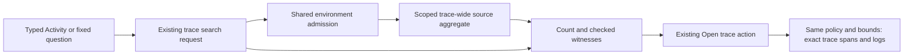

# Typed environment trace-wide search — 340

Status: source, generated semantics, four typed native profiles, observed model
replay and actor acceptance pass. The older scalar/ownership regression is a
separate gate recorded in validation. This is the general-purpose cut selected after [339](../POPULATION_CHROME.md).

## One environment policy through the existing workflow

The original trace-wide search required a scalar current-key environment name.
Ordinary Activity and Services exploration now commonly carries an effective
selector, including named, empty and unreported populations. Refusing those
contexts breaks the existing Find traces containing gesture; projecting them to
a current-only name would silently change the population.

The request now uses the existing query representation: either an explicit
current-only scalar name, or `environmentSelector` with a checked version, policy
and scope. A nonempty scalar together with a selector refuses. Current-only
selectors require a named scope. Effective selectors admit named, empty and
unreported scopes. Neither omission nor an empty scalar means all environments.
The scalar is a real current-only representation, not a fallback for typed input.

The shared checked environment selection drives source compilation. Names and
values remain bound parameters; physical OTel map keys stay in the source adapter.
The result echoes the whole original request. Client admission compares the whole
request, including representation and policy. Opening an admitted trace carries
those same bounds and environment fields into the existing exact-trace span/log
queries; it does not inherit the search conditions or the original service filter.

## Presence is evidence

Every condition witness includes both qualified resource keys:
`deployment.environment.name` and `deployment.environment`. These are added to
and deduplicated with the condition's ordinary field proof, in deterministic
qualified order. A null field value means absent; a present empty string remains
present. A witness no longer relies on a scalar fixture label or on a condition
happening to mention the environment.

| Selection | Matching record evidence |
| --- | --- |
| Current-only named | Current key exists and equals the requested name. |
| Effective named | Current key wins when present; otherwise legacy key exists and equals the name. |
| Effective empty | The winning key exists and is empty. A present empty current key masks a named legacy key. |
| Effective unreported | Neither key exists. |

A current value may legitimately differ from a legacy value in the same witness.
A condition on the shadowed legacy key can still be true; that does not change the
winning environment policy. Source and client check the actual two-key evidence
against the admitted selection. Independent reference execution reads the same
qualified raw fields rather than a separately normalized fixture string.

## Existing authority and limits remain

One to four conditions are independent existential tests over records with the
same valid reported trace ID inside the requested policy and half-open window.
Different conditions can match different services, or one span can satisfy several.
This does not imply an ordering, parent relationship, invocation identity or cause.

The source still makes one aggregate read. The full distinct trace count is
separate from the bounded lexicographic list and representative witness records.
Duplicate records remain in matching-record counts. Existing predicate, source
row, SQL, field-value and response budgets remain checked. Sampling, records
outside the fixed window and upstream telemetry completeness stay unknown.

Trace opening uses the existing owner/return flow and two independent exact-trace
reads. Search-result equality checks, late-response refusal, cancellation and
current-visit controls remain responsible for adoption. The checked policy must
survive through witness validation and continuation, not only the initial POST.

## Verification contract

The independent verification oracle branches directly on current/legacy field
presence and value. It does not call the production identity matcher. Existing
full-population intersection, numeric and witness-order properties now carry
explicit environment fields; contextual request generation also exercises typed
policies. New generated cases use constant physical resources across scalar,
current-only named, effective named, empty and unreported requests. Their totals
must differ by policy, preserve list-limit/full-count separation and survive record
permutation. Actual JavaScript builders and Go validation/compiler/reference are
executed, with detached input checks and named values kept out of SQL text.

The existing trace-search Quint model gains a return branch after its first checked
trace opening. The original ten-step path remains intact. Each new typed native
profile records six actions: parent read, local stage, search, local witness
inspection, two-signal exact-trace open, and source-free Back. The Go checker
requires the complete action list and independently validates fixture membership,
whole parent qualifiers, request echo, witnesses and both continuation queries.
Quint separately checks observable endpoint effects. A shortened prefix, changed
scope/witness, inherited contextual filter or unexpected Back read must refuse.

The native fixture should place legacy-only and mixed-key positives inside the
bounded list. Opening a legacy-only effective result then proves physical records
survive, rather than merely comparing DTO labels while all records also happen to
have the current key. Separate empty/unreported openings exercise absent/empty map
semantics. Existing search-ownership regression remains the cancellation and late
response gate; typed supplements must not weaken those checks.

No new search surface, query engine, layout framework or saved runtime-result
format is introduced. Production and verification use the configured Go 1.27.3
runtime; no dependency update is selected by this semantic feature.

## Observed source/semantic acceptance

Source review accepts whole-request detachment before source compilation/IO,
shared environment admission, both-key witness proof and independent reference
matching. UI request creation preserves the typed selector; result admission
checks exact request echo plus actual resource presence/value evidence. The existing
trace reader already carries the complete environment representation and creates
trace-ID-only span/log queries within the original bounds. No new read owner is
introduced.

The scheduled semantic gate passes in 31.770 seconds, zero skips/failures:

- `TestHegelTraceSearchIndependentIntersection`: 90 existing independent-oracle
  cases, now with explicit raw environment evidence (1.67 seconds).
- `TestHegelTraceSearchContextualClientRequest`: 70 actual JavaScript contextual
  builder cases across typed policies, preserving the original condition-one
  qualifiers without leaking them into the added condition (12.73 seconds).
- `TestHegelTypedTraceSearchEnvironment340`: 40 generated cases, each checking
  scalar/current-only/effective named/empty/unreported over constant physical
  resources, actual JS request creation, Go compiler/reference, parameter binding,
  full-count/limit separation, detached input and order invariance (12.07 seconds).
- `TestTypedTraceSearchPolicyContrasts340`: shadowed legacy predicate, legacy-only
  effective population, unreported evidence and invalid representation contrasts
  (0.01 seconds).
- `TestQuintTypedTraceSearchModel340`: existing model's checked-return branch,
  strict unfinished-prefix guard and negative unexpected Back source read
  (5.24 seconds).

Existing ten-step source-search and eight-step ownership models have not been
claimed as rerun by that generated gate. Their actual old native paths remain the
separate regression check. New native typed-profile replay must still validate
all four physical policies, witnesses, continued queries and source-free return.

## Final typed native acceptance

The final native 340 journey passes in 3.1 minutes (3.2 total), with observed
Go/Quint replay in 31.021 seconds. Independent raw review confirms four profiles:
effective named 15 matching trace IDs, current-only named 13, effective empty 2
and unreported 1. The bounded effective/current lists retain their full counts;
separate full-list probes include same-span and disconnected cross-service matches.

Each profile records the complete six-action path ending at four source requests.
Every actual exact-trace opening reads three spans and one log with the original
typed policy and fixed bounds. Effective opening uses a legacy-only trace, so a
weaker current-only projection would fail the physical row check. The independent
Go oracle checks representative witnesses and both raw environment keys, including
nil absence, empty values and conflicts. No browser errors or seeded definitions
are reported; the fixture is ordinary OTLP.

Typed supplements also pass a retired/closed held response and a deliberately
wrong echoed policy; those two request attempts are outside the four profile
ledgers. Close-search controls are independently center-hit-tested in the viewport
for all profiles (tops approximately 486, 485, 486 and 662px), and checked-trace
Back actions retain reachable focus/controls. These are real interaction checks,
not merely programmatic DOM invocation of hidden buttons.

The 40-second actor passes with 435 snapshots through phases 0–8, four verified
transitions, four source requests, preserved typed policy and no horizontal
overflow. Actual Playwright frames separately show the unreported label, three
span records, an exact-trace linked log, fixed-window scope and coverage-unknown
wording. Driver screenshots are not used as terminal visual evidence. Existing
scalar main/ownership replay remains a separately reported regression rather than
being inferred from these typed results.

## Next depth candidate — 341 (proposal only)

The next ordinary task is “did latency change, or only traffic volume?” Existing
source already provides most of the machinery:

- `DurationSummary` stores exact decimal sum-nanoseconds/count, validates the
  128-bit sum and 64-bit record count, and keeps zero-duration observations distinct
  from `no_data` (zero contributing count).
- Ordinary span queries and the aggregate-only baseline endpoint already support
  `summary: span-duration`; adapters validate duration/count/group conservation.
- `/api/compare` already emits duration summaries and exact rational
  `ViewComparison` changes, including `duration.mean`. Existing supplied
  measure-summary components can display these fields with units and receipts.

The present gap is natural declaration/presentation: the previous-window button
requires an aggregate Count display, comparison declarations pin display.value to
count, and the supplied count-pair presenter explicitly chooses only the count
field. A span-duration query can already carry duration data through that count
path, but it does not naturally expose mean duration as the comparison task.

Bound 341 to ordinary fresh previous-window span mean comparison plus its
contributing record counts, using existing source aggregation and checked
comparison results. Preserve typed environment, qualified grouping, each full
predicate, adjacent equal-duration windows, explicit staging/Run, independent
read clocks, no-data/diagnostic states, Back and saved-definition behavior. Derive
means from each whole-population sum/count, not loaded inspection rows, per-group
mean averages or scalar percentile averages. Keep exact rational authority while
formatting human-readable milliseconds at display time.

Acceptance should distinguish positive-count zero duration from empty populations,
unequal population sizes, group-weighting traps, values above 2^53, inconsistent
source reads and unavailable deltas. No new aggregation API, query engine or
capture custody model is justified. Per-category duration comparisons, percentile
expansion, status/error comparisons and broader captured-measure authoring are
outside this first depth contract. This is a future proposal, not 340 delivery.
