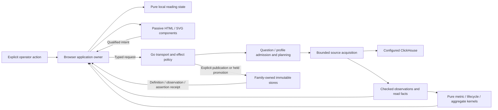

# Whole-system architecture: understandability and simplicity

Reviewed 2026-11-17 against `9119a967`, after the seven component walkthroughs and
reviews were complete. This is a source/architecture review, not an implemented
refactor or a new performance benchmark. No production code changed.

## Assessment

The product has a coherent foundation: one Go runtime, typed source questions,
pure semantic kernels, application-owned interaction and passive display. The
main obstacle is **seeing those boundaries in the implementation**. Dense authored
JavaScript and large owner/coordinator functions make a reader reconstruct several
lifetimes before understanding one action. Historical documentation compounds
that cost.

An afternoon should be enough to trace one flow, identify its authorities and
make a bounded change. It is not a credible promise that every profile and
failure condition in the application can be mastered in an afternoon. The new
[walkthrough index](../../walkthroughs/README.md) sets the right scope.

The target is a smaller mental model, not fewer directories or one universal
engine. Keep the existing product architecture; make its implementation outline
ordinary and explicit.

## Target responsibility map

This graph describes responsibility, not a proposed package renaming or new
framework. The browser owner remains responsible for which snapshot may act;
Go remains authoritative for source and storage admission. Instrumentation and
the collector supply ordinary OTel data independently of the product server.

## Ranked changes

| Order | Evidence and architectural cost | Bounded change and acceptance |
| --- | --- | --- |
| **1. Readable authored source and one effect map** | [`population-workspace.mjs`](../../../ui/population-workspace.mjs), [`captures.mjs`](../../../ui/captures.mjs) and [`documents.mjs`](../../../ui/documents.mjs) pack distinct state, DOM, callbacks and effects into long statements. [`app.mjs`](../../../ui/app.mjs) wires callbacks and global events without one owner/effect index. | Format representative owner/component files first, separately from semantic edits. Add a compact publisher → consumer → read/write/local-only → lifetime table beside the application walkthrough. Prefer existing injected callbacks for local one-to-one handoffs. Acceptance: a reader can locate entry, retirement and side effects without reconstructing compressed closures. Do not introduce a new event bus. |
| **2. Replace retained private DOM snapshots with explicit owner reading state** | [`investigation-trail.mjs`](../../../ui/investigation-trail.mjs) `leave` captures every `goo-*` element's child nodes, and `restore` / `select` reconnect the view then replace those children. The trail therefore knows private presentation structure and reconnect behavior. | Start with one retained record-result owner. Let that owner capture/restore bounded reading state or explicitly retain a view with a documented suspend/resume contract. Keep source/publication authority out of snapshots. Acceptance: original inspector/Find/page/scroll and eight-visit bounds survive; Return makes no source read; stale callbacks stay withdrawn. This is a coupling risk, **not a proven current broken callback or memory leak**. No global state framework is required. |
| **3. Decompose large browser owners by lifetime** | `population-workspace.mount` owns execution, result actions, declaration editors and preservation wiring. Capture/document owners similarly mix read visits, drafts and publication recovery. These need different cancellation and retirement rules. | Extract a query/result owner, a cohesive presentation-editor owner, and publication adapters as named units around existing pure helpers. Keep a short composition function that shows their connections. Use 462's pure reading-state extraction as a bounded precedent, not a universal reducer. Acceptance: hidden/stale/ABA, pending-write, local-kind-change and Return tests remain meaningful; no source capability moves into a passive widget. |
| **4. Expose backend acquisition and semantic phases** | [`Source.fetchProfile`](../../../exploration/source.go) combines freeze/compile, population and row reads, optional supporting reads, consistency assessment and dataset construction. [`measurements/source.go`](../../../measurements/source.go) combines compilation, raw decoding and profile dispatch; [`Definition.Validate`](../../../measurements/model.go) carries a large profile cross-product. | Keep visible typed coordinators with named internal stages: admit/freeze, plan, acquire, decode, assess consistency, evaluate, project. Compute invariant profile facts before row loops. Acceptance: query/parameter bytes, source-read order/count, exactness, rejecting inputs, partial/changed-source states and custody behavior stay unchanged. Do not replace stages with a runtime plugin registry or remove public admission checks merely because internal calls repeat them. |
| **5. Make contract/carrier relationships finite and visible** | Ordinary field metadata is repeated in the Go model/compiler/CEL declarations. Capture families and environment policies span Go and JavaScript carriers. Display shape, runtime provenance and query-bound declaration checks look similar but grant different things. | Maintain one small matrix per existing boundary and consolidate only identical metadata: ordinary field name/type/signal mapping; carrier scope/support; display shape → producer → witness → kind. Preserve a separate CEL exposure allowlist. Use rejecting cross-language fixtures for wire parity rather than sending server SQL metadata into the browser. Acceptance: a new field or carrier has a short auditable checklist; copied completeness JSON still cannot grant complete-only rendering. |
| **6. Clarify preservation domains before merging stores** | [`workbench.Store`](../../../workbench/store.go), [`CaptureStore`](../../../exploration/capture_store.go), held-observation stores, operation [`investigations.Store`](../../../investigations/store.go) and optional [`retention.Store`](../../../retention/store.go) are active but their names obscure configuration, observation, assertion and custody meanings. | Put these five meanings in one compact store/receipt table; rename the operation-evidence owner if it stays. Standardize genuinely identical bounded JSON and publication primitives. Product must decide overlap before combining an operation envelope with a generic capture family. Acceptance: every registered route names one owning store and write outcome; Save, Keep and Capture remain distinct; uncertain publication is not rewritten as failure or reread. No universal repository/retry abstraction is justified. |
| **7. Reduce development-system ambiguity and historical authority** | Default local checks omit nested application modules; generic journeys enter reservation-lab lifecycle through [`run_journeys.sh`](../../../scripts/run_journeys.sh). Current behavior is scattered among very large validation and verification ledgers. | Provide one current module/check matrix, separate generic journeys from reservation fixtures, and turn historical narratives into clearly labelled reference material. Keep the walkthroughs as the code entry, not another independent specification set. Acceptance: a fresh contributor chooses one truthful fast check and one relevant integration path; required skips fail; generic source journeys do not need reservation Redis. Preserve only diagnostic artifacts with a reproduction, contract or explanatory purpose. |

## Boundaries worth keeping

Source inspection confirms that these are deliberate distinctions, not dead
layers to collapse:

- [`queryhttp.ReadHandler`](../../../internal/queryhttp/handlers.go) shares small
  typed wire mechanics, while family effects and mixed publication lifetimes stay
  explicit. [`configuredHTTPServer`](../../../cmd/goo/serve_http.go) composes one
  runtime; there is no product Python proxy to remove.
- Record predicates/CEL, native metric intervals and prepared subject facts have
  different semantics. CEL is checked condition authoring, not a replacement
  optimizer or a general authority to run SQL.
- Structural display validation, admitted-source/runtime witnesses and question
  compatibility are different checks. They should become easier to navigate,
  not one caller-supplied `complete` flag.
- Source reads can be cancelled; publication can have an uncertain acknowledged
  outcome after disconnect. A shared retry or disposal wrapper must not erase
  that difference.
- Physical schema compatibility, observed inventory, semantic eligibility and
  display eligibility are separate facts. A common presentation may explain them;
  one permissive support boolean would make the design less coherent.

## Deletion, performance and reliability

The component reviews established a few small removal candidates: unused aliases,
literal-only dependency shims and redundant protocol re-export indirection. They
did **not** prove an entire production feature, store or chart family dead.
`grammar.py` is an active offline reference, not a product gateway. Retiring it is
possible in this prerelease after moving any uniquely useful assertions; its
language alone is not evidence of dead work. No compatibility floor requires
keeping an obsolete format, but current callers and saved-artifact contracts must
be identified before declaring one obsolete.

Performance work should target measured costs: retained DOM/listeners through
eight visits, repeated validate/compile/copy inside a single native run, and
filtered revision catalogs near their declared bounds. Document the combined
ordinary-query and Tail budget exposure; they are separate admissions. Do not
parallelize independent source reads, add indexes/pools, or weaken immutable
copies without showing the workload, desired semantics and allocation/latency
change. The current review demonstrates structural complexity, not a new latency
regression.

## Sequence and coverage

Begin with formatting and the effect/carrier/store maps. Characterize one retained
visit's behavior, then replace its private-DOM restoration and extract one editor
owner. Only afterward simplify the backend stages and consolidate checked field
metadata. Run focused semantic/owner tests at each boundary, followed by relevant
actual-source browser/model traces; do not require every campaign for a comments-only
patch or substitute unit success for source/persistence behavior.

The seven walkthroughs cover the major application and delivery components.
Remaining onboarding gaps are cross-cutting tables—event/effect ownership, carrier
admission, store meanings and current check tiers—not evidence that more feature
manuals or another framework are needed. Add those tables to their existing
walkthroughs as the corresponding refactor proceeds.

This review inspected the walkthroughs, all component findings and representative
runtime, acquisition, typed-handler, view-composition and retained-navigation
source. Existing tests were read to understand their boundaries. It did not run a
new browser, load, heap or live-store campaign, and makes no such acceptance claim.
