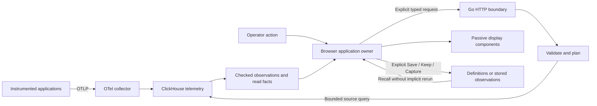

# Understand Goo's code

Goo is a Go observability workbench over existing OTel-shaped ClickHouse data.
The browser owns interactive reading state; Go validates and executes explicit
questions; shared display elements render supplied observations. Definitions and
stored observations are separate things.

These walkthroughs explain the current implementation. Each offers an afternoon
reading path: trace one concrete flow, locate its owners, and understand its
boundaries before changing it. That is an orientation goal, not a claim that all
features and edge cases can be mastered in one sitting. Use the focused checks
in each chapter when changing that component.

## Choose a component

| Component | Start here | Main source territory |
| --- | --- | --- |
| Runtime, HTTP and ClickHouse access | [Runtime](runtime.md) | `cmd/goo`, HTTP/source packages in `internal`, acquisition in `exploration`, OpenAPI |
| Questions, CEL and measurement semantics | [Semantic core](semantics.md) | `querycel`, `measurements`, `metrics`, `lifecycle`, `identity`, `subjectfacts`, `scopedview`, semantic planning in `exploration`/`workbench` |
| Live activity and application interaction | [Activity](activity.md) | browser workspace, query/filter owners, Tail, paired Activity, held chronology and Return |
| Data model, reusable views and rendering | [Presentation](presentation.md) | passive web components, plotting/view grammar, kinds, editor, shared CSS/accessibility |
| Discovery, service views and metric entry | [Discovery and metrics](discovery-metrics.md) | source compatibility, services/host/Kubernetes profiles, instrument discovery and raw/evaluated entry |
| Saved questions, observations and investigations | [Preservation](preservation.md) | capture/revision/retention stores, findings, labels, temporal adapters and corresponding browser owners |
| Instrumentation, lab, verification and delivery | [Delivery](delivery.md) | annotations/weaving, nested modules, examples, OTel lab, build/CI, Playwright/Bombadil/Hegel/Quint/gotogether |

Some directories span chapters. For example, `exploration` includes both semantic
planning and physical acquisition; `ui` includes application owners and passive
display elements. Follow responsibilities rather than assuming a directory is a
single layer. The seven chapters collectively cover the main product and its
supporting development system; they do not list every file.

## Follow one end-to-end flow

Start with Activity's **Start → inspect → narrow → Hold → Return** path. Then
follow runtime acquisition and the semantic predicate compiler. Read preservation
before changing anything named Save, Keep or Capture. Read presentation before
adding a widget. Read delivery before assuming a root test command covers the
whole repository.

## Find the effect owner

| Operation | First owner to inspect | Effect to distinguish |
| --- | --- | --- |
| Find, page, change a held display | Browser reading state / passive component | Local work; no source read |
| Check a CEL condition | Filter owner → checked planning endpoint | Server validation/planning, not a telemetry query |
| Start / Apply / Run | Application query owner → typed Go route/source | Explicit bounded source work with cancellation and current-result admission |
| Save definition or narrative | Application publication owner → `workbench.Store` | Durable configuration or authored interpretation, not observed rows |
| Keep held observations | Current held-membership owner → kept-observation store | Promote admitted held observations without substituting a new source read |
| Capture | Application capture owner → `exploration.CaptureStore` | Explicit source read and stored result; separate read and publication outcomes |
| Operation evidence | Operation routes → `investigations.Store` | Operation-package evidence, distinct from narrative investigation documents |
| Optional temporal publication | Explicit retention adapter → `retention.Store` | XTDB transaction/await/retry semantics, not a replacement for local stores |

Use the linked component chapters for exact route registrations, caller guards
and budget policies. This table is a map of responsibilities, not a global effect
registry or a claim that every family accepts every carrier.

## Boundaries to preserve

- Display elements receive data; they do not gain source, navigation or storage
  authority merely by mounting or opening a disclosure.
- A source query is different from a local Find, page or related-record scope.
  Return must not depend on the original row still being visible.
- A saved definition is configuration. Capture may read new observations; Keep
  preserves only supported held observations. Report actual write outcomes.
- Event time, source read time and stored/custody time describe different events.
  Missing or partial telemetry never proves health or completeness.
- Standard OTel attributes are the interoperability surface. Optional manifests
  and Go annotations enrich that surface; ordinary data must remain useful.

## Scope and provenance

The component review began at commit `9119a967` on 2026-11-16. At that point the
tracked repository contained 281 non-test Go files (44,692 physical lines), 285
UI ES modules (14,608 physical lines), and 969 Markdown files under `docs`
(126,581 physical lines). Go counts include examples and nested modules; Markdown
includes historical reviews and storyboards. Compressed JavaScript makes physical
line counts a poor complexity metric. These numbers describe the reading footprint,
not code quality or runtime performance.

The associated [review index](../reviews/understandability/README.md) distinguishes
current behavior, observed problems and proposed changes. It records the later
whole-system Go, architecture and product reviews. Review recommendations are not
implemented features unless the implementation record explicitly says so.
