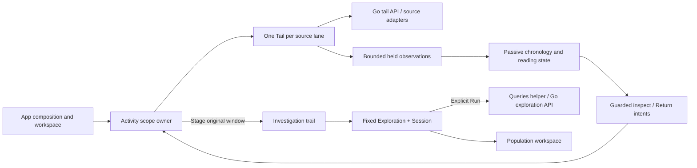

# Activity and fixed investigations: a code walkthrough

This component turns a chosen telemetry scope into a live stream or a fixed
question, and lets an operator leave and return without silently reading again.
It is the application owner above the passive display components. It does not
implement ClickHouse SQL or durable storage; those are separate backend owners.

The current behavior is explainable in an afternoon. Reading every line of the
current owner files is not: several combine large amounts of UI construction,
execution and feature wiring. Use the path below, then follow one interaction.
The [component review](../reviews/understandability/activity.md) identifies the
specific code changes needed to make the source itself easier to read.

Declared Operations is now a tab under Services, not another workspace route.
`ResourceTabs` owns its visibility; the existing operation reader is cancelled
on tab leave and Saved return selects the same tab. Its backend/store is retained.
In `app.mjs`, `clearOperationViews` resets the shared display slots for both live
and saved rendering. `clearOperationEvidence` additionally withdraws the live
selection and its title, diagnostics and window label before another read. The
request controller and generation guard still own cancellation and publication;
the display reset never starts a read or modifies stored evidence.

Reusable authoring lives under Saved. `savedTabs` chooses evidence or definitions;
`definitionTabs` chooses records, measurements or application contracts.
`openDefinitions` is the single contextual entry for question drafts and annotated
packages. The record editor's visibility handler retires pending work on either
tab or workspace departure. Display tabs do not read telemetry; Preview and Run
remain explicit actions. Evidence/document open events select the evidence tab.

## An afternoon reading path

Read the named functions, not every imported feature implementation.

| Order | Source | What to learn |
| --- | --- | --- |
| 1 | [`workspace.mjs`](../../ui/workspace.mjs), `mount` / `navigate` | Route and panel visibility; navigation itself does not execute telemetry. |
| 2 | [`app.mjs`](../../ui/app.mjs), mounts around `appWorkspace` / `activityEntry` | The composition root connects Activity, fixed visits, services, measurements and Saved. Generic startup and configured lab startup differ. |
| 3 | [`stream-entry.mjs`](../../ui/stream-entry.mjs), `EntryGate` / `mount` | Fresh-entry scope, single versus paired mode, staged filters, Start/Apply and Activity-to-fixed handoff. |
| 4 | [`tail.mjs`](../../ui/tail.mjs), `TailBuffer`, `SSEParser`, `connect`, `halt` | One live source, bounded observations, frame admission, cancellation, gaps and retry. |
| 5 | [`question-session.mjs`](../../ui/question-session.mjs), `Session` / `identity` | Pure fixed-query lifecycle and rejection of stale or mismatched results. |
| 6 | [`filter-editor.mjs`](../../ui/filter-editor.mjs), `mount` | Editable conditions and optional CEL checking; the caller owns applying them. |
| 7 | [`paired-activity.mjs`](../../ui/paired-activity.mjs), `hold.onclick`, `inspect` | Two independent sources, frozen chronology and guarded observation-window handoff. |
| 8 | [`chronology-reading.mjs`](../../ui/chronology-reading.mjs) | Immutable Find/page/related/Return transitions without DOM or IO. |
| 9 | [`investigation-trail.mjs`](../../ui/investigation-trail.mjs), `create`, `leave`, `select` | Up to eight in-memory fixed visits, suspension and local restoration. |
| 10 | [`exploration.mjs`](../../ui/exploration.mjs), `mount`, `openQuestion`, `run`, `suspend` | Fixed-query admission, execution, result actions and population workspace wiring. |

Allow about 30 minutes for composition and scope, 45 for one Tail, 45 for the
fixed session/filter path, and 60 for paired Hold/Return and the focused checks.

## Follow one operator journey

1. **Choose scope and Start.** `app.mjs` mounts `StreamEntry` after UI
   configuration arrives. Generic startup does not automatically read an unknown
   source. Configured lab startup may claim a fresh-entry automatic start through
   `EntryGate`. `stream-entry` owns the authored environment, signal and conditions;
   `RecordScopeDraft` keeps the environment selector separate from input text.
2. **Receive observations.** `Tail.mount` posts the selector to `/api/tail` and
   consumes an SSE response using `fetch` and a reader, not `EventSource`.
   `SSEParser` frames bytes; `connect` checks sequence, selector, connection,
   timestamps and read-window facts before appending to `TailBuffer`.
   Reset, batch and gap are distinct events. A bounded bank is not a complete
   population, and a completed empty read differs from a failed read.
3. **Find locally or Apply a source condition.** Loaded-record Find narrows only
   the retained presentation. A field action stages a condition. `FilterEditor`
   can check CEL through planning endpoints, but it does not start telemetry.
   The owning Apply handler adopts the checked condition and starts a source
   explicitly. Scope epochs invalidate old actions even if a later scope has
   identical text.
4. **Hold both lanes.** In paired mode, `PairedActivity` owns two `Tail` instances.
   Hold pauses them and calls `held-chronology.prepare` to admit immutable display
   observations. The chronology receives independent lane selectors, clocks,
   limits and occurrence keys. It has no subscription or preservation tokens.
5. **Inspect and follow context.** The application resolves an inspect intent
   against its original held-occurrence map. Related held records is a local
   exact-TraceId subset, optionally narrowed to the anchor SpanId. Parent context
   uses held span observations; duplicate parent candidates remain ambiguous.
   `chronology-reading` saves the first return point independently of later
   inspection or re-anchoring. Explicit Return restores that original inspector
   even when Find or paging hides its row, with visible Find as the focus fallback.
6. **Analyze a fixed window.** Analyze observation window stages the selected
   occurrence's original selector and poll window through the app callback.
   `InvestigationTrail` creates an `Exploration` visit; a later explicit Run reads
   it. `Session.start` returns a generation. `Session.publish` accepts only the
   current running generation and matching question identity. Source HTTP reads
   use [`queries.mjs`](../../ui/queries.mjs), whose abort handling also requests
   server cancellation and rejects a late body.
7. **Return.** Activity and fixed visits retain local view state. Suspension
   revokes result actions, aborts current work and stops hidden live sources.
   Returning resumes the held presentation; Start/Run remains explicit. This is
   tab-local memory, not a saved question, capture or durable investigation.



## Where the larger population workspace fits

[`population-workspace.mjs`](../../ui/population-workspace.mjs) is the owner for
fixed population questions, independent comparison sides, breakdowns, view
composition, definition editing and result interactions. `Exploration` mounts it;
Activity can stage a completed-window question into it. It delegates to checked
pure query/view helpers and passive charts, but presently also contains many
nested form and preservation adapters. Start with `mount`, `run`, `stage`,
`suspend`, `resumeHeld` and the returned API. Its individual form builders are a
second reading session, not prerequisites for understanding the source lifecycle.

## Rules to keep in mind

- Navigation, reading-state changes and display disclosures do not imply a read.
- A selector describes source scope; a generation/epoch describes a current
  operation. Equality of selectors alone cannot authorize an old callback.
- Source cancellation and publication acknowledgment have different lifetimes.
  Do not cancel a pending durable write merely because its originating view hides.
- Original occurrence window/read clock, latest source read, and stored evidence
  time are different facts. Preserve all three meanings.
- A selected row may be absent from the current page or Find result. Restore its
  identity through the owner, not by searching for a visible button.

## Verify the path

```sh
node --experimental-test-module-mocks --test \
 tests/tail.test.js tests/stream-entry.test.js tests/question-session.test.js \
 tests/paired-activity-start-445.test.mjs tests/investigation-trail-visit.test.mjs \
 tests/chronology-reading462.test.mjs
```

All six files passed during this review, zero skips. For physical OTLP/source
behavior, use the [related-record storyboard](../journeys/related-held-records.md)
and its explicit Go runtime/lab prerequisites. This walkthrough review did not
rerun those browser campaigns or certify production deployment behavior.
