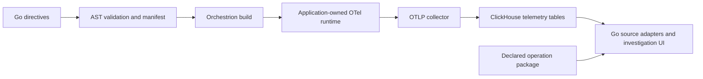

# Delivery, instrumentation and verification

Goo ships as one Go executable. Go applications can optionally publish Goo-specific
operation observations through ordinary OpenTelemetry; manifests describe what
was declared. The lab supplies data and failure scenarios. Verification tooling
checks semantic rules and actual user journeys; none of it is a product gateway.

This walkthrough describes the code as reviewed on 2026-11-16. Read it alongside
the [system overview](../SYSTEM_OVERVIEW.md), then follow this path in an afternoon.

## Read-first path

| Order | File or entry | What to learn |
| --- | --- | --- |
| 1 | [CONTRIBUTING.md](../../CONTRIBUTING.md), [Makefile](../../Makefile) | Normal build/test entry points and the nested-module caveat. |
| 2 | [annotations/manifest.go](../../annotations/manifest.go), `ScanDir` | Go AST/directive validation, source digests and the declaration manifest. |
| 3 | [instrumentation/orchestrion.yml](../../instrumentation/orchestrion.yml) | How `goo:operation` and `goo:event` directives insert hooks. |
| 4 | [instrumentation/runtime.go](../../instrumentation/runtime.go), `NewRuntime`, `BindDefault`, `Runtime.Operation/Event` | Provider ownership, finite outcome accounting and safe deferred completion. |
| 5 | [scripts/build_operation_app.sh](../../scripts/build_operation_app.sh), [examples/operation-app/main.go](../../examples/operation-app/main.go) | Scan before weaving; application-owned OTel providers and actual export setup. |
| 6 | [compose.yaml](../../compose.yaml), [config/collector.yaml](../../config/collector.yaml) | Independent lab services and OTLP-to-ClickHouse data flow. |
| 7 | [journeys/support/cross-app.js](../../journeys/support/cross-app.js), `startBombadil`, `verifyWithGo` | Browser-driver orchestration, explicit native checks and rejection of skipped verdicts. |
| 8 | [scripts/verify_optional.py](../../scripts/verify_optional.py), [verification/toolchain.json](../../verification/toolchain.json) | Pinned optional verification prerequisites and test-event validation. |
| 9 | [.github/workflows/api-contract.yml](../../.github/workflows/api-contract.yml), [.github/workflows/retention-driver.yml](../../.github/workflows/retention-driver.yml) | What CI actually checks, including API drift and native XTDB. |
| 10 | [.ko.yaml](../../.ko.yaml), [Dockerfile](../../Dockerfile), [container guide](../CONTAINER_IMAGES.md) | Minimal product image versus a source-configured lab image. |

## From source annotation to observed application

A function comment such as `//goo:operation name:checkout role:server` is input to
`annotations.ScanDir`, not executable behavior by itself. The scanner checks a
bounded dialect and function signature, then records source digests, declarations
and expected signals. The root CLI exposes this as `goo manifest`.

The sample build script validates the source package first, then invokes the
module-pinned Orchestrion tool. Its advice updates the function's named context,
starts an operation, and defers completion. Error and panic paths remain distinct;
a panic is rethrown. Event advice records successful-return events and evaluates
subject/outcome selectors only when the runtime is bound.

The application creates its metric/tracer providers, constructs a Runtime, then
binds woven hooks once. It owns provider shutdown. Operation completion is guarded
by `sync.Once`: repeated completion cannot decrement active work twice. The runtime
uses OTel counters, a seconds histogram, spans and a bounded initialization map.
Never-invoked operations do not gain invented zero observations. A manifest is a
source declaration, not proof that a deployed process emitted anything. Events
require a recording parent span and explicitly scoped subject identity; dropped
selectors/parents are diagnosed. A successful-return event does not establish
transaction commit or durable business completion.



Ordinary OTel applications need none of this annotation machinery to use Goo.
The Python reservation services and Go operation/report applications are independent
workloads. `config/collector.yaml` batches logs, traces and metrics into ClickHouse.
Goo reads that stored telemetry; it does not become the application exporter or
collector. Configuration packages under `config/operations`, `config/measurements`
and `config/views` supply declared lab examples. `prebuilt` is a live Go catalog/
expansion package, not the retired reservation compiler.

## Build and test loop

Use the compiler pinned in `.go-version` (currently Go 1.27.3) and the Node/npm
versions documented for verification. Start with no containers:

```sh
go build -o /tmp/goo ./cmd/goo
go test ./...
npm ci
npm run test:visualizations
(cd instrumentation && go test ./...)
(cd examples/operation-app && go test ./...)
(cd examples/report-app && go test ./...)
```

Root `go test ./...` cannot discover nested Go modules. Optional `verification`,
`verification/weaving` and `verification/gotogether` are separate on purpose:
Hegel, Quint, Orchestrion and gotogether are not product dependencies. The
[verification guide](../../verification/README.md) gives prerequisite-aware native
commands. `python3 scripts/verify_optional.py --help` exposes the bounded offline/
woven runner. It validates exact tool versions and named Go test events; skips
are not successful coverage. The gotogether control entry is
`npm run test:gotogether-controls`; its dependency is pinned in its own module.

For real data, follow the [lab guide](../LOCAL_LAB.md), then
`npm run test:journeys`. The wrapper currently pauses lab traffic, drains the
reservation stream and restores traffic on exit. Generic-runtime journeys may be
run directly with Playwright and an explicit `GOO_GENERIC_BINARY`; inspect their
own setup requirements. They often launch an isolated runtime on port 18088, so
run those journeys serially.

Playwright exercises intended gestures and creates documentation frames.
Bombadil independently explores allowed actions/invariants. Native Quint checks
observed traces, and Hegel generates property cases; simulated records are not
physical ingestion evidence. Actual SQL/API measurements distinguish a local
interaction from a source read. A journey can pass only the checks it actually
executes—no single command represents every module, source or deployment.

## Shipping and diagnostics

`make image` uses pinned ko and a digest-pinned nonroot distroless base, loads a
local image and does not publish it. The Compose lab's Dockerfile also builds a
Go executable, but includes declaration inputs/configuration for its sample
profile. Its Python `sample` target is a separate workload. The generic product
image has no Python process or proxy.

Tracked screenshots explain current behavior. Temporary browser recordings live
under ignored `artifacts/`; `scripts/retain_diagnostics.py` plans pruning by default
and deletes eligible recordings only with `--apply`. It retains compact audit data
and protects pinned/recent failure groups. Keep new evidence only when it helps
reproduce a failure, validate a contract or explain a feature.

[Current validation](../../VALIDATION.md) records executed checks. The
[documentation index](../README.md) is the navigation entry; historical design
notes should not be read as current runtime instructions.
