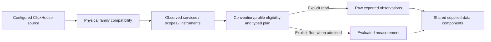

# Discovery, service views and native metric entry

This component answers two questions: what telemetry can this source supply, and
what can Goo truthfully do with the observed services and instruments? It bridges
physical source compatibility, observed inventory, semantic eligibility and the
operator's next explicit action. Those are four different facts.

## Afternoon reading path

Read these in order, following one service and then one metric instrument:

1. [`internal/sourcecap/sourcecap.go`](../../internal/sourcecap/sourcecap.go):
   `Family`, `Compatible`, and the fixed table/column specifications. Physical
   compatibility is inspected through the source owner's bounded reader.
2. [`ui/inventory.mjs`](../../ui/inventory.mjs): `mountCatalog`, its `run` action,
   service list/distributed presentation and `stageService` return boundary.
   Follow how scope, cancellation and stale-result guards are retained.
3. [`exploration/dashboard.go`](../../exploration/dashboard.go):
   `PlanServiceDashboard` and the profile-specific question builders. This plans
   supported questions; it does not make an unsupported OTel convention valid.
4. [`ui/service-dashboard.mjs`](../../ui/service-dashboard.mjs): `load`,
   `profilePicker`, `renderRecords` and native summaries. The application owner
   executes planned work and distinguishes missing widgets from failed reads.
5. [`ui/metric-scopes.mjs`](../../ui/metric-scopes.mjs) and
   [`measurements/metric_scopes.go`](../../measurements/metric_scopes.go):
   unknown-label metric entry and `DiscoverMetricScopes`. Observe that discovery
   returns bounded choices rather than a promise of complete inventory.
6. [`ui/metric-discovery.mjs`](../../ui/metric-discovery.mjs): `render`, its local
   instrument pages, and explicit build/read callbacks.
7. [`ui/instrument-capabilities.mjs`](../../ui/instrument-capabilities.mjs):
   instrument eligibility and reasons. Read it with
   [`ui/raw-observation-profiles.mjs`](../../ui/raw-observation-profiles.mjs)
   to distinguish raw inspection from evaluation.
8. [`internal/nativehttp/routes.go`](../../internal/nativehttp/routes.go):
   `RegisterMeasurements`, `registerRead` and `registerPlan`. Discovery, raw points,
   evaluated measurements and pure plans have separate typed routes.
9. [`ui/measurements.mjs`](../../ui/measurements.mjs): `render`,
   `streamQuestion` and the native timeline/context adapters. Then use the
   [semantic walkthrough](semantics.md) for the actual metric kernels.

Do not read every service profile before tracing one request. Return to the
HTTP/DB/messaging/host/Kubernetes variants when the profile you are changing
requires them. The [runtime](runtime.md), [semantic](semantics.md) and
[presentation](presentation.md) chapters explain the layers on either side.

## Follow an operator journey

The operator discovers services for an explicit window. The source adapter probes
available signal families and reads compatible tables. The catalog retains
separate log, span and metric-point counts; these are not interchangeable request
counts. A service opener carries scope into a planned dashboard. The dashboard
can expose candidate convention profiles while retaining unavailable or unobserved
prerequisites. Its application owner makes explicit reads and renders each result.

For a metric-only source, metric-scope discovery supplies observed scope choices.
Instrument discovery reports metadata and support. Reading raw exported points
can be supported even when evaluating a measurement is refused. Building a
measurement stages a definition; evaluation still requires explicit Run. A plot
of held points does not silently acquire more observations.



## Invariants that explain the branches

- Schema compatibility does not establish convention compliance, value validity,
  complete coverage or successful evaluation.
- An observed dimension key does not prove that every stream has it. Missing,
  empty and named environment/instance facts stay distinct.
- Raw exports keep unit, temporality, monotonicity, exact counts and occurrence
  identity. Scalar percentiles are not composable fleet distributions.
- An absent table, denied source and successful empty read need different states.
  A partial inventory is not a zero-valued dashboard or a healthy service.
- Local instrument paging and disclosures do not read sources. Cross-surface
  openers retain the original question and require current owners.

## Focused checks

These are commands to use while changing this component, not a claim that this
review executed all of them:

```sh
node --experimental-test-module-mocks --test \
 tests/metric-scopes.test.mjs tests/instrument-capabilities.test.js \
 tests/service-dashboard.test.js tests/service-dashboard-recovery-354.test.mjs
go test ./measurements ./exploration ./internal/sourcecap ./internal/nativehttp
```

Source-backed journeys additionally need the lab and an explicit built runtime;
see [delivery](delivery.md). The [component review](../reviews/understandability/discovery-metrics.md)
records simplification candidates, not implemented changes.
