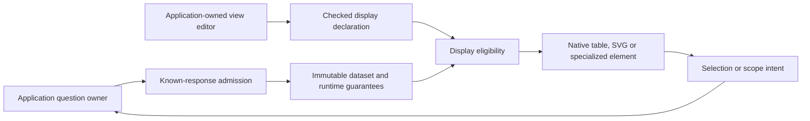

# Display components, view grammar and authoring

This component turns **supplied observations** into a checked presentation. It
owns HTML/SVG, display settings and reading gestures. Application owners decide
when to read a source, change a question or preserve evidence. This separation is
the most useful starting point: a chart selection is an **intent**, not a query.

Allow about three hours for the path below. Read one ordinary grouped-count
example before exploring native-metric and comparison profiles.

## Read-first map

| Order | Source | What to learn |
| --- | --- | --- |
| 1 | [display.mjs](../../ui/display.mjs) | Public feature exports. This convenience entry currently imports a closed 91-module passive graph; a feature can be imported directly. |
| 2 | [view-schema.mjs](../../ui/view-schema.mjs): `validateSnapshot`, `validateDisplay`, intent helpers | The `goo.dataset/1` shapes, exact field values, stable row keys, quality facts and allowed kinds. |
| 3 | [snapshots.mjs](../../ui/snapshots.mjs): `importSnapshot`, `createSourceAdapter`, `hasGuarantee` | Immutable admission, input budgets and runtime provenance witnesses. JSON saying “complete” is not enough. |
| 4 | [view-model.mjs](../../ui/view-model.mjs) | Runtime display eligibility and population shares. This deliberately wraps structural validation with verified coverage requirements. |
| 5 | [scope-view.mjs](../../ui/scope-view.mjs): `Chart.render`; [chart-frame.mjs](../../ui/chart-frame.mjs) | A checked snapshot/display mapping becomes native tables, SVG or specialized child elements, with shared state/unit/window chrome. |
| 6 | [components.mjs](../../ui/components.mjs); [record-presentation.mjs](../../ui/record-presentation.mjs) | Native controls, inspector, stats and record/parent-context composition. [record-list.mjs](../../ui/record-list.mjs) adds a checked bounded record-page presentation. |
| 7 | [view-declaration.mjs](../../ui/view-declaration.mjs); [view-composition.mjs](../../ui/view-composition.mjs) | Query-bound presentation intent: pinned kinds and a stack of unique roles, not evaluated data or arbitrary executable templates. |
| 8 | [population-workspace.mjs](../../ui/population-workspace.mjs): `mountCompositionEditor`, `mountDisplayEditors`, `mountFacetEditor` | The application-owned editor checks declarations, tracks drafts and updates held presentation. Its source operations are outside the passive components. |
| 9 | [view-artifact.mjs](../../ui/view-artifact.mjs); [view-template-handoff.mjs](../../ui/view-template-handoff.mjs) | Portable configuration and checked reuse against a destination question. Store-local captured baselines are not silently exported. |

## Follow one ordinary breakdown

Suppose an application owner has run a fixed span question grouped by service.
The Go response includes the checked question and a ranked dataset with exact
counts. [source-snapshots.mjs](../../ui/source-snapshots.mjs),
`adoptExploration`, checks the response against the requested question and admits
known response slots through its source adapter. This is an application trust
boundary, not an authentication mechanism.

A dataset describes rows and fields, not rendering instructions: scope identity
and generation, revision, dimensions, exact values, cells and quality travel
together. Large integers and rationals retain their exact strings. Disposable
floating-point coordinates are only a plotting convenience.

The application supplies that snapshot and a display mapping to `goo-chart` (implemented by `scope-view.mjs`).
`view-model.validateDisplay` first asks whether the shape, fields and kind fit,
then checks runtime guarantees. For example, population shares and a
`requiresComplete` display need verified full-query coverage. If shares are
unavailable, some ranked bar/table cases retain an exact-values table and a
visible refusal instead of manufacturing percentages.

`scope-view` selects native rendering: table, ranked bars/line, time intervals,
grouped series, histogram, or admitted raw-observation children. `goo-chart-frame`
only contributes the heading, unit, window and state. It does not calculate
statistics, fetch data or own the plot.

Selection/range gestures emit revision-qualified intents. The application checks
that the intent still belongs to its current snapshot before staging another
question or inspecting a retained occurrence. Local Find or a representation
switch does not grant a new source read.



## What “grammar” currently means

There are two related contracts. `goo.dataset/1` is supplied data plus quality;
`goo.view/1` and `goo.composition/1` describe a query-bound display and roles such
as records, aggregate, timeline, summary, histogram, facet and comparison. A
composition currently holds one to six unique roles and must leave useful content
visible. Each role delegates to its own checked declaration.

The editor is native forms and an optional composition-source textarea. It is
not a general drag-and-drop canvas or an arbitrary team-code plugin system.
Portable YAML is admitted by the server; labels identify configuration, not a
published registry. Plotly remains a proposal, not a runtime dependency or an
implemented escape hatch. Actual rendering uses native HTML/SVG and Web
Components.

Not every screen already consumes `goo.dataset/1`. Record pages, trace timing,
held chronology and several native projections have deliberately narrower
contracts. Read their component walkthroughs rather than assuming one chart kind
can accept every result.

## Changing or adding a display

Start with the existing shape and declaration. Add a kind only when its input
requirements and uncertainty semantics are explicit; then add eligibility,
renderer and refusal tests together. For a new data shape, keep schema validation
separate from runtime admission/coverage witnesses. A new renderer must not turn
unknown into zero or scalar percentiles into a fleet percentile.

Use `components.mjs`, `components.css` and feature CSS for reusable behavior and
styling. `product.css` owns application placement; it also contains accumulated
integration overrides, so verify standalone and nested rendering. Preserve native
labels, table captions, focus, disclosure semantics and visible state text.
Selection needs a non-color cue in forced colors. Avoid adding a live region per
incoming point.

## Checks to run

```sh
node --experimental-test-module-mocks --test \
 tests/view-model.test.js tests/view-composition.test.js \
 tests/view-composition-reuse.test.js tests/view-artifact.test.js \
 tests/chart-frame.test.js tests/display-modules.test.mjs tests/record-list.test.js
```

All seven files passed during this review. For renderer changes, also run the
relevant real-data storyboard and inspect desktop, narrow, keyboard and
forced-color frames. The display-graph test prevents application bootstrap/source
clients from entering the public passive bundle; it is not a browser usability
or performance benchmark.
