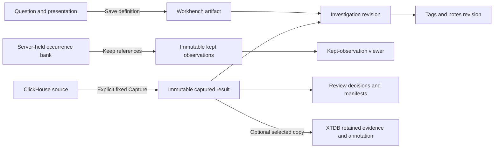

# Preservation, investigations and annotations

This component lets an operator return to a question, preserve observations, and
explain what those observations meant. Its central distinction is **configuration
is not telemetry evidence**. Save definition stores a reusable question and
presentation. Keep stores particular observations already held by the server.
Capture normally executes a fresh fixed question and stores its bounded result.
An investigation document arranges references and narrative; opening it does not
execute those questions.

This walkthrough describes current code. Proposed simplifications are in the
[component review](../reviews/understandability/preservation.md).

## Read this in an afternoon

Read these in order; follow only the named functions first. UI files currently
pack substantial logic into long lines, so a formatter or symbol navigation helps.

| Time | Read | Question it answers |
| --- | --- | --- |
| 15 min | [ui/preservation.mjs](../../ui/preservation.mjs): `meaning`, `availability`, `selectedQuestion` | What does the operator choose, and which actions are allowed? |
| 20 min | [workbench/activity_views.go](../../workbench/activity_views.go): `Validate`, `CreateActivityView`, `LoadActivityView` | What does saving reusable configuration store? Other view families use the same workbench store. |
| 25 min | [exploration/capture_store.go](../../exploration/capture_store.go): `CaptureQuestion`, `Create`, `publish`, `Load`, `Page` | How does a fresh query become an immutable, paged capture? |
| 20 min | [exploration/kept_observations.go](../../exploration/kept_observations.go): `Keep`, `publish`; [kept_records.go](../../exploration/kept_records.go): `KeepRecords` | How do we preserve held occurrences without rereading ClickHouse? |
| 20 min | [workbench/documents.go](../../workbench/documents.go): `Card`, `CreateDocument`, `LoadDocument` | How do questions, findings and exact artifact references form an investigation? |
| 15 min | [workbench/meaning.go](../../workbench/meaning.go): `MeaningTarget`, `PrepareMeaning`, `CreateMeaning` | How are tags, notes and applicability revisions kept separate from evidence? |
| 15 min | [ui/captures.mjs](../../ui/captures.mjs): `mount`; [ui/saved-capture-protocol.mjs](../../ui/saved-capture-protocol.mjs): `validateVisit` | How does recall validate and display a stored result without a source read? |
| 20 min | [ui/documents.mjs](../../ui/documents.mjs): `mount`, save handler; [ui/investigation-draft.mjs](../../ui/investigation-draft.mjs): `Journal` | Which state is an editor draft, a stored revision, or an uncertain save? |
| 15 min | [retention/store.go](../../retention/store.go): `Publish`, `CorrectOnce`; [retention/tail.go](../../retention/tail.go): `PublishTail` | What does optional XTDB add, and where is its boundary? |

For the shared disk primitive, read
[immutablefile.Publish](../../internal/immutablefile/publish.go) after the capture
path. Its caller owns validation, identity, bounds and verification of an
existing winner. Publication errors do not necessarily prove that no file was
published.

## One concrete investigation

1. **Save a view.** A UI owner validates the configured scope and presentation,
   then a workbench route writes a content-addressed definition. Activity views
   reopen paused and require an explicit Start. No observed rows are implied.
2. **Keep selected occurrences.** Tail/result owners submit references to a
   server-held membership bank, not browser-supplied record JSON. `Keep` and
   `KeepRecords` resolve these capabilities, check expiry and expected scope,
   then publish a bounded local kept resource. Retry identity distinguishes the
   same intent from a conflicting reuse. Expiry refuses rather than rereads.
3. **Or capture a fixed question.**
   [capturehttp.Register](../../internal/capturehttp/routes.go) admits the request
   and calls `CaptureStore.Create`. Its closed families include records,
   inventory, native measurements, comparisons and trace search. Most families
   make explicit source reads; held explanation promotion is a separate path.
   The result receives a receipt and content-derived ID, is published without
   replacing another artifact, then can be opened by ID. Record paging reads
   the stored row bank, not a new source page.
4. **Write the investigation.** `CreateDocument` checks ordered cards and their
   references, records its time and explicit parent, and writes another immutable
   artifact. Question cards carry configuration; capture cards reference evidence.
   The browser editor journals drafts separately and checkpoints an uncertain
   publication before sending it. A lost response is not silently called failure
   or success.
5. **Annotate or review.** A meaning revision targets an exact artifact or scoped
   service, has tags/note and an optional service applicability window, and can
   branch or withdraw an earlier assertion. Training/review decisions use
   [capture_review.go](../../workbench/capture_review.go): exact captured-record
   references, declared labels, superseding decisions and bounded manifest export.
   They do not mutate the stored record.
6. **Return later.** `captures.mjs`, `kept-saved.mjs`, `documents.mjs` and the
   saved workspace compose recall. Each owner retains its request generation,
   draft and return lifetime. Opening a stored artifact stays separate from an
   explicit fresh Run, Refresh or Capture.



## Boundaries that must remain understandable

- **Three times have different meanings:** telemetry event time, source-read time,
  and storage/recorded time. None proves original exporter custody. A capture
  refresh keeps the original question and points to its parent; it creates new
  evidence and a new receipt rather than overwriting history.
- **References have different authority:** hashes identify immutable artifacts;
  cursors identify stored positions; live membership tokens authorize particular
  held occurrences. A hash or cursor is not source authorization.
- **Bounded does not mean complete:** capture/keep limits, source refusal and
  uncertainty survive recall. Comparison sides retain independent reads.
- **Annotations are assertions:** local revisions use `local-user-unverified`
  origin. Parent links preserve branches; there is no silent mutable “latest”
  replacement. Label corrections and withdrawals do not alter observations.
- **Disk and XTDB are distinct implementations:** the normal lab stores authored
  artifacts, captures and keeps as local files. XTDB is an optional retained-copy
  experiment reached through `/retained-evidence`; absent configuration returns a
  refusal. It carries read-basis await tokens and atomic evidence/annotation
  transactions. This is not general federated ClickHouse querying or a complete
  bitemporal product API. Current XTDB profiles explicitly refuse unsupported
  environment selectors.
- [investigations/store.go](../../investigations/store.go) is the separate active
  operation-package capture format. It pins package revision, window, selection
  and operation evidence. It is registered by `registerInvestigations`; it is not
  the generic investigation-document store despite the package name.

## Check a change

From the repository root, use the configured Go toolchain and workspace caches:

```sh
go test ./investigations ./workbench ./retention -count=1
node --experimental-test-module-mocks --test \
 tests/preservation.test.js tests/investigation-draft.test.js \
 tests/saved-capture-protocol.test.js tests/retention-client.test.js
```

XTDB integration tests require their explicit instance and otherwise skip; a
filesystem/unit pass does not validate XTDB. Storage-contract tests cover
identity, winner behavior and corrupt/oversized data. Real user flows are in
[journeys](../journeys/investigation-reuse.md); changes to custody or request
ownership need the corresponding real-source browser checks, not only snapshots.
