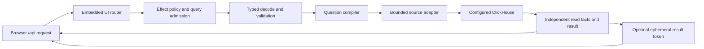

# Runtime, HTTP boundaries and source reads

This component turns browser or CLI intent into bounded work. Goo is one Go
process: it serves embedded browser assets, handles typed APIs, calls the
configured ClickHouse HTTP endpoint, and coordinates stores. It does not receive
OTLP itself. The collector/ClickHouse pipeline supplies telemetry independently.

An afternoon here should let you trace one request, change a route's transport
policy, and identify where a new query or store operation belongs. It need not
teach every measurement profile or every saved-document schema.

## Read in this order

| Stop | What to find |
| --- | --- |
| [CLI dispatch](../../cmd/goo/main.go) | `run` selects the command; `serve-http` is the browser/API runtime. |
| [Composition root](../../cmd/goo/serve_http.go) | `configuredHTTPServer` validates startup configuration, constructs source adapters and per-server ephemeral banks, registers families, then builds the handler. |
| [UI handler](../../cmd/goo/serve_ui.go) | `newUIHandler` serves embedded assets and maps `/api/…` into the same in-process API handler. `registerUIAPI` serves metadata/liveness. |
| [Record routes](../../internal/recordhttp/routes.go) | `Register` binds question validators and source methods; `registerRead` infers its ordinary Go type parameters. |
| [Record policy](../../internal/recordhttp/policy.go) | Exact method/path effects, body limits and deadlines. This is transport policy, not source authorization. |
| [Typed HTTP mechanics](../../internal/queryhttp/handlers.go) | `ReadHandler` decodes, validates, establishes the source deadline, executes, and maps failures. |
| [Query admission](../../internal/queryhttp/budget.go) | `NewBudget` owns concurrent-query admission, query IDs, cancellation and tombstones. |
| [Query model](../../exploration/model.go) | `Query.Validate` defines which questions are admissible. Follow `Compile` into [the SQL compiler](../../exploration/compiler.go). |
| [Record source](../../exploration/source.go) | `Source.read` bounds each physical read; `fetchProfile` assembles the question's independently acquired result. |
| [Server shutdown](../../cmd/goo/server_lifecycle.go) | `runHTTPListener` stops acceptance, drains with a bound, then cancels remaining requests and streams. |

The source connection is constructed once from environment settings in
[source dependencies](../../cmd/goo/source_dependencies.go). It produces separate
typed record and native-measurement adapters. Sharing connection configuration
does not merge their query semantics.

## Trace one ordinary request

Suppose the UI submits a fixed log question to `POST /api/explore`.

1. `newUIHandler` strips `/api` and calls the existing handler directly. There is
   no Python gateway, proxy network hop, or response JSON re-encoding.
2. `newQueryBudget` classifies the exact route through its family's policy. A
   source-backed request consumes one of four process query slots. A supplied
   `X-Goo-Query-ID` permits explicit cancellation; the request context carries it
   through source work. Cancellation tombstones also handle cancel-before-admit.
3. `recordhttp.Register`'s typed handler uses `httpjson.Decode`. It rejects unknown
   fields, oversized input and trailing JSON; Go's duplicate-field/null behavior
   is deliberately retained. It validates the question before any source call.
4. `exploration.Source.Fetch` freezes the complete question, compiles its
   allowlisted fields/predicates into SQL and typed parameters, then executes the
   required reads. SQL values are parameters, not concatenated operator input.
5. `Source.read` sets ClickHouse read-only/resource limits, sends the request with
   the caller's context through `sourcehttp.Post`, and decodes bounded JSONEachRow
   through `sourcejson.ReadObjects`. Transport mechanics do not infer data quality.
6. `fetchProfile` acquires the total, bounded rows and requested groups/timelines/
   field discovery. Those can be separate source reads. A page is not the total,
   and changing telemetry can yield `changed_between_reads`.
7. The route may freeze the result in its server-local `ResultSnapshots` bank.
   Failure to obtain this optional capability adds a warning rather than changing
   a successful source result into invented custody. The JSON response returns
   question, basis/read facts, values and uncertainty to the browser owner.



## Two paths that deliberately differ

**Live Activity** uses [tail HTTP](../../cmd/goo/tail_http.go) and
[tail semantics](../../exploration/tail.go). A POST opens an SSE response. It has
its own four-stream admission, a 60-second connection lifetime, per-frame write
deadlines and a two-second polling cadence. A tracker assigns observed occurrence
identity; reset/batch/gap events describe observed delivery. This is bounded
polling over ClickHouse, not a durable event bus or a completeness guarantee.
Do not send it through the buffered JSON responder.

**Publication and held promotion** live in family owners such as
[capture routes](../../internal/capturehttp/routes.go) and
[workbench HTTP](../../cmd/goo/workbench_http.go). A publication can complete after
a client disconnects. Cancelling a read is not rollback. These mixed-effect routes
therefore retain explicit handlers rather than being forced into `ReadHandler`.
The persistence walkthrough covers their document and custody rules.

## Rules to retain while changing this code

- Startup and `/health` establish process liveness, not ClickHouse readiness.
  Generic startup does not require demo authoring assets or perform hidden reads.
- Family validation owns admissible scope; a shared HTTP helper must not widen it.
- Query IDs and ephemeral result/tail tokens are short-lived local capabilities,
  not authentication, tenant identity, or portable saved evidence.
- Source errors remain unavailable, malformed or budget failures. They do not
  become empty/healthy telemetry. Native measurement evaluation keeps its own
  temporality/unit/profile rules.
- Response bodies belong to the source caller; request contexts, deadlines and
  cancellation must reach them. Shutdown must release active work.

## Check a change

From the repository root with the configured Go toolchain:

```sh
go test ./internal/queryhttp ./internal/recordhttp ./internal/httpjson \
  ./internal/sourcehttp ./internal/sourcejson -count=1
go test ./cmd/goo -run 'TestEmbeddedUI|TestBrowserAPI|TestServerShutdown' -count=1
```

These use local HTTP fixtures; they are not ClickHouse/OTLP integration evidence.
For an actual browser/source path use the executable
[related-record journey](../journeys/related-held-records.md), or the API's
[OpenAPI contract](../../api/openapi.json). The family-policy contract tests check
published request-size/admission boundaries against the policy declarations.

[Simplicity review and proposed changes](../reviews/understandability/runtime.md).
