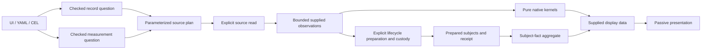

# Semantic core: from a question to a defensible result

This walkthrough describes the implementation at `9119a967`, before this review's
proposed refactors. Allow an afternoon to understand the boundaries and follow one
representative flow; the individual OTel instrument profiles remain reference material.

The semantic core answers three different questions: which records belong to an
investigation, what a native instrument means over time, and what can be counted
about explicitly prepared business subjects. It does not own the browser's current
selection. Most functions take supplied values and return checked values or errors.
Source reads and lifecycle custody are explicit boundaries.

## The map

| Component | Owns | Does not own |
| --- | --- | --- |
| `identity` | Literal observed environment/namespace identity and checked population selection | Inferring an environment from an empty text box |
| `exploration` | Record fields, bounded predicates/questions, refinement and ClickHouse plans | Native counter or business-outcome semantics |
| `querycel` | A checked record-condition authoring language that lowers to the ordinary predicate tree | Arbitrary SQL, source reads, whole-query optimization |
| `measurements` | Versioned native definitions, OTel binding/admission, source plans and kernel orchestration | Guessing instrument support from a metric name alone |
| `metrics` | Pure gauge, counter, stock, state, histogram and comparison kernels | HTTP, files or global clock reads |
| `lifecycle` / `subjectfacts` | Prepare event evidence under a frozen policy; aggregate validated subject facts | Inferring outcomes directly from arbitrary spans |
| `scopedview` / workbench declarations | Source-neutral display facts and validated reusable configuration | Treating a saved question as stored observations |



## Read these ten stops in order

1. [identity/environment_selection.go](../../identity/environment_selection.go):
   `CurrentEnvironment`, `EffectiveEnvironment`, `AllEnvironments`, `Matches`.
   Checked selection is deliberately not its own JSON format; the owning wire type
   must preserve the policy. Missing, present-empty and named observations differ.
2. [exploration/model.go](../../exploration/model.go) and
   [refinement.go](../../exploration/refinement.go): `Query.Validate`,
   `ValidatePredicate`, `CloneQuery`, `Refine`. A query combines scope, fixed bounds,
   a condition and delivery limits. Refinement adds conditions without replacing
   the parent's question or clock. Predicate depth/node budgets bound traversal.
3. [querycel/program.go](../../querycel/program.go) and
   [planning.go](../../querycel/planning.go): `Compile`, `Program.Apply`,
   `NewPlanRequest`, `PlanRecord`. The source-free receipt binds expression,
   original base identity, editor slot/epoch/revision and compiler profile.
   [library.go](../../querycel/library.go) defines the admitted OTel helpers and cost limits.
4. [exploration/compiler.go](../../exploration/compiler.go): `Compile` and the
   internal compiler's field/predicate lowering. Physical ClickHouse columns live
   behind allowlisted mappings; user values become typed parameters. Count, rows,
   groups and field discovery are separate plan members, not one transactional read.
5. [measurements/model.go](../../measurements/model.go): `Definition`, `Question`,
   `Validate`, `Read`. Begin with one `counter` definition rather than every branch.
   A definition declares kind, grain, unit, source identity and allowed gaps. A
   question adds fixed bounds; a plan, result basis and definition revision have
   different identities.
6. [measurements/source.go](../../measurements/source.go): `Compile`, `Source.Run`,
   `prepareResult`, `Evaluate`. Follow the counter path into
   [metrics/counter.go](../../metrics/counter.go), `EvaluateCounters`. The adapter
   checks source records and converts them into typed kernel inputs; the kernel
   handles temporality, resets, interval validity and exact values.
7. [metrics/gauge.go](../../metrics/gauge.go),
   [histogram.go](../../metrics/histogram.go), [stock.go](../../metrics/stock.go)
   and [state.go](../../metrics/state.go) are alternative kernel paths. Read one
   matching your use case. Profile-specific helpers in `measurements` build checked
   host, pod, container, runtime, RPC, HTTP or pool questions; they are not new engines.
8. [lifecycle/prepare.go](../../lifecycle/prepare.go), `Policy.PrepareRaw`, then
   [evaluate.go](../../lifecycle/evaluate.go), `Prepared.Evaluate`. Preparation
   creates facts *and a receipt* under fixed event, observation and evaluation
   bounds. [measurements/lifecycle.go](../../measurements/lifecycle.go) owns explicit
   custody operations. Numeric `Evaluate` refuses lifecycle requests.
9. [subjectfacts/model.go](../../subjectfacts/model.go),
   [evaluate.go](../../subjectfacts/evaluate.go), [compile.go](../../subjectfacts/compile.go):
   `Definition.Validate`, `Evaluate`, `Compile`. This small aggregate language
   counts subjects and forms guarded ratios over prepared facts. It can generate
   ClickHouse SQL or Databricks metric-view YAML; that is a different compilation
   path from raw-record SQL and does not imply a live Databricks integration.
10. [scopedview/model.go](../../scopedview/model.go), then
    [workbench/exploration_views.go](../../workbench/exploration_views.go),
    [view_composition.go](../../workbench/view_composition.go) and
    [cel_authoring.go](../../workbench/cel_authoring.go). The DTO describes supplied
    values, support, quality and named completeness aspects. Workbench validates
    reusable query/display combinations and authoring provenance before storage.
    The persistence walkthrough covers their actual store operations.

## Follow one native counter question

`measurements.Read` decodes a bounded, known-field YAML document and validates its
source binding. `Question.Validate` checks its fixed window. `Compile` validates
again, computes a definition revision and produces SQL with typed parameters. For
counters it fetches enough earlier data for interval context, within `MaxGapMS`.
`Source.Run` detaches the question, reads observations, and supplies the read time
explicitly to `Evaluate`.

`prepareResult` canonicalizes and detaches source rows, rejects an over-limit
population, records the actual read clock and derives its basis. `Evaluate` checks
source identity/profile and constructs `metrics.CounterPoint` values.
`EvaluateCounters` groups exact streams, validates temporality and computes valid
intervals or explicit unavailable states. The resulting question, basis and kernel
facts reach the workbench/UI; the UI does not reconstruct a fleet rate from scalar
chips. To debug, inspect these artifacts in that order rather than starting in a chart.

## Rules worth retaining

- Event time, first-observation custody time and evaluation/read time are different.
- Missing is not zero; unknown and no-data are useful results. A bounded page is
  not a complete population. Native source limits fail before partial evaluation.
- Preserve full stream identity and counter temporality. Never average scalar
  percentiles into a fleet percentile.
- CEL is checked authoring for an owned extra condition. It cannot erase parent
  scope; save-time authoring validation checks provenance again.
- Lifecycle aggregates consume the prepared receipt. A damaged scope may make a
  ratio unknown even when damaged rows are absent from the chosen groups.
- A reusable view is configuration. A display completeness claim names its aspect,
  scope and revision; it is not an assertion of upstream collection completeness.

## Focused checks

From the repository, with its Go toolchain and caches configured:

```sh
go test ./identity ./querycel ./metrics ./subjectfacts ./lifecycle ./scopedview -count=1
go test ./measurements ./exploration ./workbench -count=1
```

The first command passed during this review (`scopedview` has no test files).
The second also exercises adapters/stores and may require permitted localhost
listeners. Existing tests are a better next read than every profile branch:
`querycel/planning_test.go`, `measurements/evaluation_boundary_test.go`,
`metrics/counter_test.go`, `lifecycle/prepare_test.go`, and
`subjectfacts/example_test.go`. See the [component review](../reviews/understandability/semantics.md)
for proposed simplifications; they are not delivered changes.
