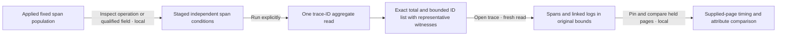

# 186 — Find traces containing independent span conditions

The real OTel main, stale-owner journey and 55-second Bombadil campaign pass.
Independent native/model verification rejects all 80 changed controls.
No mocked positive source data is used.

A developer sees slow database spans and asks: **which reported traces contain
both a slow database operation and an error span?** Conditions can match different
services or the same span. This is an intersection of reported trace IDs in a
fixed environment/window, not a parent path, temporal sequence, distinct-span
requirement, unique invocation count or complete-trace claim.

## Real user flow

[Executable journey](trace-search.spec.js), [ordinary OTLP fixture](186-trace-search-fixture.js)
and [independent browser oracle/source helpers](186-trace-search-support.js)
retain exact requests, raw emitted facts and observed source effects.



1. Run a fixed span population for `db-service`, duration ≥50 ms, resource
   namespace `commerce` and attribute `team=core`. It matches **135 span records**
   while the inspection page shows **100**. The subsequent search uses the full
   source population, not those 100 displayed rows.
2. Inspect a database span and choose **Find traces with this operation**. Its
   exact reported service/operation and original filters seed condition 1;
   trace/span identity is not silently inserted. Opening and editing are local.
3. Add condition 2, `column:status_class = error`, and Run trace search explicitly.
   Only the shared environment and fixed window apply globally. Original
   population predicates stay in condition 1; the error may be in another service.
4. Inspect **15 distinct valid reported trace IDs**. The cross-service example
   has a slow `db-service` operation and an error in `queue-worker`. Another trace
   has a single slow error database span; both condition witnesses legitimately
   use its same SpanId. A-only and B-only spans in different traces never combine.
5. Expand representative evidence locally. Qualified condition fields include
   source columns, an attribute and a resource field. The witness shows exact
   values, UTC time, human duration and exact nanoseconds. It is one representative
   matching record per condition, not every matching span, a root or a causal path.
6. A repeated trace reports **120 matching records for each condition** while
   remaining one trace ID. A separate actual API read with list limit 2 still
   reports total 15 and `hasMore=true`; the total precedes list truncation. A known
   empty API query reports `no_data` without inferring health.
7. Open a listed cross-service trace through **Open trace (fresh read)**. Its three
   spans and separate linked-log query use the original environment and exact
   fixed bounds, with only TraceId filtering. Condition-1 service/duration filters
   do not hide the other service's evidence.
8. Pin that returned trace page locally, close the inspector and open the
   same-span example. Its two-span page uses the same original bounds. Existing
   comparison stays source-free: root inclusive duration changes 200→300 ms
   (+100 ms), and duration outside observed direct children changes 100→180 ms
   (+80 ms). Labels align observations, not invocations.
9. Open the repeated trace. It counts **241 spans**, but supplies a 100-row page;
   its error witness is not in that first page. Explicit Next trace page returns
   another 100 records and includes that witness. The 200 distinct supplied rows
   do not become a completeness claim for all 241, sampling or the whole trace.

The final main passes in **13.9s**:
`artifacts/trace-search/trace-search-fb788e547b/ledger.json`.
Its ten logical browser source operations are parent Run, trace-search Run and
four explicit trace/page reads with their existing linked-log reads. Contextual
staging, witness disclosure, pin and comparison add no reads. All API traffic is
recorded; cancellation requests are explicitly classified as control operations.
These browser operations are not ClickHouse statement counts. Trace search itself
uses the new single aggregate query, with no hidden per-trace witness queries.

Two request-context API probes (bounded/empty) are separately labeled
`directSourceReads: 2`. Fixture setup has its own readiness probes: 135 parent
matches; a broad-window probe proves **291 records/19 trace IDs** in the common
fixture environment; another proves **3 records/1 ID** in the excluded environment.
These include the outside-window control physically present before exclusion is
asserted. All 294 ordinary span observations belong to the retained fixture.
Malformed/all-zero IDs are covered by backend raw-source parity/property checks,
not fabricated as successfully ingested OTLP records in this journey.

## Actual frames and compact entry

| Frame | What the actual application shows |
| --- | --- |
| [Cross-service witnesses](../docs/journeys/screenshots/186a-cross-service-condition-witnesses.png) | Independent matching spans in database and worker services, qualified field evidence and exact counts |
| [Same-span witnesses on mobile](../docs/journeys/screenshots/186b-mobile-same-span-witnesses.png) | Both conditions use one reported span; no distinct-span requirement; no page overflow |
| [Original-window trace comparison](../docs/journeys/screenshots/186c-matching-trace-page-comparison.png) | Existing local comparison of two explicitly expanded matching trace pages |
| [Controls through first result](../docs/journeys/screenshots/186d-controls-to-first-result.png) | Full actual entry context, concise predicates, closed editors and the first result without scrolling through full forms |

The final measured controls-to-first-result distance is **464.046875 px**, rather
than roughly 1,800 px in the initial verbose editor layout. The seed editor starts
closed, a newly added condition opens for editing, and successful Run closes the
full editors while preserving readable actual-predicate summaries. The original
AST and source query are unchanged by this display arrangement.

Frames use production styles and normal scrolling. The mobile assertion requires
whole-page containment. The initial source-basis line overflow was fixed with
scoped wrapping; no fields, counts or labels were hidden to make the frame fit.

## Own pending and closed work

The final ownership case passes in **10.8s**:
`artifacts/trace-search/trace-search-84a5306a6a/ownership.json`.

It mutates a retained input under a closed editor, checks that matches stay
visible, then performs an actual explicit rerun. The new request equals the
original request exactly. Opening Edit restores the accepted `error` value,
rather than accepting an invisible private editor mutation.

Closed and route-hidden retained Run/Open/Add actions are inert. A later search
fetches a real successful response but holds its delivery; a visible condition
edit supersedes and cancels that work. Releasing the old response publishes no
matches. Restoring the condition and explicitly running again succeeds. The
ledger retains the real held response, any aborted-delivery diagnostic, all eight
actions, per-action DOM states, five source operations and one separate query
cancellation. Positive responses are not substituted or fabricated.

## Exploratory campaign

[Actor](../verification/bombadil/trace-search.ts) passes a **55-second** campaign
(56.8s test time), completing all **16 phases** across **1,089 snapshots**. It
observes the actual 135/100 parent and 15-match response, cross-service and
same-span cases, repeated 120/120 counts, qualified UTC/duration evidence,
closed-editor restoration, original-window fresh trace expansion and inert
retained actions after closing. It ends with both inspectors closed at exactly
four source reads. The wrapper requires phase coverage and terminal proof,
not merely exit code zero.

`artifacts/trace-search/trace-search-92e91b2266/bombadil/` retains the actual trace,
process log, run result and `acceptance-summary.json`.
`artifacts/trace-search-actor.log` records the pass.

## Independent source and lifecycle verification

The main native gate passes in **8.396s** with **62 changed controls**, and the
ownership gate passes in **7.905s** with **18**. All 80 controls are rejected,
including four invalid observed traces rejected by the actual Quint model.
Neither baseline required an observer/oracle correction. Adjacent
`native-validation.txt` files retain exact commands and results.

The independent oracle verifies all 294 physical fixture records and 20 trace
IDs, full-source 135/100 accounting, 15 matched IDs, complete 120/120 matching
counts and deterministic qualified representative witnesses. It also checks
original-bound trace continuation, 241 versus 100+100 supplied rows, exact held
page comparison, the closed-editor rerun and delayed cancellation lifecycle.
The separate 300-example property campaign passes in 6.115s; malformed/all-zero
identity and qualified absent-field tie cases have backend source-parity evidence.
The targeted absent-derived-field tie correction is independently reviewed and
real-ClickHouse checked before final binary deployment.

## Evidence limits and custody

Search results are held observations with a read clock and basis. This feature
adds no search capture/store kind, saved paired search or comparison receipt.
Existing trace pages, local comparison, linked logs and capture flows retain their
own contracts. The existing accepted 185 capture remains **12,477 bytes** with
SHA-256 `c5d4a6ab3be045df0ed6338f171b3da8fc5127d0c2df5e06094ee5055ce16c0c`.
The actual stored-file check is in `artifacts/trace-search/legacy-custody.json`;
it is not a reserialized browser copy.

The source/deployment basis is TS1 `f70ff2f`, TS2 `19c7e91`, the qualified absent
witness tie correction `618767f`, compact editors `bb81466` and scoped mobile
wrapping `76556d7`. Final Go runtime SHA-256 is
`61e8dfb75661692c6741f64f85412660f4d3a3f7a009f62f0f7c3c4d502fc9e1`.
`artifacts/trace-search/deployment.json` records served asset/schema/server hashes,
MIME/status checks, the superseded binary and final installation. The deployed
read-only API gate passes all nine cases in 0.55s, including schemas, an absent
trace-search environment and unsupported-version refusal. No publication occurs.

## Reproduce

```sh
npx playwright test journeys/trace-search.spec.js --grep-invert 'optional real'
GOO_TRACE_SEARCH_BOMBADIL=1 npx playwright test \
  journeys/trace-search.spec.js --grep 'optional real'
```

Use the repository journey wrapper for wider-suite traffic-generator isolation.
These focused checks ran serially against the already deployed local lab. No
other browser or resource-heavy native campaign ran concurrently.

## Retained diagnostics

The first invocation selected a hidden custom-grouping field as well as the real
condition field. The selector now names `Condition … field` explicitly; original
traces remain in `artifacts/trace-search/first-diagnostics/`.

The second owner passed (10.1s), while the main hit a fractional screenshot y
coordinate of −0.421875 px after source/witness assertions passed. Normal scrolling
now positions the actual target below the header; the full-frame guard stays.
Its traces remain in `second-diagnostics/`.

The third owner passed the new closed-editor proof, while the main's strict
mobile whole-page containment caught a real unbroken source-basis line. The
scoped wrapping fix preserves that guard. Third traces and provisional frames are
in `third-diagnostics/`; only the main needed repeating for the CSS-only change.
No incomplete combined invocation is described as a full acceptance pass.

The initial deployment readiness script assumed native `/health` existed. That
route returns 404; native readiness uses the existing metadata-only
`/operation-packages` route. The superseded binary and corrected readiness check
are retained in the deployment receipt. The final Go tie fix and API gate
completed before any browser trace-search acceptance ran.
