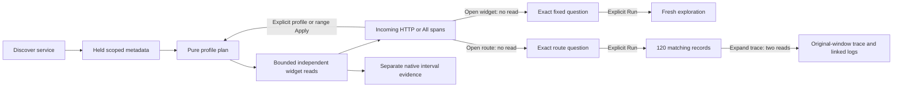

# 187 · Incoming HTTP service overview

The actual ordinary-OTel journey passes in **17.6 seconds** against core/source
`13a8da1`, compact overview `d648655` and mobile label containment `a01141b`.
The separate 45-second Bombadil campaign and bounded independent source-ledger
check pass. The test uses generated ordinary OTLP fixture telemetry, with no
manifest and no mocked positive source or UI responses.

A team opens Services for an application that receives HTTP and makes outbound
HTTP calls. Incoming traffic becomes useful without treating client calls as
server requests. The fixture emits 225 ordinary spans plus three native
instruments. Its exact `commerce / edge-api` population contains 198 mixed spans,
of which 137 have reported Server kind and a nonempty current HTTP method.

| User step | Verified behavior |
| --- | --- |
| Discover and open the service | Incoming HTTP is selected from an eligible native HTTP instrument or a positive held Server/method observation. Flat keys alone are only candidates. No manifest is required. |
| Read the overview | Full totals, duration sums, recorded span Error and route groups use all 137 matching records, despite a 100-row held page. Missing and empty routes remain separate. Legacy-only, empty and missing methods are excluded by the explicit current-key rule. Custom reported methods remain values, not conformance evidence. |
| Compare useful views | Explicit All spans reads 198 mixed records; explicit Incoming HTTP reads 137 again. Each switch preserves service, resource namespace and fixed time, uses one pure plan and exactly one source operation per supported widget, and does not repeat discovery or silently run a fallback. |
| Narrow the time window | Range edits are local. Apply reads a one-millisecond interval containing one Server record outside all 100 held supporting rows. The newly computed hint is false, but the accepted `http-server` view stays explicit. Reset restores the original scope and profile. |
| Investigate a widget | Open widget question stages its exact fixed query without reading. Run explicitly returns the same 137-record population. A retained old profile control cannot trigger a hidden read after navigation. |
| Follow a route into a trace | A separate 9.1-second journey stages the exact `/items` HTTP scope without a read, explicitly runs its 120-record operation, then expands an actual trace and linked logs in the original fixed bounds. Browser Back restores the identical held service overview without reading. |
| Open other service roles | An ordinary worker keeps its generic overview. A client-only HTTP service defaults to All spans. Explicit Incoming HTTP honestly returns zero; an explicit switch back recovers its seven client spans. |

The native `http.server.request.duration` histogram is prioritized ahead of an
alphabetically earlier runtime gauge and a client histogram. Its four
observations belong to a separate native interval and exact stream; they are not
combined with 137 server-span records or called complete window coverage.

## Actual screens

[Desktop overview](../docs/journeys/screenshots/187a-incoming-http-service-dashboard.png)
shows the compact linked timeline, primary server summary, route diagnosis and
separate native cards. [Mobile summary](../docs/journeys/screenshots/187b-mobile-http-server-records.png)
keeps the answer compact. The route mean and p95 track widths are both **98 px**
at desktop and mobile; all equal 20 ms values have equal fill lengths. Long native
lane labels and units remain inside their label cells and cannot overlap a plot.

[Desktop in context](../docs/journeys/screenshots/187c-service-overview-in-context.png)
and [mobile in context](../docs/journeys/screenshots/187d-mobile-service-overview-in-context.png)
retain the actual application navigation and service entry controls. The mobile
frame intentionally exposes existing catalog/header overhead; this is a future
entry-flow improvement, not hidden by the documentation crop.

[Route to original-window trace](../docs/journeys/screenshots/187e-route-to-original-window-trace.png)
shows one supplied span and zero linked logs from actual fresh reads. This is not
a complete-trace claim or invented linked-log evidence.



## Reproduce and evidence

With the reviewed assets and lab running:

```sh
node_modules/.bin/playwright test journeys/http-server-dashboards.spec.js --grep '187 Incoming'
node_modules/.bin/playwright test journeys/http-dashboard-route.spec.js
GOO_HTTP_DASHBOARD_BOMBADIL=1 node_modules/.bin/playwright test journeys/http-server-dashboards.spec.js --grep '187 optional'
```

The accepted main ledger is
`artifacts/http-server-dashboard/http-dashboard-13dc64d238/ledger.json`; its log is
`artifacts/http-server-dashboard/main-fourth.log`. Raw facts, all actual source
responses, plans, supporting page, exact drilldown query, view/geometry snapshots
and every API effect are retained. The complete multi-service exercise makes 43
logical browser source operations and nine pure plans. Initial discovery is one
operation; opening the first service adds four supporting operations and four
widget operations. These are UI operations, not a count of underlying SQL reads.
Ingestion and readiness probes are separate setup evidence.

The bounded independent Go check passes in 0.055 seconds: 19 actual span
responses are compared with raw fixture facts for scope, kind/method membership,
complete groups, missing/empty route values, duration sums, recorded status and
unique raw page observations. Nineteen changed-count controls are rejected.
Its `native-validation.txt` sits beside the accepted main ledger. Separate
planner properties check the positive-hint and fallback policy; this slice does
not add a new formal-model campaign.

The route supplement passes in 9.1 seconds (11.7-second invocation), with
`artifacts/http-server-dashboard/http-dashboard-5e49093a0a/route.json` and
`artifacts/http-server-dashboard/route-first.log`. `/items` retains the original
Server/current-method, service, resource namespace and fixed-window predicates.
Its explicit Run returns full count 120, duration sum 2,400,000,000 ns and 24
recorded span Errors versus 100 displayed rows. Trace expansion uses two existing
source operations, with exact original bounds and reported trace ID; its returned
page has one span and linked logs have zero records. Browser Back follows three actual retained history entries and restores
structurally identical held dashboard view metadata and fixed scope without
another source operation. The accepted main and actor were not repeated for this
supplement.

The actor passes in 47.0 seconds (48.4-second invocation), completing all nine
observed phases over 974 snapshots. Its terminal proof is
`http:137|all:198|http:137`, with exactly 17 source operations and three pure plans.
Evidence disclosure, native-picker inspection and return to the held catalog add
none. The fixture and `bombadil/acceptance-summary.json`, trace, run result and
process log are retained under
`artifacts/http-server-dashboard/http-dashboard-b5a69ca44d/`. This verifies completed
actions and final state, not merely the actor process exit code.

Deployment hashes and correct MIME checks are retained in `deployment.json`,
`deployment-polish.json` and `deployment-containment.json` under the same artifact
root. The temporary build binary was removed after installation. The actual API
schema route is `/openapi.json`; an initial audit of nonexistent
`/api/openapi.json` received 404 and was corrected without redeployment.

Three failed main attempts remain in `first-failure-diagnostics`,
`second-failure-diagnostics` and `third-failure-diagnostics`, with their logs:

- The first range driver kept a detached second slider after the controlled range
  redraw. It now resolves each live input separately and verifies the exact
  preview bounds before Apply.
- The supporting page orders early records first; selecting its earliest interval
  did not establish a false observation hint. The final check selects the latest
  actual Server record and proves all held timestamps are outside the interval.
- After compact Apply, range tools close. The harness now opens their actual
  disclosure before Reset. No hidden-control shortcut was added.

Actual visual review also exposed excessive timeline controls before the answer,
repeated caveat cards and mobile native-label overlap. The reviewed UI fixes
collapse range/prerequisite detail, retain independent evidence and wrap labels
inside their existing grid. Final strict scope, count and geometry assertions
pass; failed batches are not represented as successful combined invocations.

Server-span rates count captured records over fixed elapsed time. They do not
deduplicate retries into requests or establish export coverage, service health or
an HTTP outcome policy. Native measurements retain their own units, temporality
and read clock. This slice introduces no capture format or persistence owner.
