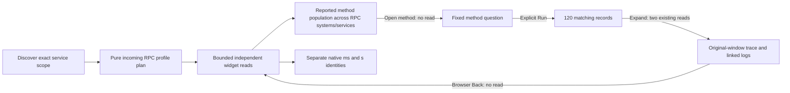

# 188 · Incoming RPC service overview

The real ordinary-OTLP main journey passes in **24.4 seconds**, the bounded
30-second actor passes, and independent source verification passes. Implementation
`4274441` adds the explicit legacy RPC profile; display-only `ccdd2d1` makes native
instrument units visible. The fixture is generated telemetry, with no goo
manifest or mocked positive source/UI responses.

## What the user does

| Step | Actual verified result |
| --- | --- |
| Discover `commerce / rpc-api` | The default incoming RPC view matches 132 Server records versus 203 mixed records. It requires nonempty legacy `rpc.system` and `rpc.method` on the same record. Missing/empty keys, clients, internal spans and `rpc.system.name` alone are excluded. Resource namespaces, including missing and reported empty, remain distinct. |
| Read counts, recorded status and duration | Complete totals, sums and groups use all matching records despite the 100-row held page. The 12-record `CustomCall` group reports nonzero grpc codes but SpanStatus OK; the UI does not infer protocol failures from those codes. |
| Inspect a reported method population | `catalog.Inventory/GetItem` combines 108 grpc records and 12 interleaved custom-protocol records, with two `rpc.service` values. Actual first-page rows include both systems/services. Its 120 records are a method population, not one globally unique operation. |
| Distinguish native measurements | Legacy `rpc.server.duration [ms]` is prioritized as an exact supported binding. A same-name `[s]` histogram remains a separate generic native binding. Their four observations retain their own intervals, units and coverage; no conversion, fleet merge or span/native count blending occurs. |
| Switch and narrow explicitly | All spans returns 203, then Incoming RPC returns 132 in the same fixed scope. Local range preview reads nothing. Apply selects one actual Server record outside all 100 supporting rows; its false hint does not re-guess the accepted RPC profile. Reset retains that profile and restores the original window. |
| Continue method → records → trace | Open method population stages the exact parent predicates plus a method leaf without reading. Explicit Run returns 120 records, sum 3,000,000,000 ns and 24 recorded span Errors. Trace expansion and linked logs use their two existing fresh reads in the original fixed bounds. Browser Back restores the identical held service view without reading. |
| Inspect client-only RPC | Flat keys permit an explicit candidate but do not default to incoming traffic. Explicit Incoming RPC returns zero; explicit All spans recovers seven client records without a hidden fallback read. |

Custom and whitespace values follow the reported nonempty-string rule; this is
not a semantic-convention conformance check. The profile is deliberately legacy:
modern `rpc.system.name` is not silently unioned with `rpc.system`.

## Actual screens and display provenance

| Frame | Evidence |
| --- | --- |
| [Incoming RPC overview](../docs/journeys/screenshots/188a-incoming-rpc-dashboard.png) | Full server population, explicit method identity limits, separate `[ms]` and `[s]` cards and lanes |
| [Mobile summary](../docs/journeys/screenshots/188b-mobile-rpc-summary.png) | Compact captured-record count, recorded span Error and duration |
| [Desktop in context](../docs/journeys/screenshots/188c-rpc-service-in-context.png) | Actual application navigation, service discovery scope and profile controls |
| [Mobile in context](../docs/journeys/screenshots/188d-mobile-rpc-in-context.png) | Real catalog/header overhead, scoped method view and contained native labels |
| [Method to original-window trace](../docs/journeys/screenshots/188e-rpc-method-to-trace.png) | An actual supplied span and honestly empty linked logs; no complete-trace claim |

Frames **188a–d** come from the separate fresh display fixture and new source
clocks after `ccdd2d1`; **188e** retains the accepted semantic main's original
fixture/window. This is not a single frozen receipt. Mean and p95 tracks are both
98 px at both tested widths, with equal fills for equal 25 ms values. Long native
labels stay inside their own cells and cannot overlap a plot.

Visual review of the first successful main found that two native histograms with
the same name but different units had identical headings. The reviewed display
fix adds `[ms]` and `[s]` to instrument identities. It preserves the histogram
count axis, **observations per interval**, rather than relabeling counts as time.
Original pre-fix frames remain under
`artifacts/rpc-server-dashboard/pre-unit-label-frames/`.



## Reproduce

```sh
node_modules/.bin/playwright test journeys/rpc-server-dashboards.spec.js --grep '188 incoming'
GOO_RPC_DASHBOARD_BOMBADIL=1 node_modules/.bin/playwright test journeys/rpc-server-dashboards.spec.js --grep '188 optional'
node_modules/.bin/playwright test journeys/rpc-dashboard-labels.spec.js
```

- Main: **24.4s** / 27.7s invocation, first attempt. Raw fixture, plans, complete
  responses, scopes, method/trace continuation, returned view and API effects:
  `artifacts/rpc-server-dashboard/rpc-dashboard-8bcb4af8ed/ledger.json`.
  Log: `artifacts/rpc-server-dashboard/main-first.log`. The full multi-service
  exercise makes 38 logical source operations and eight pure plans. Initial
  catalog discovery is one operation; opening the first service adds four
  supporting operations and four widget operations. Each profile switch uses
  held metadata, one pure plan and exactly the supported-widget reads.
- Actor: **30-second campaign**, 31.8s test / 33.0s invocation, first attempt.
  All nine phases complete over **498 snapshots**, ending at source count 17 and
  plan count three with `rpc:132|all:203|rpc:132`. Local evidence/native-picker
  inspection and held catalog return add no reads. Trace, process/run result and
  `bombadil/acceptance-summary.json` are under
  `artifacts/rpc-server-dashboard/rpc-dashboard-154ca6479e/`.
- Independent Go: **0.091s**, validating 18 actual full-population/page/group/
  status/duration responses and rejecting changed-count controls for all 18.
  It derives expectations from raw 234-record fixture facts, not planner SQL or
  the UI model. Exact log:
  `artifacts/rpc-server-dashboard/rpc-dashboard-8bcb4af8ed/native-validation.txt`.
  Its initial oracle omitted raw `trace_id`/`span_id` field mappings; those were
  added to validate the existing trace continuation, with the diagnostic
  retained as `native-validation-missing-oracle-identity.txt`. Source facts and
  implementation were unchanged. Separate scoped generated properties cover
  admission, null/empty keys, aliases, units and priority; no new phase-model
  quota or formal campaign is claimed.
- Unit-label replay: **9.8s** / 12.6s invocation, first attempt. A fresh generated
  fixture and initial overview use nine logical source operations and one plan.
  All subsequent viewport changes, label/axis checks and captures are source-free.
  Exact identity/geometry/source snapshots:
  `artifacts/rpc-server-dashboard/rpc-dashboard-24b42fbfe3/labels.json`.
  Log: `artifacts/rpc-server-dashboard/labels-first.log`. The accepted semantic
  main and actor were not repeated for the display-only change.

Setup ingestion and readiness probes are recorded separately. Logical UI source
operations are not an underlying SQL query count. Deployment bytes and correct
MIME checks are retained in `deployment.json` and `deployment-unit-labels.json`
under `artifacts/rpc-server-dashboard/`; the temporary Go binary was removed after
installation, and its runtime hash remained unchanged for the display replay.

This slice introduces no new persistence or capture format. Captured span rates
are record counts over elapsed time, not deduplicated RPC throughput. Sampling,
export completeness, unique invocations, complete traces and service health
remain unknown unless separately established.
