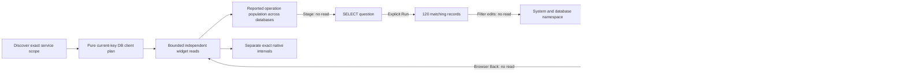

# 189 · Database client overview

The actual ordinary-OTLP main passes in **28.6 seconds**, the bounded 30-second
actor passes, and independent raw-source verification passes. Implementation
`a1cd787` adds the current-key database-client profile. This uses generated
telemetry without a goo manifest or mocked positive source/UI responses.

## What the user does

| Step | Verified result |
| --- | --- |
| Discover `commerce / db-api` | Database clients defaults to exact reported Client kind and nonempty current `db.system.name`: 137 matching records versus 189 mixed records and a 100-row held page. Server/Internal rows, missing/empty system keys and legacy-only `db.system` do not silently join. Wrong, missing and empty resource namespaces remain separate; an attribute namespace spoof cannot replace the resource selector. |
| Read operation, status and latency | Full counts, sums and groups retain all matching records. `SELECT` groups 120 across two database systems/namespaces; `FETCH` has 12, missing operation has three and reported empty operation has two. Recorded span Error is 26/137. Reported response code `ERROR` on an OK span is not silently interpreted as a span Error or database failure. |
| Choose useful defaults | Exact `db.client.operation.duration [s]` is prioritized. An incompatible unit/name remains a separate generic instrument rather than an alias or converted database-client binding. Native observations retain exact identity, interval, units and read clocks; they are not merged with span counts. |
| Inspect fallback capability | Two pure API planning probes remove supplied operation metadata, then namespace metadata. The existing single diagnosis widget falls back to `db.namespace`, then `db.system.name`, preserving the same client/system predicate and scope. Neither probe executes its widgets or adds automatic source fanout. |
| Switch and narrow explicitly | All spans returns 189, then Database clients returns 137 in the same window. Local range preview reads nothing. Apply reads one Client record outside all 100 supporting rows and keeps the accepted profile even when its newly computed hint is false. Reset restores the original window and profile. |
| Follow a literal operation population | Open client population stages `SELECT` without reading. Explicit Run returns all 120 matching records, including both `postgresql/catalog` and `mysql/archive` in the actual first 100. The grouping is not a globally unique query or operation identity. |
| Isolate a database before tracing | Existing explicit filters add `db.system.name = postgresql` and `db.namespace = catalog` without reading. Named Run returns 108, retaining the full original parent and time. Closing filters and selecting Records adds no reads. An actual row expands to one supplied span and zero linked logs in the original fixed window. Browser Back restores the identical held service view without reading. |
| Explore other roles | A Server-only service with DB keys defaults to generic; explicit database-client returns zero and explicit All spans recovers five records. A hybrid service defaults to its five HTTP Server records, while explicit RPC and DB choices each expose their own five records in the unchanged service scope. |

This profile describes a caller's database dependency. Client duration and
recorded status do not establish database-server health, connection-pool
utilization, saturation or query identity. Current-key support is explicit, not
an alias union with legacy `db.system`.

## Actual screens

| Frame | Evidence |
| --- | --- |
| [Database client overview](../docs/journeys/screenshots/189a-db-client-dashboard.png) | Exact client population, literal missing/empty operation groups, explicit cross-system grouping and separate native identities |
| [Mobile client summary](../docs/journeys/screenshots/189b-mobile-db-summary.png) | Captured-record count, recorded span Error and duration |
| [Desktop in context](../docs/journeys/screenshots/189c-db-service-in-context.png) | Actual navigation, discovery/service scope and available role choices |
| [Mobile in context](../docs/journeys/screenshots/189d-mobile-db-in-context.png) | Real entry overhead, contained native labels and compact linked timeline |
| [Isolated database population to trace](../docs/journeys/screenshots/189e-db-population-to-trace.png) | Fresh original-window span waterfall and honestly empty linked logs after the explicit 108-record read |

All five frames come from the accepted main fixture/window, not supplied display
responses. Equal 30 ms values have equal 98 px mean/p95 tracks at desktop and
mobile. Native lane labels cannot overlap plots. Native identities include exact
instrument units, while histogram timelines keep their observation-count axis.

Neither raw query text nor a supplied query summary is chosen as an automatic
dimension. Harmless fixture markers in `db.query.text` and `db.query.summary` are
asserted absent from the visible dashboard. Raw reported attributes remain
available through explicit inspection; no query-text sanitization claim is made.



## Reproduce and evidence

```sh
node_modules/.bin/playwright test journeys/db-client-dashboards.spec.js --grep '189 current-key'
GOO_DB_DASHBOARD_BOMBADIL=1 node_modules/.bin/playwright test journeys/db-client-dashboards.spec.js --grep '189 optional'
```

- Main: **28.6s** / 32.4s invocation. Accepted raw 233-record fixture, complete
  source responses, plans, filter continuation, scopes, returned view, geometry
  and API effects:
  `artifacts/db-client-dashboard/db-dashboard-00281d8421/ledger.json`.
  Log: `artifacts/db-client-dashboard/main-second.log`.
- The full multi-service browser exercise makes **49 logical source operations
  and 11 pure browser plans**. Two separately labeled request-context API probes
  are pure metadata fallback plans, not hidden source operations. Initial
  discovery is one operation; first service opening adds four supporting and
  four widget operations. Each profile switch preserves scope and uses held
  discovery metadata, one plan and exactly the supported-widget reads.
- `SELECT` returns full count 120 and sum 3,600,000,000 ns despite its 100-row
  page. Explicit system/database isolation returns 108, sum 3,240,000,000 ns and
  12 recorded span Errors. Trace ID comes from that isolated result, not the
  broader parent. Trace and linked logs retain the original bounds and exact
  reported identity. Browser Back traverses five actual history entries; the
  retained dashboard metadata and read clocks are structurally unchanged.
- Actor: **30-second campaign**, 30.9s test / 32.4s invocation, first attempt.
  All nine phases complete over **461 snapshots**, reaching exact
  `db:137|all:189|db:137`, source count 17, plan count three and retained catalog.
  Evidence/native-picker inspection and catalog return add no reads. Summary,
  trace, process log and run result are retained under
  `artifacts/db-client-dashboard/db-dashboard-8c25c5dec8/bombadil/`.
- Independent Go verification: **0.145s**, first run, comparing 25 actual
  full-population/page/group/status/duration responses with raw fixture facts
  and rejecting all 25 changed-count controls. It includes the 120-record group,
  108-record filtered population and actual trace row. The log is
  `artifacts/db-client-dashboard/db-dashboard-00281d8421/native-validation.txt`.
  Separate generated planner checks cover admission, key/role/namespace grids,
  dimension precedence, units and mixed-role priority. No new model quota or
  phase-model campaign is claimed.

The initial main failed after its successful 108-record read because filter-editor
Run selected Distribution, where Expand trace is not visible. The harness now
closes the filter disclosure and chooses the actual Records tab, asserting both
are source-free before expansion. No application defect, forced hidden click,
weakened count/window guard or app-source fix was involved. The 34.4-second
failure, trace, snapshot and preliminary frames remain under
`artifacts/db-client-dashboard/first-failure-diagnostics/`; its log is
`artifacts/db-client-dashboard/main-first.log`. The accepted main was not repeated
after passing, and the existing actor invocation was collected without launching
a duplicate after a transient agent interruption.

Deployment hashes and MIME/status checks are in
`artifacts/db-client-dashboard/deployment.json`. The static binary was installed
atomically and the temporary build removed. Setup ingestion/readiness probes are
separate evidence. Logical UI source operations are not underlying SQL query
counts. This slice introduces no persistence or capture format and makes no
sampling, completeness, unique-invocation or database/pool health guarantee.
