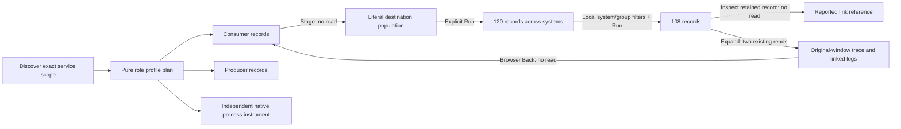

# 190 · Messaging consumer and producer overviews

The ordinary-OTLP main passes in **33.3 seconds**, the 30-second actor covers both
roles, and independent raw-source verification passes. Source `ab7e612` adds
consumer/producer profiles; CSS-only `8ae7573` fixes mobile profile-label wrapping.
The generated fixture uses no manifest or mocked positive source/UI responses.

## What the user does

| Step | Actual verified result |
| --- | --- |
| Discover `commerce / messaging-app` | Consumer is the default ahead of a simultaneously observed Producer role. Exact Consumer plus nonempty current `messaging.system` matches 137 records, Producer matches 120, and All spans matches 309. Missing/empty system keys, other span kinds and resource-namespace collisions do not silently join either role. |
| Read captured work | Consumer totals and groups use all 137 records despite the 100-row held page. The view includes process, receive and missing/empty operation names; it does not count unique processed messages, acknowledgments or completion. Recorded span Error remains a reported status measure. |
| Compare roles explicitly | Producer returns all 120 matching records, including a 100-row page; All spans returns 309 and Consumer returns 137 in the unchanged scope. Each explicit switch uses held metadata, one pure plan and exactly the supported-widget reads. |
| Inspect native context | Exact `messaging.process.duration [s]` is prioritized as an independent consumer processing instrument. Generic kernel-supported instruments remain available, including outside the consumer profile; they are not silently recognized as producer bindings. Four native observations are not blended with role-record totals. |
| Understand destination identity | `orders` combines 108 Kafka/`workers-a` and 12 interleaved RabbitMQ/`workers-b` observations. Both appear in the actual first page. The name is a literal population across systems, not a globally unique queue or topic identity. Missing and reported empty destinations remain separate from each other. |
| Inspect capability fallback | Two pure metadata API probes remove destination, then operation metadata. The existing single diagnosis widget falls back to `messaging.operation.name`, then `messaging.system`, retaining the exact Consumer/system parent. The probes do not execute widgets or add automatic source fanout. |
| Narrow time and system | Local time preview reads nothing. Apply returns one Consumer record outside the entire supporting page, keeping the accepted profile despite a false new hint; Reset restores the window. Open consumer population stages `orders` without reading. Explicit Run returns 120; system/group filter edits are local, and another named Run returns 108. |
| Inspect a reported link | An actual retained row's Raw record disclosure shows a supplied link's trace ID, span ID and attributes with no read. The target is a different Producer trace. The test does not follow an unsupported link action or infer a producer/consumer match. |
| Continue to trace and return | Expanding the isolated Consumer row makes the two existing trace/linked-log reads in its original fixed bounds. One supplied Consumer span and zero logs return. The exact isolation query is retained as origin, link references do not add a parent edge, and browser Back restores the unchanged held service without reading. |
| Explore other roles | A Server-only service with messaging keys defaults to generic; explicit Consumer honestly returns zero and generic returns five. A hybrid service defaults to its three HTTP Server records, while explicit RPC and DB choices retain their own three records in the same scope. |

These views describe reported role records and native instrument intervals.
Consumer spans may represent receive/process attempts and retries; Producer spans
are not durable acceptance or delivery confirmation. No queue depth, consumer lag,
broker health, unique-message identity or delivery guarantee is inferred.

## Actual screens and provenance

| Frame | Evidence |
| --- | --- |
| [Messaging overview](../docs/journeys/screenshots/190a-messaging-consumer-dashboard.png) | Consumer totals, literal missing/empty destinations, explicit role choices and separate native identities |
| [Mobile Consumer summary](../docs/journeys/screenshots/190b-mobile-consumer-summary.png) | Recorded role count, Error and duration |
| [Desktop in context](../docs/journeys/screenshots/190c-messaging-service-in-context.png) | Actual navigation, service scope and six readable role/view choices |
| [Mobile in context](../docs/journeys/screenshots/190d-mobile-messaging-in-context.png) | Two-column full-label controls; existing catalog/header overhead remains visible |
| [Consumer population to trace](../docs/journeys/screenshots/190e-consumer-population-to-trace.png) | Original-window supplied Consumer span, honest empty linked logs and link-reference limits |

Frames **190a–d** use the fresh display fixture after CSS `8ae7573`; **190e** keeps
the accepted main's original fixture/window. They are not one frozen receipt.
The semantic main verifies equal 30 ms mean/p95 values on equal 98 px tracks at
both widths and contained native labels. The shared display guard verifies each
word fits on one unclipped line, every full label fits its button, exactly one
Consumer view is selected and mobile uses two columns without page overflow.

Visual review found the original six-button mobile row squeezed labels into
vertical letter stacks. The scoped grid/wrapping fix changes presentation only.
Original frames are retained under
`artifacts/messaging-dashboard/pre-responsive-profile-frames/`. Catalog/header
overhead was not changed or represented as repaired. The shared new guard is
also called by future main runs; the accepted semantic main was not repeated.



The link reference is not an inferred join or parent edge between the Consumer
and Producer populations.

## Reproduce and evidence

```sh
node_modules/.bin/playwright test journeys/messaging-dashboards.spec.js --grep '190 messaging roles'
GOO_MESSAGING_DASHBOARD_BOMBADIL=1 node_modules/.bin/playwright test journeys/messaging-dashboards.spec.js --grep '190 optional'
node_modules/.bin/playwright test journeys/messaging-dashboard-display.spec.js
```

- Main: **33.3s** / 35.5s invocation. Raw 353-record fixture, actual full responses,
  pure plans, role switches, retained link inspection, exact trace origin,
  returned service, geometry and API effects:
  `artifacts/messaging-dashboard/messaging-dashboard-bc0f633c21/ledger.json`.
  Log: `artifacts/messaging-dashboard/main-second.log`.
- The full task makes **53 logical browser source operations and 12 browser
  plans**, plus two separately labeled pure request-context fallback probes.
  Initial discovery is one operation; first service opening adds four supporting
  and four widget operations. Each profile switch preserves scope and uses one
  plan plus exactly the supported-widget reads. Local edits, disclosures,
  Records selection and retained navigation add no telemetry reads. Browser Back
  traverses five actual history entries and restores identical held metadata.
- The `orders` population is 120 records with duration sum 3,600,000,000 ns.
  Explicit Kafka/group isolation returns 108 and sum 3,240,000,000 ns. Its actual
  inspected record retains one reported link with `test.link = reported-only`.
  Trace expansion returns only that Consumer trace; no linked Producer trace is
  automatically fetched or paired. The trace origin equals the isolated query.
- Actor: **30-second campaign**, 30.9s test / 32.2s invocation, first attempt.
  All **11 phases** complete over **511 snapshots**, with exact source count 25,
  plan count five and terminal proof
  `consumer:137|all:309|consumer:137|producer:120|consumer:137`.
  The process/run result, trace and `bombadil/acceptance-summary.json` are under
  `artifacts/messaging-dashboard/messaging-dashboard-e876d3c458/`.
- Independent Go verification: **0.225s**, first run, checking 27 actual
  population/group/status/duration/page responses from the raw facts and rejecting
  all 27 changed-count controls. Includes both roles, 309 generic records,
  destination 120, filtered 108 and actual trace one. Log:
  `artifacts/messaging-dashboard/messaging-dashboard-bc0f633c21/native-validation.txt`.
  Separate generated planner properties cover two-role admission, same-row
  hints, namespace scope, dimension priority, exact native seconds and family
  order. No new formal-model quota or phase-model campaign is claimed.
- Responsive display replay: **10.0s** / 12.6s invocation, first attempt. The fresh
  overview uses nine source operations and one plan. Subsequent viewport changes,
  word/selection/grid assertions and frame capture are source-free. Receipt:
  `artifacts/messaging-dashboard/messaging-dashboard-0f6c958f1a/display.json`.
  Log: `artifacts/messaging-dashboard/display-first.log`. No accepted semantic
  main or actor repeat was needed for the CSS-only change.

The first main failed in 24.7s because a test selector matched both the waterfall
extent disclaimer and its separate identity note. The correction selects the
actual extent paragraph; source data and all link/scope/count guards are
unchanged. No application defect or source fix was involved. Diagnostic trace,
snapshot and preliminary frames remain under
`artifacts/messaging-dashboard/first-failure-diagnostics/`; log:
`artifacts/messaging-dashboard/main-first.log`.

Deployment hashes, actual MIME/status checks and unchanged Go binary custody for
the CSS replay are in `deployment.json` and `deployment-responsive-profiles.json`
under `artifacts/messaging-dashboard/`. The temporary static binary was removed
after atomic installation. Setup ingestion/readiness is separate from browser
effects; logical UI source operations are not underlying SQL query counts.
This slice adds no persistence or capture format.
