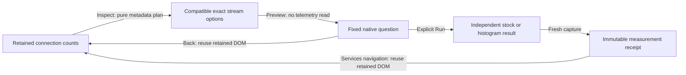

# 197 — Independent pool capacity and acquisition wait

Delivered source `b229599`. Generated ordinary OTLP fixture telemetry passes
through the actual collector and ClickHouse. Positive source/UI responses are
not mocked. The separate ownership case delays an actual fetched planner body.

```sh
npx playwright test journeys/pool-signals.spec.js --workers=1
GOO_POOL_SIGNALS_BOMBADIL=1 npx playwright test journeys/pool-signals-bombadil.spec.js --workers=1
```



## First-pass actual journeys

Main **14.4s** and held-response ownership **4.5s** pass in one **21.6s**
invocation. There are no failed browser attempts or application changes during
acceptance. Log: `artifacts/pool-signals/main-owner-first.log`.

- Main: `artifacts/pool-signals/pool-signals-64f0827254/ledger.json`.
- Ownership: `artifacts/pool-signals/pool-signals-a40b948f32/ownership.json`.
- Fixture: [197-pool-signals-fixture.js](197-pool-signals-fixture.js), with raw
  OTLP payloads, exact value/epoch strings, resource labels and histogram buckets
  retained independently from observed production results.

The service overview retains 120 HTTP Server spans and the existing full
100-record supporting page. HTTP duration and connection count remain the only
two default native reads. Capacity/wait discovery metadata does not introduce
additional automatic telemetry reads. The actual dashboard planner request is
**15,896 bytes**, within its unchanged **16,384-byte** budget; the contextual
pool planner request is **9,417 bytes**, within its **65,536-byte** budget.

Inspect pool signals matches the pinned 1.37 pool name, complete resource and
instrumentation identity, namespace and original fixed window. Only the
connection-state attribute is removed from the count stream's dimensions.
Actual incompatible resource, schema, unit and extra-dimension reports remain
excluded. A different resource namespace is also present in the raw fixture.

Preview capacity stages without reading. Explicit Run observes **20→0** with an
accumulation epoch change in one exact stock stream, retaining
`stockDomain: nonnegative-integer`. Preview acquisition wait independently stages
and reads one delta histogram: four observations, bounds `[0.01, 0.05, 0.1]`,
bucket counts `[1, 2, 1, 0]`, and p95 bucket bound **(0.05, 0.1] seconds**.
This is a bucket range, not an interpolated scalar percentile. A cumulative wait
sibling is retained in discovery for another exact instance; the chosen main
wait execution uses delta temporality.

Each signal receives a normal fresh measurement capture and source-free frozen
API reopen. Explicit Services navigation restores the retained pool DOM without
reading. The actual Back to service button is also exercised from a staged
native question. Full-page frozen UI reload occurs last: retention of a prior
SPA owner after a full-page reload is not claimed. Archive exposes a useful
wait-only plan; a pool with neither compatible preview remains unconfirmed,
which is not proof that telemetry is absent.

| Main action | Logical telemetry operations | Pool planner POSTs |
| --- | ---: | ---: |
| Open overview | 9 | 0 |
| Inspect paired signals | 9 | 1 |
| Preview capacity | 9 | 1 |
| Run / fresh capture capacity | 10 / 11 | 1 |
| Frozen reopen / retained return | 11 | 1 |
| Preview wait | 11 | 1 |
| Run / fresh capture wait | 12 / 13 | 1 |
| Frozen reopen / retained return / staged Back | 13 | 1 |
| Partial and unconfirmed plans | 13 | 3 |
| Final frozen UI reload | 13 | 3 |

These are browser logical operations, not backend SQL statement counts. The
ledger's `events.plans` counts pool planner POSTs specifically; existing pure
dashboard/measurement preview requests remain separately recorded with request
effect `plan`. The new pool planner has effect `pure`. Setup ingestion/readiness
probes are separate from browser effects.

The ownership case holds a real completed planner response, leaves the service,
then releases it. URL, source count **9** and zero published option buttons remain
unchanged; the departed service stays hidden. The actual held request/response
and before/after observations are retained in its ledger.

## Actor and actual frames

The first bounded actor passes **31.0s** (33.3s invocation), **nine phases / 405
snapshots**. It uses its own fresh ordinary OTLP fixture, verifies pure planning,
source-free preview, the explicit exact capacity zero/domain read and retained
Back. Final effects: **10 telemetry operations, one pool planner POST**, terminal
true. Receipt:
`artifacts/pool-signals/pool-signals-16eac4ec83/bombadil/acceptance-summary.json`;
log `artifacts/pool-signals/actor-first.log`.

[Desktop contextual options](../docs/journeys/screenshots/197a-pool-signal-options.png)
· [Mobile options](../docs/journeys/screenshots/197b-mobile-pool-options.png)
· [Actual selected wait interval](../docs/journeys/screenshots/197c-exact-wait-interval.png).

All three frames use the accepted main fixture and real DOM/styles. The mobile
page remains within its viewport. The wait inspector displays its actual UTC
bounds and bucket-bound p95. Existing interval record-context actions are shown,
but are not exercised or claimed as a new feature in this round.

Independent actual-ledger validation passes **0.373s** (main 0.27s, owner
0.09s), rejecting **eight changed controls**. It checks complete resource/scope
identity, capacity zero/epochs, wait bucket-bound p95, pure planner effects,
late ownership and full stored bytes/content IDs. Its initial observer wrongly
included the deliberately mismatched resource control; the preserved rejection
led to reconstructing the complete resource and scope. No application or fixture
changed. Log: `artifacts/pool-signals/native-validation.txt`. No new lifecycle
model is introduced.

## Stored evidence and deployment

| Capture | ID | Full bytes | SHA256 |
| --- | --- | ---: | --- |
| Capacity | `39c639d49c164cb21d294f716329daffc862c08b2fe354e954292330b4fccfc7` | 6,645 | `dfae375dc47b4cc47c06a7aa923ae4ffed34b0e652d00499a264230c5931725b` |
| Wait | `129e71678e59bed5d7ab8dfca52e438059258cb6613fd20bb415ddfebc3c7f92` | 6,537 | `1f79900a42ff49ec69e707ce03d06fc233b4cdbbd81b1f7ae546654086581ed4` |

Actual `capacity-before.json` / `capacity-after.json` and `wait-before.json` /
`wait-after.json` next to the main ledger are byte-identical. No new capture or
store format is introduced.

Deployment: `artifacts/pool-signals/deployment.json`, source `b229599`, binary
SHA256 `eea3d5b229ea5f8c7894a0500158d8aaa9a6807548325158acf683dbcec5cb2f`.
Ten asset/server/spec hashes are verified, including actual new-module HTTP/MIME.
Only existing query/packages containers restart; telemetry volumes are retained.
The temporary build binary is removed. Traffic is not paused in this round.

Counts, capacity and acquisition wait retain independent populations, epochs and
read clocks. No simultaneous utilization ratio, capacity alignment, queue/pool
health, fleet aggregation or causal inference is introduced. Metadata options
are candidates until explicitly read; missing or clipped previews are not proof
of absence.
