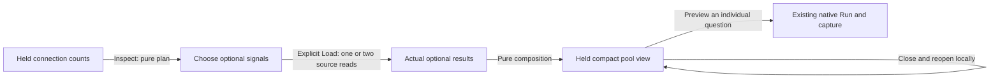

# 198 — Compact pool evidence with certified reported alignment

The functional round runs source `cb63955`; final display-only refinements are
`25119f1`, `70810e1` and `2f8405e`. Generated ordinary OTLP fixture telemetry goes
through the actual collector and ClickHouse. No positive source/UI responses are
mocked. There is no composite capture or new paired evidence store.

```sh
npx playwright test journeys/198-pool-view.spec.js journeys/198-pool-view-ownership.spec.js --workers=1
GOO_POOL_VIEW_BOMBADIL=1 npx playwright test journeys/198-pool-view-bombadil.spec.js --workers=1
GOO_POOL_VIEW_LEDGER=artifacts/pool-view/pool-view-cb9c0ef820/ledger.json \
  npx playwright test journeys/198-pool-view-display.spec.js --workers=1
```



## Functional receipts

First-pass main **21.1s** and three-case ownership **12.0s** pass in one **37.9s**
invocation. No application or fixture change accommodates these functional gates.
Log: `artifacts/pool-view/main-owner-first.log`.

- Main: `artifacts/pool-view/pool-view-cb9c0ef820/ledger.json`.
- Ownership: `artifacts/pool-view/pool-view-79f71bfe7e/ownership.json`.
- Raw fixture: [198-pool-view-fixture.js](198-pool-view-fixture.js), including
  original OTLP payloads and exact resource/schema/value/epoch/bucket facts.

The unchanged service opening uses nine logical telemetry operations and the
same HTTP-duration plus connection-count default native budget. The compact
planner input is **13,599 bytes**, within the unchanged 16,384-byte dashboard
route limit. Opening metadata, keyboard selection and preview do not read values.

Explicit Load reads the selected capacity and wait questions, then posts their
actual Results plus held counts to the pure `/api/pool-signals/view` endpoint.
The primary used **3** and maximum **10** have exactly equal latest observation
nanoseconds and nonzero accumulation epochs. Go returns the exact rational
**3/10**, displayed as **30%**. This certifies reported alignment only, not an
atomic snapshot, completeness or pool health. Idle **12** and custom reserved
**2** remain separate; they are not summed. Count bars share **0–12 connections**
and equal physical tracks; acquisition wait keeps its own units/population.

Enter opens/closes the disclosure; Space changes selection without reading.
Cached reopening and switching back from another pool retain the actual composed
view. A wait-only pool makes one optional source read and remains useful without
capacity. Existing Preview capacity stages an individual native question; its
Run and fresh capture use the existing owners. Services navigation restores
retained evidence. Frozen individual API/UI reopen is source-free.

| Main browser action | Telemetry operations | Pool plans | Pure views |
| --- | ---: | ---: | ---: |
| Default overview | 9 | 0 | 0 |
| Keyboard metadata/selection | 9 | 1 | 0 |
| Explicit two-signal Load | 11 | 1 | 1 |
| Local cached reopen | 11 | 1 | 1 |
| Wait-only Load | 12 | 2 | 2 |
| Cached row return / individual Preview | 12 | 2 | 2 |
| Individual native Run | 13 | 2 | 2 |
| Fresh individual capture | 14 | 2 | 2 |
| Retained service / frozen individual reopen | 14 | 2 | 2 |

These are logical browser operations, not backend SQL statement counts. Setup
polls and six direct API source/read-plus-compose supplements are separate. Their
actual raw results verify zero capacity, observation-time mismatch, epoch
mismatch, stale used data, conflicting used data and used exceeding maximum.
The first five withhold the ratio; the last is explicitly inconsistent. Both
unreported epochs are a separate pure-property boundary, not claimed as live
fixture evidence here.

The ownership journey fetches real capacity responses and holds their delivery.
Closing, changing selection and leaving the service each suppress late view
publication and navigation. Default nine operations rise to twelve for the
three deliberate source reads; no view is posted/published. Three query-cancel
controls are separate from telemetry reads. The accepted selection case dispatches
a retained-DOM change event on an enabled checkbox. Its initial comment mistakenly
called the control disabled; it is not a claim about editing disabled controls.
The future executable uses ordinary checkbox interaction instead; that small
harness adaptation is not a rerun of the accepted ownership receipt.

## Actor and independent validation

The bounded actor first passes **31.5s** (33.2s invocation), **eleven phases /
285 snapshots**, using its own fresh ordinary OTLP fixture. It verifies opening,
local selection, explicit two-result loading, exact ratio and cached disclosure.
Final effects are **11 telemetry operations, one pool plan and one pure view**.
Receipt: `artifacts/pool-view/pool-view-6b8ea264a6/bombadil/acceptance-summary.json`;
log `artifacts/pool-view/actor-first.log`.

Independent main/owner validation passes **0.549s** (main 0.37s, owner 0.17s),
rejecting **twelve changed controls**. It checks full raw identities, samples,
boundaries, exact rational, independent clocks/bases, effects, ownership and the
full individual capture content ID. Its initial observer incorrectly included
metric/unit in shared cross-signal identity. The preserved rejection led to
comparing shared identity while still checking each source's pinned metric and
unit separately; no application or fixture changed. Log:
`artifacts/pool-view/native-validation.txt`. No new formal state model is added.

## Actual final display replay

[Desktop aligned evidence](../docs/journeys/screenshots/198a-aligned-pool-evidence.png)
· [Mobile complete values](../docs/journeys/screenshots/198b-mobile-aligned-pool.png)
· [Actual whole viewport](../docs/journeys/screenshots/198c-pool-view-in-context.png).

Final display replay **12.5s** (17.4s invocation), source `2f8405e`, uses the same
accepted fixture and original fixed scope through the existing application
inventory reopening API. It makes nine normal opening reads and two explicit
optional reads, with no new ingestion/capture. Actual measurement payloads and
certified alignment match the accepted results, excluding fresh read clocks and
bases. Viewport resizing is source-free. Receipt:
`pool-view-cb9c0ef820/display-replay.json` under the artifact root; log
`artifacts/pool-view/display-fourth.log`.

Strong geometry verifies every signal/value/time cell in both X and Y, no page
pan or internal table crop, shared scales/tracks, used/idle priority, compact
one-rem square checkboxes (14px under this app's root font), short readable UTC
and full exact nanosecond/date tooltips. Provenance is closed in primary frames.
The final mobile table's scroll/client heights are both **473px**; Capacity and
Acquisition wait are actually visible. No application fullscreen control is
invented; the context frame is a real browser viewport. Existing broader product
control density is not claimed solved.

Preserved display diagnostics distinguish three issues:

1. The original mobile frame showed oversized controls and horizontal table pan;
   archived at `artifacts/pool-view/first-display-diagnostics/`.
2. First replay **10.9s** failed a harness assumption of 16px instead of declared
   one-rem/14px. Second **10.3s** then exposed a real inherited 38px minimum-height
   rule; the scoped CSS resets it. Both traces are retained separately.
3. Third replay **14.1s** passed its then-horizontal geometry gate, but actual PNG
   review found vertical clipping of Capacity/wait by the inherited 24rem table
   limit. It is not visual acceptance. Its receipt/frames/geometry remain in
   `display-third-diagnostics/`. The scoped table fix and stronger X/Y/crop gate
   pass in the final replay above.

Functional main, ownership and actor were not repeated for these display-only
changes. No source query, calculation, question or store contract changes in the
polish rounds.

## Individual custody and runtime

Capture ID: `a3dc227d2b5fe0c877a936ed792d9895f1d2b8d899494adf814729ff9389323a`.
The complete stored individual capacity capture is **6,626 bytes**, SHA256
`ff1b9cbdbf55f18974c496d6d25874add639450954a05878c448bc11540c1ae3`.
`capture-before.json`, `capture-after.json` and `capture-after-display.json` are
byte-identical. The composite view itself has no custody receipt.

Deployment receipts: `artifacts/pool-view/deployment.json` and
`display-deployment.json`. Binary `cb63955` SHA256
`9a05542547b87bb0fb1fe2b7c09f09bf5afec16328f9feeb6021d50dcdbb8cfd` remains
unchanged through static display fixes. Actual HTTP/MIME/SHA verifies assets.
Only existing query/packages containers restart for the initial deployment;
static fixes require no restart. Telemetry volumes and running traffic remain
untouched. Temporary build/helper files are removed after installation.
