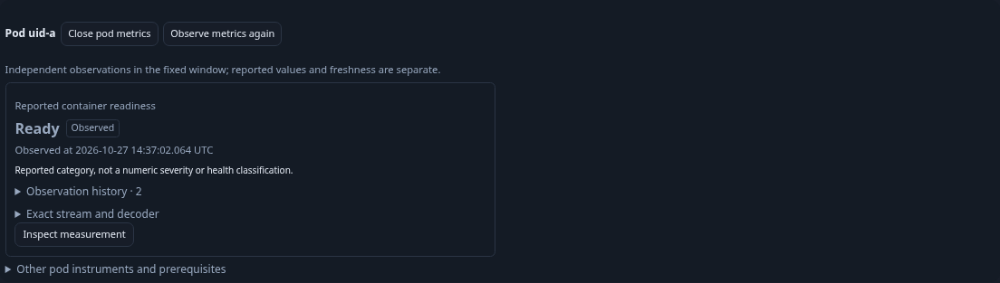
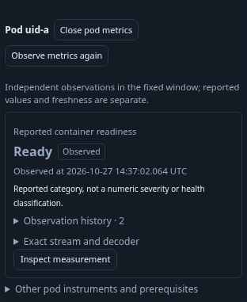
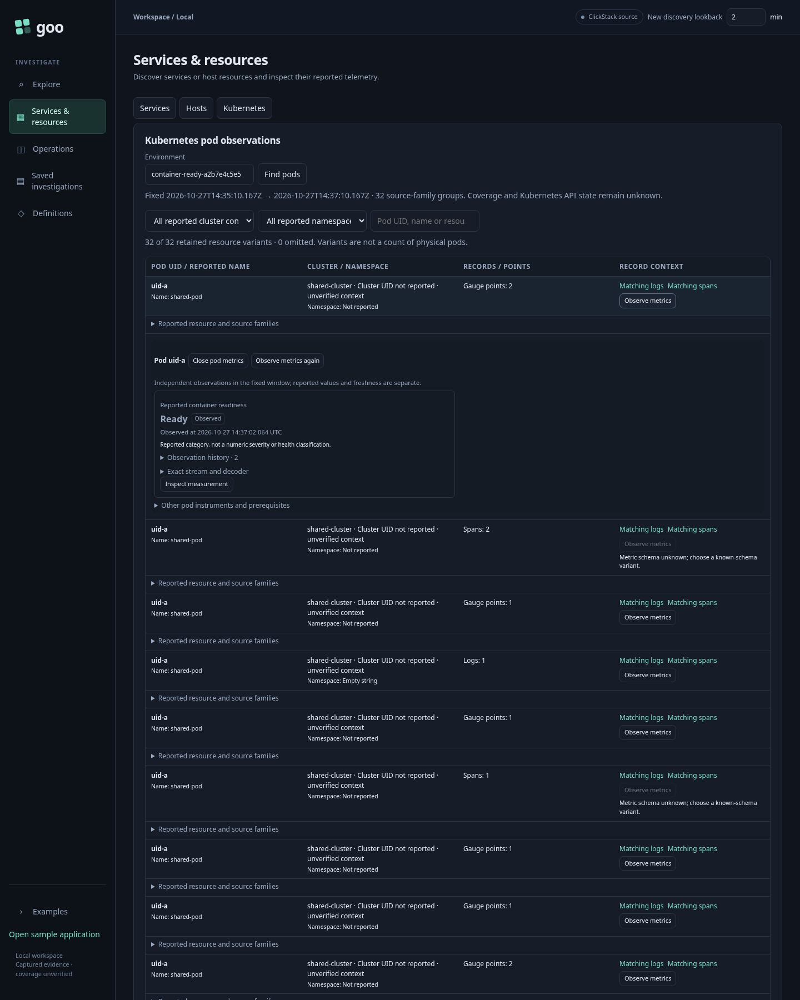

# Journey 204b — reported container readiness

Status: accepted with ordinary OTLP/browser, actual ownership, final display,
Bombadil and independent raw/custody replay evidence.
The [native prerequisite](204a-container-readiness-storyboard.md) remains the
source/API contract; [readiness design](../docs/CONTAINER_READINESS.md) defines
identity, receiver scope and honest non-goals.

1. Open Kubernetes discovery with an explicit environment and fixed UTC window.
   Retain exact reported resource variants and known resource schemas.
2. Choose Observe metrics on a container-bearing variant. Read metadata once,
   derive the plan without telemetry reads, and execute at most two defaults.
   Memory keeps priority; a cluster-only variant can show phase and readiness
   independently. No implicit pod/container aggregation occurs.
3. See Ready or Not ready with separate observed/stale/unknown quality, UTC time
   and expandable reported history. A reported zero is observed Not ready.
   Missing/conflicting latest data cannot fall back to earlier Ready.
4. Preview an explicit candidate or inspect a default. Staging performs no read;
   explicit native Run does. Back restores the held panel and opener focus
   without a read. Container ID, pod UID, name, full resource/schema and point
   attributes remain fixed.
5. Capture the individual measurement with a fresh explicit read. Reopen the
   immutable capture without source access; compare full stored bytes and hash.
6. Exercise replacement ID, same-ID resource/schema variants, unsupported codes,
   stale, conflict, missing and incorrect physical-profile controls. Withdraw
   held discovery/default/native work to verify no late panel or hidden reads.
7. Run the bounded Bombadil actor over Observe → Inspect → Run → Back, preserving
   artifacts and checking read ownership. Independently replay raw rows and
   capture bytes with rejecting controls; screenshots document actual desktop
   and mobile rendering.

Executable files: `204b-container-readiness.spec.js`, corresponding ownership and
Bombadil specs, and `verification/bombadil/container-readiness.ts`. Generated
ordinary OTLP must flow through the collector into ClickHouse; it is not a real
Kubernetes receiver/API/RBAC or readiness-probe integration test.

## Actual semantic and ownership checks

The generated fixture reports 30 metric points and 11 contextual log/span records
through ordinary OTLP, the running collector and ClickHouse. The main journey
passes in 55.9s, readiness ownership in 15.2s, and prior phase ownership in 18.3s
(serial three-case batch, 1.6m). Five genuine held-response withdrawals cannot
publish after their owners are replaced. No positive route mocks are used.

The main journal has 32 logical source operations: one inventory, 16 metadata,
14 independent native measurements and one fresh capture. Nineteen pure plans
add no source reads. Setup ingestion/readiness and direct store GET checks are
outside that journal; these counts are not physical SQL scans.

| Checkpoint | Source operations | Pure plans |
| --- | ---: | ---: |
| Inventory | 1 | 0 |
| Memory pair with readiness candidate | 4 | 1 |
| Candidate Preview and Back | 4 | 2 |
| Independent phase/readiness pair | 7 | 3 |
| Readiness-only default | 9 | 4 |
| Native staging and retained Back | 9 | 5 |
| Explicit native Run | 10 | 6 |
| Fresh individual capture and retained return | 11 | 6 |
| Eight explicitly opened boundary resources | 27 | 14 |
| Five explicitly opened profile refusals | 32 | 19 |
| Frozen reopen | 32 | 19 |

Boundaries include reported zero, replacement ID with the same pod/name,
unsupported 2 and fractional 0.5, stale supported/unsupported values, conflict and
latest missing after earlier Ready. Full-map, resource-schema and point-attribute
variants do not contaminate the selected stream. Wrong receiver version, scope,
instrumentation schema, unit and sum shape have no automatic defaults.

Individual capture `b269d19fe1c3d8d9eef8bed76f6723f829c194825a695cf65729217734e250dc`
remains 6,719 bytes with SHA256
`c8811efbcf80172fa3338852d974f40c0910610c45d6a17fa068f349f1e883bf`.
Complete store bytes, public reopen and browser frozen reopen match. The browser
rejects attempted telemetry POSTs during frozen reopen and sees none; this does
not claim a ClickHouse outage. Source-free unavailable-transport native custody
is covered separately by the API prerequisite.

Semantic ledger: `artifacts/container-readiness/container-ready-bbe4e5ac12/ledger.json`.
Readiness owner: `container-ready-3e854f1ce6/ownership.json` under the same root.
Prior phase owner: `artifacts/pod-phase/pod-phase-b73122ee9f/ownership.json`.
The semantic run uses source commit `c8f7fd6`. A later caption-only polish does not
change its source identities, measurement values or read ownership; final display
frames and actor are checked separately against that exact asset hash.

## Final display polish

Actual frame review found phase-only wording in the shared panel caption. The
only presentation patch replaces it with “Independent observations in the fixed
window; reported values and freshness are separate.” No evaluator, identity,
request budget or passive component changed. A separate executable display
journey passes in 9.0s using a fresh ordinary OTLP fixture, three source operations
and one pure plan. It verifies exact raw results, final caption, category/quality,
UTC/tooltips and contained controls at both widths; it makes no capture.
Receipt: `artifacts/container-readiness/container-ready-a2b7e4c5e5/display.json`.
The first semantic capture and owner ledgers remain valid and unchanged.

The panel is compact, uses neutral categories, and keeps detailed raw identity
and history closed. Container name/ID currently live inside the exact-stream
inspection; a concise identity cue for visually similar variants is a follow-on
usability opportunity, not inferred ownership or a broader inventory claim.

The final-assets Bombadil run passes on its first invocation: a configured
30-second campaign, 42.4-second test including setup, 45.6-second invocation,
nine phases and 167 snapshots. It reaches terminal native completion/Back with
four source operations and two pure plans. Trace/screenshots and the acceptance
summary are retained under
`artifacts/container-readiness/container-ready-c4b854e7c5/bombadil/`.
No browser invocation failed this round. This is one bounded owner workflow,
not exhaustive whole-product exploration or a new cross-host ordering model.

Independent native replay passes on its first actual invocation: readiness main
0.75s and owner 0.05s, with 12 main plus four owner rejecting controls. The shared
raw-oracle refactor also replays accepted phase main and fresh prior-phase owner
in 0.65s/0.13s with their 12+4 controls intact. Combined package: 1.608s; stdout is
`artifacts/container-readiness/native-validation.txt`. No production decoder is
used as the raw-value/domain/quality oracle. No new Quint model is introduced for
the unchanged explicit-read/retained-owner algebra.

[Compact acceptance receipt](../docs/evidence/container-readiness-204b.json)
records binary, frame and capture hashes. Final source/UI/frame and oracle
reviews found no blocking issue. Exact temporary binary/deployment helpers are
removed; normal artifact-retention dry-run found nothing expired or over budget.
Application data, traffic, capture history and diagnostic receipts are preserved.
