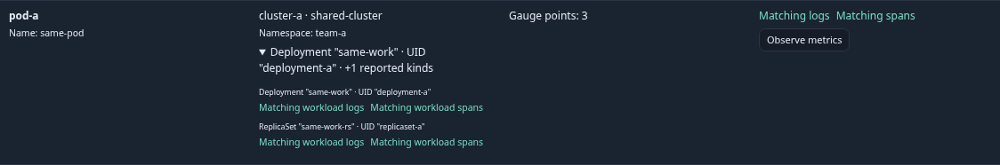
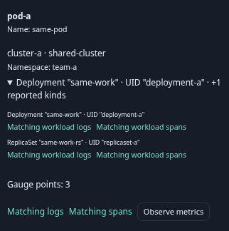
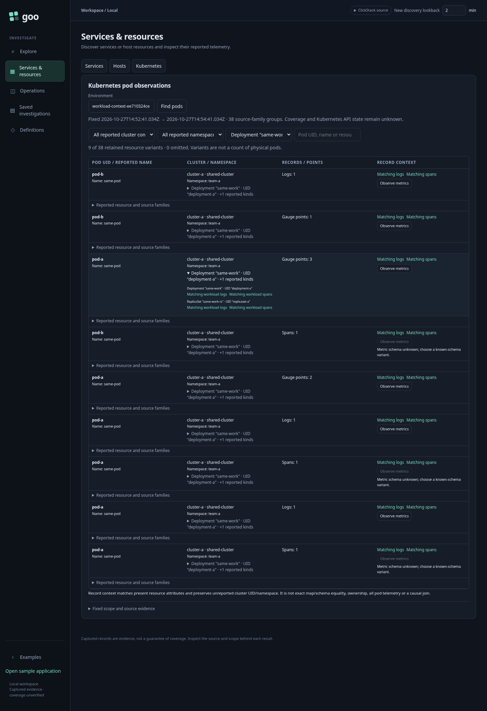
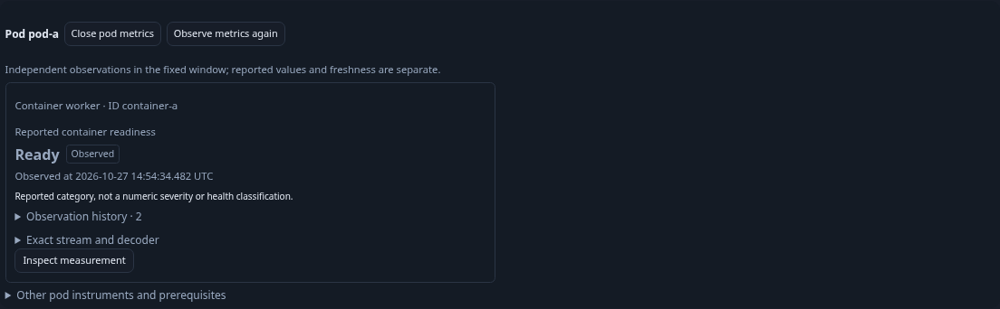
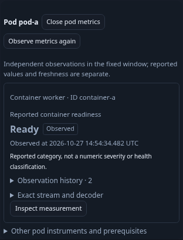

# Journey 205 — reported workload context and container identity

Status: accepted with ordinary OTLP/ClickHouse browser, actual owner withdrawal,
final mobile display, corrected Bombadil and independent raw/custody evidence.
[Contract and scope diagram](../docs/KUBERNETES_WORKLOAD_CONTEXT.md).

1. Find pod-bearing resource observations in an explicit environment/fixed UTC
   window. See reported workload kinds and compact container identity without
   inferring a controller hierarchy.
2. Use the local workload facet to isolate one qualified reported context.
   Same names with different UID/namespace/cluster remain distinct; missing and
   empty values stay separate. Filtering/disclosure add no source reads.
3. Open a workload's logs or spans as a staged record question. The original
   environment/window and all five qualifier/pair states remain exact; pod,
   container, service and unrelated workload attributes are intentionally dropped.
4. Explicit Run finds sibling-pod matching records and excludes differently
   qualified contexts. Inspect/capture through existing record owners.
5. Back restores the held workload facet, resource rows and opener focus without
   reading inventory/records again. Hidden or superseded actions cannot open
   work. Missing pod UID does not disable valid workload context.
6. Observe exact container readiness and distinguish original/replacement
   container IDs in compact cards. Native/frozen owners share the identity cue.
7. Exercise a bounded Bombadil campaign and independent raw membership/ownership
   checks with rejecting controls. Capture actual compact desktop/mobile frames.

The generated fixture travels through ordinary OTLP and ClickHouse. It is not a
running Kubernetes API/receiver, verified ownership or full inventory test.
Actual results and artifact paths will be recorded after the source freeze.

## Actual source and browser checks

The source milestone is `9045d4a`. All 95 Node files pass (15.82s), 22 Python
startup/proxy tests pass (4.49s), and Hegel compiles 144 generated context
questions across all six kinds and both signals (0.972s source gate). No
production Go, API schema or capture format changed; the Go binary remains
`55b5226fffd4bc7b17d67b58823e5443b0e2704f931396d5d2b93c94c20158db`.

Generated ordinary OTLP reports 21 metric points and 24 logs/spans through the
collector into ClickHouse. Main passes in 19.2s; actual held-response withdrawal
passes in 8.6s (two-case serial invocation 30.7s). UID-qualified deployment logs
and spans each return exactly three raw records from original, replacement and
sibling-pod contexts. Other UID/namespace/cluster, empty-qualifier, wrong-
environment and outside-window records do not enter this selected population.
Partial/name-only and all-kind local facets have browser coverage; actual
cross-pod record membership uses the UID-qualified Deployment case. This is
reported matching context, not verified Kubernetes ownership or full coverage.

| Checkpoint | Logical source operations | Pure plans |
| --- | ---: | ---: |
| Inventory, local facets and logs staging | 1 | 0 |
| Logs Run and retained Back | 2 | 0 |
| Spans staging, Run and retained Back | 3 | 0 |
| Exact container metadata and readiness default | 5 | 1 |
| Explicit native Run | 6 | 2 |
| Fresh individual capture and frozen reopen | 7 | 2 |

Staging, facets, disclosures and retained Back add no source reads. Setup/ingest
and direct store GET checks are outside this journal; these are logical HTTP
effects rather than physical SQL scans. Applied time bounds come from the
initial inventory request, rather than fixture construction time. Inventory and
record reads are independent, not an atomic snapshot.

The 8,193-byte individual capture
`cf8157897a9fcad3576586a3314fd372916a00a2b932ba69380de0dbeb252940`
is unchanged through complete store/public/UI reopening, SHA256
`a5ee560a7de880da6288413392d8e845327185d67e6b9fb7002ef652e0ba2ded`.
Browser frozen reopen attempts zero telemetry POSTs; this is not an actual
ClickHouse outage. No old capture is rewritten to add the new display cue.

Semantic ledger: `artifacts/workload-context/workload-context-77da2fc2a2/ledger.json`.
Owner: `artifacts/workload-context/workload-context-c53e32f9cf/ownership.json`.

## Final visual polish and exploratory driver

Actual review found expanded mobile workload context cramped into one half-width
cell. A single scoped rule gives that context the full row below 650px, leaving
desktop and execution unchanged. A separate actual display journey passes in
8.4s with three source operations and one pure plan; it creates no capture.
Final frames come from fixture `workload-context-ee710324ce`, whose `display.json`
is retained under the same artifact root. CSS SHA256:
`561e9ba3cc44a077885dcc5df2a963fad84a8f08e8db14c90d10bfa9a201444f`.
Desktop/mobile frame review finds no clipping or visual blocker.

The first Bombadil run selected a different same-container-ID resource because
its harness selector assumed ID uniqueness. It stopped before record execution;
the test now compares the complete intended resource map and exact schema. The
next corrected workflow reached terminal, but the CDP driver exited with timeouts
afterward; that run is not counted as passing. The exact corrected executable
then passes cleanly: configured 30-second campaign, 31.6-second test, 32.8-second
invocation, nine phases, 450 snapshots, two source operations and terminal Back.
Both earlier diagnostics are retained separately; no application exception,
source change or weakened phase assertion was used to obtain the pass.
Final actor receipt:
`artifacts/workload-context/workload-context-4bba599166/bombadil/acceptance-summary.json`.

This is a bounded journey/owner campaign, not exhaustive exploration or a new
cross-host model. Verified controller facts, requests/limits, replica/workload
rollups and authoritative lifecycle history remain separate work.

## Independent native verification

Final main/owner replay passes in 0.44s/0.06s (0.524s package), rejecting 19 main
controls and four owner controls. Controls include duplicated signal context,
missing/extra qualifiers, duplicate/missing records, predicate overlays, raw-wire
nanosecond bounds, missing/nonzero actual source flags, hidden reads and custody
changes. The hardened Hegel property separately passes in 1.16s after extracting
the shared scope checker; its six-kind/both-signal checks remain intact.

The initial independent replay exposed observer assumptions, preserved in the
initial/window-corrected/guard diagnostics. The authoritative window is the
applied inventory request rather than fixture construction time; the actual UI
request includes empty `groupBy: []`; and this fixture/retained OTLP omits Flags,
whose protobuf default is zero. The final observer accepts only that empty
projection, verifies every retained OTLP identity/value/time field, then applies
only omitted-zero Flags to a detached expected-fixture copy. Actual source flags
remain mandatory and unmodified. Shared categorical decoding rules, exact
membership, scope and full custody guards remain unchanged. No app, fixture,
store or browser run was changed to correct these observer assumptions.

Final stdout: `artifacts/workload-context/native-validation.txt`.
[Compact receipt and frame hashes](../docs/evidence/workload-context-205.json).
No new formal model is claimed for the unchanged explicit-read/Back protocol.
Normal diagnostic retention removes only expired recordings and preserves both
actor diagnostics, current full capture bytes and compact receipts. Temporary
deployment helpers are removed; telemetry data, traffic and history are retained.
