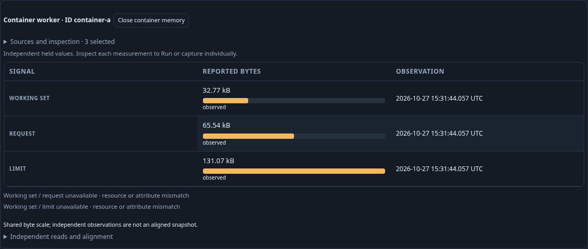
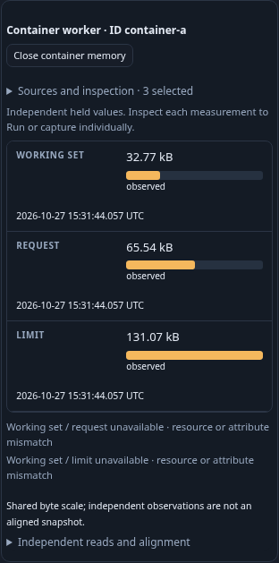
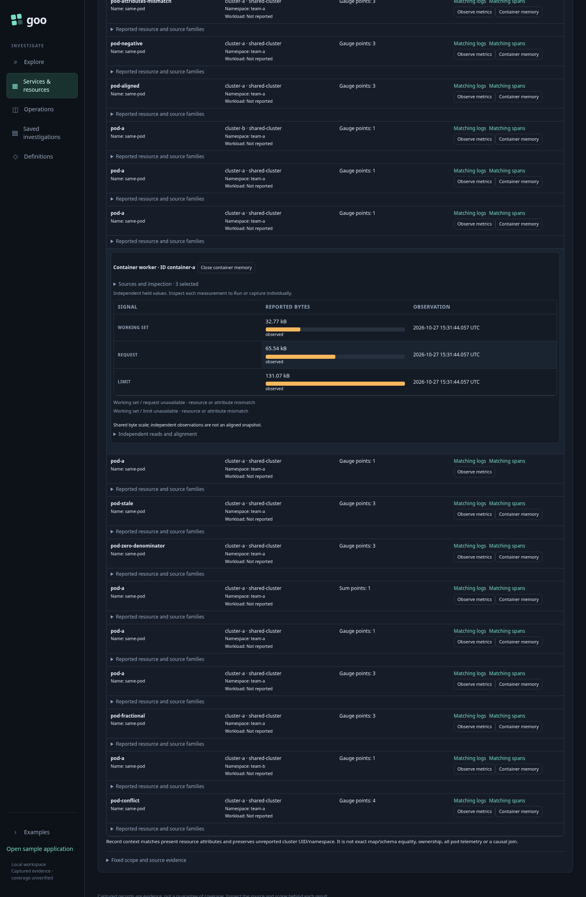
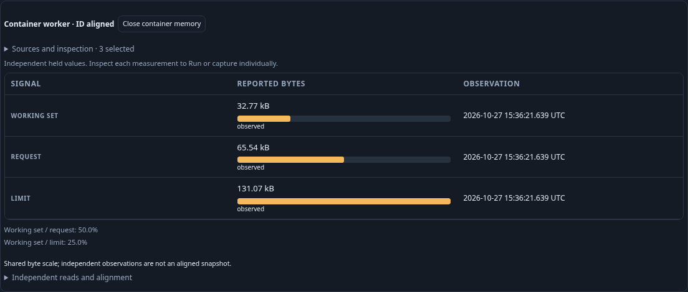

# Journey 206 — explicit container memory context

Status: accepted with source/property/API, ordinary OTLP/ClickHouse browser,
actual owners, answer-first display, Bombadil and independent raw/custody evidence.
[Contract and diagram](../docs/CONTAINER_MEMORY.md).

1. Discover pod-bearing telemetry with explicit environment and fixed UTC window.
   Open Container memory on a known-schema, ID-bearing resource variant.
2. Discover selected exact metadata variants explicitly. Keep receiver maps and
   resource schemas separate; ambiguous options need a choice. Selection changes
   perform no native read and cancel any obsolete work.
3. Load up to three chosen signals explicitly. Read working set, request and
   limit as independent observations with their own UTC/freshness and byte bars.
4. Ordinary kubelet/cluster resource/schema differences withhold percentages.
   A separate intentionally aligned raw-report fixture tests exact conditional
   arithmetic. Zero, absent, invalid, stale, conflict and mismatched evidence
   remains honest; a replacement container is a different authority.
5. Reopen Sources and inspection locally, inspect one role through the existing
   native owner, explicitly Run/capture,
   then return to retained context without repeating discovery or reads.
6. Reopen immutable individual evidence without telemetry access. Verify complete
   store bytes and independent raw membership/domain/alignment oracles, including
   rejecting controls. Exercise real held-response withdrawal and bounded
   Bombadil actions; capture compact desktop/mobile frames.

Generated ordinary OTLP tests the collector and ClickHouse, not actual Kubernetes
API/RBAC, running receivers or source authenticity. Actual results, limits and
artifact paths will be recorded after source freeze.

## Actual semantic checks

Source `b938ba8` passes four affected Go suites, 97 Node files, 23 Python
startup/proxy tests, OpenAPI (81 Go/88 total operations, 502 schemas) and a focused
Hegel alignment property. Pinned source research documents real receiver resource
schemas and optional container-ID emission separately from generated telemetry.

The first ordinary OTLP main passes in 37.4s and five actual held-response owner
cases in 17.1s (serial invocation 58.0s). Forty-seven metric points cover the
prepared fixture; the live main explicitly exercises the primary independent
view plus seven aligned/boundary contexts. Other prepared vectors are left to
unit/property verification and are not claimed as browser execution.

| Checkpoint | Logical source operations | Pure plans | Pure compositions |
| --- | ---: | ---: | ---: |
| Inventory | 1 | 0 | 0 |
| First exact metadata; no values | 2 | 1 | 0 |
| Second exact metadata and local role selection | 3 | 2 | 0 |
| Three explicit signal reads | 6 | 2 | 1 |
| Native staging and retained Back | 6 | 3 | 1 |
| Explicit native Run | 7 | 4 | 1 |
| Fresh individual capture and retained return | 8 | 4 | 1 |
| Aligned context | 12 | 5 | 2 |
| Explicit zero denominators | 16 | 6 | 3 |
| Partial context | 18 | 7 | 4 |
| Unsafe byte count | 22 | 8 | 5 |
| Stale values | 26 | 9 | 6 |
| Conflicting values | 30 | 10 | 7 |
| Missing recorded value | 34 | 11 | 8 |
| Frozen reopen | 34 | 11 | 8 |

All counts are logical HTTP effects, excluding setup ingestion/readiness and
direct store GET checks. They are not physical SQL scans or snapshot guarantees.
The primary receiver variants have independently correct 32,768/65,536/131,072
byte evidence but different schemas/maps, so percentages stay unavailable.
A separate intentionally aligned raw-report case yields 50.0% / 25.0%; it is not
claimed as default output of the running real receivers. Automatic default
budgets are unchanged. Native staging, local selection and retained Back do not
read source; fresh capture explicitly rereads one individual measurement.

The individual capture
`ee3313d33bb73a041259172eff6e779a1b1f363f582d4286f80172425b64b823`
remains exactly 6,436 bytes, SHA256
`7b6acd7772ed4ae266c82e238765d3a0fdda2dfe562a9bdb5fa708001368f8da`.
Full store/public/UI reopening retains bytes. Browser frozen reopening attempts
zero telemetry POSTs; actual unavailable-source transport is a separate native
HTTP custody check, not a browser ClickHouse-outage claim.

Main ledger:
`artifacts/container-memory/container-memory-a36db96747/ledger.json`.
First owner:
`artifacts/container-memory/container-memory-930ea80256/ownership.json`.
First actor passes cleanly: configured 30 seconds, 31.0s test/32.9s invocation,
13 phases, 352 snapshots, seven source operations, three pure plans, one pure
composition and terminal Back. Receipt:
`artifacts/container-memory/container-memory-9fe1c92fee/bombadil/acceptance-summary.json`.

## Answer-first refinement

The first frames fit correctly but setup controls dominated the loaded answer.
The bounded final UI refinement places existing controls inside a Sources and
inspection disclosure, initially open and collapsed after successful composition.
Opening it is source-free; deliberate closure while pending withdraws that work.
Publication checks disclosure state synchronously, independently of queued
`toggle` delivery. Wide open configuration uses three role columns. No byte,
percentage, source identity, automatic default or capture semantics change.

Focused Node cases cover source-free reopening, retained inspection, hidden
controls, deliberate per-role selection/skip preservation and close-before-toggle
late-reply rejection. Separate actual display/closure-owner/final actor runs below record final frames
and gestures; the original semantic/custody receipts remain unchanged.

Final display passes in 15.2s (18.7s invocation): ten source operations, four pure
plans, two compositions, no native Run/capture. It checks loaded disclosure
closure, answer-first offsets, zero-request reopening, wide three-column roles,
native staging/retained Back and both widths. Final display fixture:
`artifacts/container-memory/container-memory-10e83dffb9/display.json`.
The real disclosure-close owner passes in 9.2s (12.7s invocation), with an actual
200 metadata body, source two/plan zero/composition zero, no late publication,
and local reopening. Receipt:
`artifacts/container-memory/container-memory-dc230fb189/disclosure-ownership.json`.

The updated final-assets actor passes on its first run: configured 30 seconds,
31.1s test/34.4s invocation, 13 phases, 440 snapshots, seven source operations,
three pure plans, one composition and terminal Back. Receipt:
`artifacts/container-memory/container-memory-83fcdeaad3/bombadil/acceptance-summary.json`.
No browser invocation failed this round. This remains a bounded explicit workflow,
not exhaustive whole-product or distributed-ordering proof.

### Final frames and capture readiness

Frames 206a/b/c come from display fixture `10e83dffb9`. Manual review initially
questioned text in the aligned image; retained pixels and OCR confirm its summary,
Working set and all three UTC clocks were already present. No application or
rasterization defect is established. A targeted aligned-only actual replay adds
explicit role/time DOM, geometry, font and paint-settlement guards: 7.5s test,
10.8s invocation, five source operations, one pure plan and one composition, no
capture. It supplies final frame 206d from fixture `ca31753a9d`; receipt
`artifacts/container-memory/container-memory-ca31753a9d/aligned-frame.json`.
The original questioned PNG is preserved for review; the narrower replay does
not replace the semantic main or custody evidence. Final frame review approves
all labels, clocks, equal byte tracks, conditional percentages and containment.

### Independent validation and cleanup

The first actual native invocation passes in 1.814s: main 1.65s, five-case owner
0.12s and disclosure owner 0.03s, rejecting 16+6+4 changed controls. The raw oracle
independently reconstructs point membership/quality and exact-byte/ratio proof,
then checks actual network composition, per-result clocks, fixed 34/11/8 journal
and complete individual store bytes/content ID/hash. It does not call the
production evaluator/composer as the expected-value oracle. No observer, source,
fixture or stored-byte correction was required. Stdout:
`artifacts/container-memory/native-validation.txt`.

[Compact acceptance receipt](../docs/evidence/container-memory-206.json) records
source/binary/frame/capture hashes, independent fixture provenance and limits.
No new formal model is claimed for the reused request/retained-owner algebra.
Exact temporary binaries/helpers/tars are removed. Normal diagnostic retention
expires only old recordings and preserves current capture bytes, original
frames/asset receipts and review diagnostics. Telemetry data, traffic and history
are retained.
